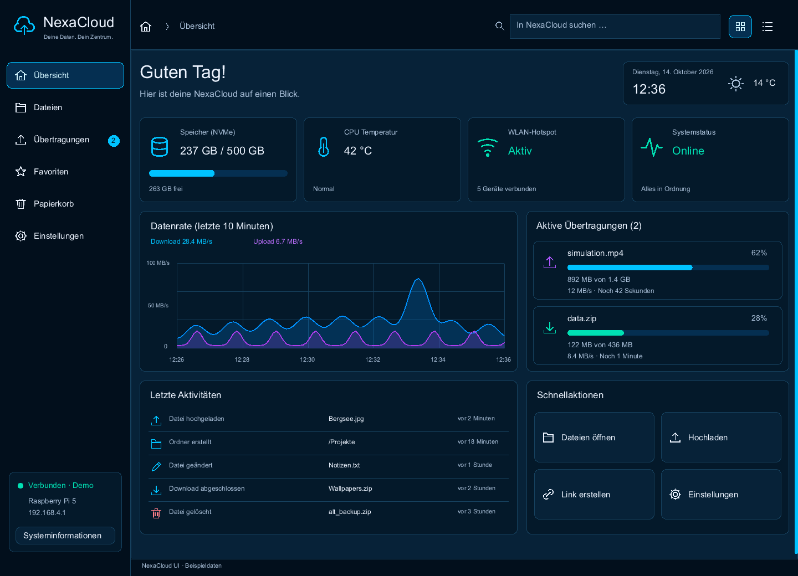

# NexaUI

**A native desktop UI framework written in C17, built for editors, simulation dashboards and developer tools.**

[](https://github.com/Lulus792/NexaUI/actions/workflows/ci.yml)
[](LICENSE)

[Usage](#usage) · [Getting started](#getting-started) · [Examples](#examples) · [Integration](#integration) · [Documentation](#documentation) · [Roadmap](ROADMAP.md) · [Contributing](CONTRIBUTING.md)

NexaUI brings layout, widgets, text, rendering and native window integration behind a C API. Its core uses NexaUI code and the C standard library; platform and renderer modules call operating-system and graphics APIs directly. It does not use third-party UI, windowing, layout, shaping or font libraries.

Applications own their data and compose each frame through independent UI contexts. The framework includes a deterministic software renderer, an initial Windows D3D12 renderer, a Linux Vulkan renderer for shapes, images and glyph masks with nested clips and straight-alpha composition, and primitives for moving simulation snapshots and commands between worker threads and the UI.

> **Early development — 0.1.0.** The repository contains a working foundation and examples. The toolkit is incomplete, and public APIs may change before v1.0. Read the [platform status](#platform-status) and [known limitations](#known-limitations) before choosing it for an application.

## Usage

Create a context, record a frame, then pass its drawing commands to a renderer. This complete C example draws a panel into an in-memory RGBA8 image; it needs no window or font:

```c
#include <nexaui/nexaui.h>

int main(void) {
    nx_context *ui = NULL;
    const nx_command *commands = NULL;
    size_t count = 0;
    static uint8_t rgba[320 * 180 * 4];

    nx_result result = nx_context_create(NULL, &ui);
    if (result != NX_OK) return 1;

    result = nx_begin_frame(ui, 320, 180, 1.0 / 60.0);
    if (result == NX_OK)
        result = nx_fill_round_rect(ui, (nx_rect){16, 16, 288, 148}, 12,
                                    (nx_color){0.12f, 0.15f, 0.21f, 1});
    if (result == NX_OK) result = nx_end_frame(ui);
    if (result == NX_OK) result = nx_frame_commands(ui, &commands, &count);
    if (result == NX_OK)
        result = nx_headless_render(commands, count, rgba, 320, 180, 320 * 4,
                                   (nx_color){0.06f, 0.08f, 0.12f, 1});

    nx_context_destroy(ui);
    return result == NX_OK ? 0 : 1;
}
```

Link with `NexaUI::NexaUI` as shown in [Integration](#integration). The [headless example](examples/00_headless/main.c) also writes the pixels to a PPM file. For a native window and widgets, start with [Hello UI](examples/01_hello_ui/README.md); for a larger application, explore the [Studio showcase](examples/showcase/README.md).

## Features

- **Layout and widgets.** Rows, columns, wrapping, grids, overlays and split panes; buttons, toggles, text and numeric fields, tabs, menus, popups, tables, trees, docking and searchable controls. [Layout](docs/concepts/layout.md) · [Widgets](docs/concepts/widgets.md)
- **Cloud-style interfaces.** Rounded cards, navigation and file-tile actions, vector icons, progress displays, a Midnight theme and reusable cached text stamps. The [NexaCloud example](examples/nexacloud/README.md) combines them into an overview and file browser; its native runners target Windows/D3D12 and Linux/Vulkan.
- **Text and fonts.** UTF-8 editing, TrueType outlines and rasterization, glyph caching and font fallback; Unicode 18.0.0 boundaries and bidi processing, initial OpenType shaping, multiline layout, caret geometry and rich-text drawing. [Text](docs/concepts/text.md)
- **Rendering.** Clipped drawing commands, basic shapes, RGBA8 images and A8 glyph masks; deterministic headless output, an initial D3D12 path and Vulkan shapes, images and glyph masks with clips and straight alpha. [Rendering](docs/concepts/rendering.md) · [D3D12](docs/concepts/d3d12.md) · [Vulkan](docs/concepts/vulkan.md)
- **Themes and interaction.** Dark, light and high-contrast presets, local theme overrides, keyboard focus, input routing, clipboard and file-drop reception, plus interruptible transitions and reduced-motion state. [Themes](docs/concepts/themes.md) · [Input](docs/concepts/input.md) · [Animation](docs/concepts/animation.md)
- **Tooling and data views.** Virtual lists, time-series decimation, real-time plots, telemetry and profiler panels, hierarchy and property inspectors, and application-rendered viewport images. [Plotting](docs/concepts/plotting.md) · [Inspectors](docs/concepts/inspector.md) · [Viewports](docs/concepts/viewport.md)
- **Simulation integration.** Immutable snapshot exchange and a bounded command/completion channel with explicit ownership and backpressure. [Snapshots](docs/concepts/simulation.md) · [Command channel](docs/concepts/sim-channel.md)
- **Accessibility foundations.** Widget semantics, keyboard traversal, focus handling and validation state. Native assistive-technology bridges remain planned. [Accessibility](docs/concepts/accessibility.md)

## Platform status

| Platform | Native window and input | Rendering |
| --- | --- | --- |
| Windows | Win32 backend, clipboard, file drops and initial IME integration | Software renderer and initial D3D12 backend |
| Linux | X11 and Wayland backends, clipboard, file drops and initial IME integration | Software renderer and Vulkan shapes, RGBA8 images and A8 masks with nested clips and straight alpha |
| macOS | Native backend planned | Headless software renderer |

On Linux, NexaUI tries Wayland when available and falls back to X11. Set `NEXAUI_PLATFORM=wayland` or `NEXAUI_PLATFORM=x11` to select a backend explicitly. Native tests require the corresponding display; headless core tests can run without one.

### Known limitations

- Native macOS windows, Metal, broader native acceptance and direct GPU texture import are pending. Native renderer drivers are currently private to the build tree. Linux has a [Vulkan shape pipeline](docs/concepts/vulkan.md#shape-pipeline) for core shapes, images and glyph masks with clips and straight alpha.
- Text shaping and script coverage are incomplete. X11 callback-style XIM needs acceptance testing with installed input methods, and Wayland input support remains a work in progress.
- Accessibility semantics are recorded internally; operating-system accessibility bridges are pending.
- Widget styling and toolkit coverage are still evolving. See the [roadmap](ROADMAP.md), [architectural decisions](DECISIONS.md) and [text contract](docs/concepts/text.md) for details.

## Getting started

### Requirements

- A C17 compiler and **CMake 3.21 or newer**.
- The platform SDK and a CMake build tool, such as Visual Studio/MSBuild, Ninja or Make.
- On Linux: X11, Wayland and xkbcommon development files, `wayland-protocols`, `wayland-scanner`, `pkg-config`, and Vulkan headers 1.3.250 or newer plus the loader for the private backend (disable with `-DNEXAUI_BUILD_VULKAN=OFF`). The native Vulkan example requires KHR or EXT swapchain-maintenance present fences by default; [explicit compatibility modes](docs/concepts/vulkan.md#presentation-retirement-and-close) support older drivers with a weaker retirement guarantee.
- Python 3 for Unicode table verification and Python-based development checks. The generated tables and their source data are already included.

For Debian/Ubuntu, install the native build dependencies with:

```sh
sudo apt-get install build-essential cmake pkg-config libx11-dev libxext-dev libwayland-dev libwayland-bin libxkbcommon-dev wayland-protocols libvulkan-dev mesa-vulkan-drivers
```

### Build and test

```sh
git clone https://github.com/Lulus792/NexaUI.git
cd NexaUI
cmake -S . -B build
cmake --build build --config Debug
ctest --test-dir build -C Debug --output-on-failure --timeout 30
```

Tests and examples are enabled by default. Multi-configuration generators such as Visual Studio use the `Debug` configuration above. With a single-configuration generator, add `-DCMAKE_BUILD_TYPE=Debug` to the configure command for a debug build.

On Linux, run the X11 native tests in an isolated display to avoid interference from an active desktop clipboard. Install `xvfb` and `xauth`, then use:

```sh
NEXAUI_TEST_PRIVATE_X11=1 xvfb-run -a ctest --test-dir build --output-on-failure --timeout 30
```

Wayland native tests additionally need a running compositor. See the [Linux CI workflow](.github/workflows/ci.yml) for the display and renderer test environments.

### Run an example

The headless example writes a 320 × 180 PPM image without opening a window.

**Windows / PowerShell (Visual Studio build):**

```powershell
.\build\examples\00_headless\Debug\nexaui_headless.exe nexaui.ppm
```

**Linux or macOS (single-configuration build):**

```sh
./build/examples/00_headless/nexaui_headless nexaui.ppm
```

Open `nexaui.ppm` in an image viewer that supports PPM. Executable directories depend on the CMake generator.

For a native Windows demo, launch the Studio showcase with a local TrueType font:

```powershell
.\build\examples\showcase\Debug\nexaui_showcase.exe "$env:WINDIR\Fonts\arial.ttf"
```

The showcase combines a scene tree, a live oscillator plot, an editable gain property, telemetry and a responsive layout. See its [usage guide](examples/showcase/README.md) for controls and smoke-test options.

## Examples

Start with a small example, then explore the parts your application needs.

| Example | What it demonstrates |
| --- | --- |
| [Headless drawing](examples/00_headless/README.md) | Basic shapes, clipping and image output |
| [Hello UI](examples/01_hello_ui/README.md) | A native Windows window and rendered UI commands |
| [Buttons and input](examples/02_buttons_and_input/README.md) | Pointer and keyboard interaction in a native Windows UI |
| [Layout](examples/03_layout/README.md) | Wide and narrow arrangements of the same scene |
| [Forms](examples/04_forms/README.md) | Text fields, validation and submission |
| [Scrolling](examples/05_scroll/README.md) / [Tables](examples/06_tables/README.md) | Virtualized content, scrolling and stable sorting |
| [Text editing](examples/07_text_editing/README.md) / [Themes](examples/08_themes/README.md) | Editable text and runtime theme switching |
| [Custom widgets](examples/09_custom_widget/README.md) | Composing drawing, input and semantics |
| [Docking editor](examples/10_docking_editor/README.md) | Docking state, tabs and a draggable split |
| [Native renderer](examples/10_native_clear/README.md) | D3D12 drawing on Windows and Vulkan shapes on Linux |
| [Multiple windows](examples/11_multi_window/README.md) | Independent Windows UI contexts and renderers |
| [Accessibility](examples/12_accessibility/README.md) | Keyboard traversal and semantic state |
| [Real-time plot](examples/13_realtime_plot/README.md) | A moving time window with pointer and keyboard cursors |
| [Simulation dashboard](examples/14_simulation_dashboard/README.md) | Worker snapshots, plots, telemetry and profiling |
| [3D viewport shell](examples/15_3d_viewport_shell/README.md) | An application-rendered cube at multiple backing scales |
| [Studio showcase](examples/showcase/README.md) | A native Windows D3D12 editor/dashboard |
| [NexaCloud](examples/nexacloud/README.md) | Cloud dashboard and file browser, shared C17 scene and native Windows/Linux runners |

NexaCloud's overview, captured from the native Windows D3D12 back buffer:



Some examples require a local TrueType font. You can select the font used by example tests at configure time with `-DNEXAUI_EXAMPLE_FONT=/path/to/font.ttf`.

## Integration

Include the public header as `#include <nexaui/nexaui.h>` and link the CMake target `NexaUI::NexaUI`.

### Add to an existing CMake project

Place the sources in `external/NexaUI`, then add:

```cmake
set(NEXAUI_BUILD_TESTS OFF CACHE BOOL "" FORCE)
set(NEXAUI_BUILD_EXAMPLES OFF CACHE BOOL "" FORCE)
add_subdirectory(external/NexaUI)
target_link_libraries(your_app PRIVATE NexaUI::NexaUI)
```

Replace `your_app` with your application's existing CMake target. A complete consumer is available in [tests/add_subdirectory_consumer](tests/add_subdirectory_consumer/CMakeLists.txt).

### Use an installed package

```sh
cmake --install build --config Debug --prefix stage
```

In the consuming project:

```cmake
find_package(NexaUI CONFIG REQUIRED)
target_link_libraries(your_app PRIVATE NexaUI::NexaUI)
```

Configure the consumer with `-DCMAKE_PREFIX_PATH=/absolute/path/to/NexaUI/stage`. See the [installed-package consumer](tests/package_consumer/CMakeLists.txt).

### Build options

| CMake option | Default | Purpose |
| --- | --- | --- |
| `BUILD_SHARED_LIBS` | `OFF` | Build a shared library instead of a static library |
| `NEXAUI_BUILD_TESTS` | `ON` | Build and register tests |
| `NEXAUI_BUILD_EXAMPLES` | `ON` | Build example applications |
| `NEXAUI_BUILD_BENCHMARKS` | `OFF` | Build benchmarks |
| `NEXAUI_BUILD_FUZZERS` | `OFF` | Build Clang/libFuzzer targets |
| `NEXAUI_BUILD_VULKAN` (Linux) | `ON` | Build the private Vulkan device and presentation backend |

## Documentation

| Topic | Reference |
| --- | --- |
| API and architecture | [Public C header](include/nexaui/nexaui.h) · [Core API](docs/api/core.md) · [Architecture](ARCHITECTURE.md) · [Threading](docs/concepts/threading.md) |
| UI composition | [Layout](docs/concepts/layout.md) · [Widgets](docs/concepts/widgets.md) · [Themes](docs/concepts/themes.md) · [Animation](docs/concepts/animation.md) |
| Text and interaction | [Text](docs/concepts/text.md) · [Input](docs/concepts/input.md) · [Focus](docs/concepts/focus.md) · [Accessibility](docs/concepts/accessibility.md) |
| Rendering | [Commands and software output](docs/concepts/rendering.md) · [Backend contract](docs/concepts/renderer-backend.md) · [D3D12](docs/concepts/d3d12.md) · [Vulkan](docs/concepts/vulkan.md) |
| Simulation and tools | [Snapshots](docs/concepts/simulation.md) · [Command channel](docs/concepts/sim-channel.md) · [Time series](docs/concepts/series.md) · [Plotting](docs/concepts/plotting.md) · [Telemetry](docs/concepts/telemetry.md) · [Inspectors](docs/concepts/inspector.md) · [Viewports](docs/concepts/viewport.md) |
| Quality and dependencies | [Visual baselines](tests/baselines/README.md) · [Sanitizers](docs/quality/sanitizers.md) · [Fuzzing](fuzz/README.md) · [Benchmarks](benchmarks/README.md) · [Dependency boundary](docs/concepts/dependencies.md) · [Unicode data](data/unicode/18.0.0/README.md) |
| Project direction | [Roadmap](ROADMAP.md) · [Changelog](CHANGELOG.md) · [Decisions](DECISIONS.md) · [Full requirements](MASTER.md) |

## Contributing

Bug reports, focused fixes, examples and documentation improvements are welcome. Read [CONTRIBUTING.md](CONTRIBUTING.md) for ownership, testing and dependency rules before making changes.

Report bugs through [GitHub Issues](https://github.com/Lulus792/NexaUI/issues). Include a minimal reproduction, the commit you used, operating system, compiler, CMake options and relevant logs. For native input or rendering issues, include the windowing backend and graphics environment.

## License

NexaUI is available under the [MIT License](LICENSE). The bundled Unicode data has its own [license](data/unicode/18.0.0/license.txt).
