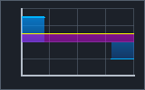

# Real-time line plot

`nx_plot` draws one time-series view inside a named, focusable widget. It uses
the S03 decimator to inspect only the inclusive visible `x` range, then draws
the first/last and vertical extrema from each occupied logical pixel column
in source order. The application supplies finite increasing x and y ranges;
the widget does not pan or autoscale them. Data stays borrowed and must remain
stable until the call returns. For simulation data, keep the S01 snapshot view
open through the call.

```c
nx_series_envelope scratch[800]; /* Reuse between frames. */
nx_plot_state plot_state = {0};   /* Keep between frames. */

nx_plot_desc plot = {0};
plot.id = plot_id;
plot.bounds = plot_bounds;
plot.name = (nx_utf8_span){"Velocity", 8};
plot.series = series_view;
plot.x_min = visible_start;
plot.x_max = visible_end;
plot.y_min = -10.0;
plot.y_max = 10.0;
plot.scratch = scratch;
plot.scratch_capacity = 800;
nx_result result = nx_plot(context, &plot, &plot_state);
```

The buffer must hold at least one envelope per logical pixel in the inner
plot area, up to a cap of 16,384. The inset leaves space for axes and optional
labels. Callers can size a reusable buffer to the full widget width, which is
an upper bound for the inner plot area. An insufficient buffer returns
`NX_ERROR_LIMIT` before registering or painting the widget. When the data view
is empty, the axes and grid still render.

The widget paints a surface, border, five horizontal and vertical grid lines,
two axes and a theme-colored trace. A supplied font collection plus finite
`pixels_per_em` in [1,16384] and positive `glyph_cache_bytes` adds numeric tick labels; without fonts,
the lines and ticks remain. Colors come from the active NexaUI theme,
including dark, light and high-contrast presets. The trace and cursor are
clipped to the inner area. Tick labels use `%.4g` formatting and currently
follow the process numeric locale; applications needing exact localized units
or label precision will need a later axis-label formatter.

The plot is a named custom semantic node with a short description. Pointer
hover or capture sets a vertical cursor in the plot area. When focused,
Left/Right moves it by one logical plot pixel; the semantic value reports its
x coordinate in the same frame. Disabled plots keep their cursor position and
use disabled theme colors. The caller retains `nx_plot_state` across frames.
Frame errors leave that state unchanged and roll back commands, hit region and
semantic node so a retry with the same ID can succeed.

The original `nx_plot` draws one series, linear x/y scales and no legend or
selection. Rendering a full million-point viewport still requires a linear
scan through S03. The widget does not own simulation data, cache samples or
schedule redraws; the application controls update cadence and visible ranges.

## Multiple series and filled areas

`nx_plot_multi` retains the axis, focus, pointer/captured crosshair and keyboard
behavior of `nx_plot`. Its `plot` member supplies bounds/ranges/fonts/scratch;
the old `series` member is ignored. Each `nx_plot_layer` has a semantic name,
line color, optional top/bottom RGBA fill colors, baseline and an array of
contiguous `nx_series_view` segments. Separate segments express missing-data
gaps. They must be ordered without overlapping x ranges; no line/fill crosses
a gap. Empty segments are allowed. Nonfinite values remain errors. Constant,
zero and negative values use the same shared finite y range, with the baseline
clamped into that range.

All segments use the existing first/min/max/last decimator and retain source
order. Linear connections introduce no spline overshoot. Layer paint order is
array order: fill then line for each series. Fills interpolate premultiplied
encoded sRGB vertically across the plot area and use straight RGBA8 masks. Shared
`x_unit`/`y_unit` and series names enter the semantic description. Numeric ticks
keep the existing formatter; applications draw the visible named legend and
time/unit labels, as the NexaCloud composition does.

There are at most 8 layers, 32 total segments and 1,000,000 total source samples.
Scratch capacity must be `columns * total_segments`, where columns is the
rounded-up logical plot width capped at 16384. Callbacks are borrowed only for
the call and cannot mutate data during it. The library retains no source view.
The fill's `raster_scale` is explicit (.125–8); physical axes cap at 4096 and
the sum of filled layer pixels at 4,194,304 (16 MiB RGBA plus small headers).
Masks belong to the context through the next `nx_begin_frame` or destruction.
Use a bounded application update cadence for changing histories. Rendering cost
is source scanning plus retained marks and filled pixels; no background sampler
or automatic animation is introduced. `hide_fills` preserves lines and input for
the application's contrast/effects fallback.

Validation/decimation precedes registration. Allocation or drawing errors roll
back commands, masks, semantics and the hit region; plot state is unchanged and
the same ID can be retried. Caller scratch contents may change on error.
The [three-series regression](../../tests/test_plot_multi.c) demonstrates gaps,
negative/constant data, units, crosshair, failure/retry and budget limits.



The [paired CPU profile](../quality/paint-cost-report.md) measures filled,
gapped/negative, empty, baseline-only and sparse histories. Each filled layer
still allocates a frame-owned RGBA mask. Column-span shading uses 16 KiB of
bounded stack storage and limits color work to its occupied rectangle; zeroing
the full mask remains area-dependent. Reuse scratch and control update cadence.
