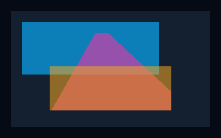
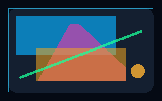

# Linux Vulkan backend

The private `nexaui_renderer_vulkan` target implements V01 device selection
and an initial V02 Wayland/X11 surface, swapchain and clear/present path, with
V03 presentation-fence retirement and retryable teardown/recovery, plus a
V04 SPIR-V rectangle/triangle pipeline and V05 nested clipping and straight-alpha
composition through the private renderer driver. The pipeline also draws stroked
rectangles, rounded fills and round-capped lines. V06 adds RGBA8 images and A8
glyph masks through a staged texture atlas. Batching, profiling,
hardware device-loss acceptance and broader integration remain V07–V09 work.

## Current investigation

At `083cf94`, one Ubuntu static CI job reported
`VUID-vkDestroySemaphore-semaphore-05149` in `nexaui_vulkan_x11_present`
([job log](https://github.com/Lulus792/NexaUI/actions/runs/38767168136/job/116533287285)).
Its shared job and sanitizer job passed. On the local Alpine/Mesa 26.1.6 system,
20 consecutive X11 presentation lifecycle runs with validation and synchronization
validation passed. This does not explain or clear the CI failure. The test-only
`NEXAUI_VULKAN_TRACE_RETIRE` diagnostic now records retirement policy, semaphore
handles and present-fence status when dropping a swapchain; Linux CI enables it
so a recurrence can be assigned to the exact teardown path. The validation-error
failure rule remains enabled. No production lifetime behavior has been changed
on the basis of an unverified cause. CI also repeats the static X11 lifecycle
20 times without this diagnostic: the trace's extra fence-status queries can
change validation-layer bookkeeping/timing, so a traced pass alone is weaker
evidence than an untraced run. Test output labels strict, compatibility, legacy
and readback teardown phases without introducing additional Vulkan queries.

## Build boundary

Linux builds enable `NEXAUI_BUILD_VULKAN` by default and require Vulkan SDK
headers 1.3.250 or newer and the system Vulkan loader. The runtime still uses
Vulkan 1.0 plus explicitly negotiated extensions. Debian/Ubuntu packages are
`libvulkan-dev`; a software driver for development is available through
`mesa-vulkan-drivers`. Pass `-DNEXAUI_BUILD_VULKAN=OFF` to build the core without
the private target. Windows and macOS do not configure this option or find
Vulkan.

The core library, public header and installed package do not link Vulkan or
expose its types. `renderers/vulkan/device.h` is a build-tree interface, and
`device_internal.h` contains the backend-only native handles and dispatch.
The backend uses the GPU-driver API directly and adds no UI or rendering
framework dependency.

## Device and ownership contract

`nx_vk_device_create` requests Vulkan 1.0. Its default descriptor enables no
optional device features. A requested present-fence policy negotiates
`VK_KHR_swapchain_maintenance1` or `VK_EXT_swapchain_maintenance1`, preferring
KHR when both are available. The selected device must advertise both the
extension and the `swapchainMaintenance1` feature. Instance creation enables
the matching surface-maintenance extension, `VK_KHR_get_surface_capabilities2`
and `VK_KHR_get_physical_device_properties2`; missing dependencies or a false
feature reject a required request. An optional request can select an adapter
without present fences. Diagnostics report the enabled variant.
It enables `VK_KHR_surface`, which needs no display connection and is required
by the `VK_KHR_swapchain` device extension. Callers can supply up to 64 unique
additional instance extension names for later platform surface integration.

Adapters need a graphics queue family with at least one queue. Selection
prefers discrete, integrated, virtual, other and finally CPU devices, keeping
enumeration order for ties. A driver that cannot create a logical device is
skipped in favor of the next candidate; host/device allocation failures stop
immediately. `require_swapchain` rejects adapters lacking that extension.
The extension is enabled whenever advertised. Surface-backed creation filters
queues by their support for the actual native surface before creating the
logical device. A shared graphics/present family is preferred; otherwise both
families get a queue and the swapchain uses concurrent sharing.

Enumeration uses at most four retries and caps each list at 4096 entries.
Shrinking lists retain the original allocation size for correct release
through caller allocators. Every partial-create path releases NexaUI storage
and successfully created native objects, and clears the output pointer.

All calls belong to the creating thread. Wrong-thread queries fail with
`NX_ERROR_STATE`; wrong-thread destruction leaves the object intact for its
owner. Multiple devices are independent. Query outputs are cleared on error.
NexaUI bookkeeping uses the supplied `nx_allocator`, or malloc/free by default;
Vulkan driver allocations use the driver's own callbacks. Internal borrowed
handles remain valid only until destruction. Their resources and external
submissions must be retired by the caller.

## Shape pipeline

`nx_vulkan_render` accepts logical coordinates and a backing scale. The F11
adapter passes the same command stream and scale to it. The initial pipeline
supports filled/stroked rectangles, rounded fills, triangles, lines, RGBA8/A8
bitmaps, straight-alpha paints, and balanced `PUSH_CLIP`/`POP_CLIP` scopes up to `NX_MAX_CLIP_DEPTH`.
Empty streams still clear/present. It validates the whole stream before image
acquisition and returns `NX_ERROR_UNSUPPORTED` for other command types. Clear
colors can contain alpha. Shape drawing needs color-attachment and sampling
support for owned optimal images in the selected UNORM format; the swapchain
itself needs only transfer-destination usage. The public installed API and core
dependency boundary are unchanged.

The painter lazily creates Vulkan 1.0 shader modules, a render pass, pipeline,
one owned canvas/framebuffer and a sampled history image. A combined-image
sampler descriptor reads the previous color. Explicit barriers connect transfer
clear, clipped history copies, shader reads, attachment writes, optional readback
and a full canvas-to-swapchain copy before presentation. Both images use the same
format, so that final copy does not reinterpret channel order. Initial clear-only
frames retain the direct swapchain transfer path. All native objects retire with
their swapchain under the V03 rules. Vertex storage is a
mapped host-visible/coherent buffer, replaced only after graphics submission
completion. Growth first creates a replacement, preserving the old buffer
if allocation fails. Current frames serialize; rings and broader batching
remain V07 work. Diagnostics expose capacity, allocation count and the latest
submitted vertex count. A reusable caller-allocator-owned array holds per-draw
scissors and vertex ranges. Allocation failure and in-flight submission waits
do not invalidate the previous GPU upload. Destroy/rebuild releases host storage
with its exact original allocation size.

Rectangles snap bounds to the reference renderer's half-open pixel-center
coverage. Triangles draw a snapped bounding quad and evaluate their original
edges in the fragment shader, with normalized winding and the same top-left
tie rule. Direct hardware triangle rasterization rounded a vertex at
`10.50001` to a pixel center in the regression. Compensated float32 differences
and split products also preserve small edge differences for the tested
million-coordinate offscreen triangle; a plain float determinant lost them.
Vulkan assigns GLSL.std.450 `Fma` the precision inherited from multiply followed
by add, so it cannot supply a guaranteed fused product-rounding residual.
The shader uses split products and `NoContraction` for this calculation.
This path requires no `shaderFloat64` feature. Scaled triangle coordinates
beyond `sqrt(FLT_MAX)/8` return `NX_ERROR_LIMIT` to keep edge products finite;
count, NDC conversion, viewport and framebuffer limits are checked too.
Hardware-driver precision and performance acceptance remain open.

Rounded fills clamp the radius to half the smaller dimension; strokes are
inside the rectangle and disappear into a solid fill when the inset consumes
it. Lines use round caps, including a disk for coincident endpoints. A snapped
bounding quad supplies fragments; shape coverage is evaluated in the shader.
Compensated float32 differences/products preserve tested circle, thin-stroke
and offscreen-line boundaries without optional float64. Line interior coverage
compares squared cross distance with squared radius times length, avoiding a
division; endpoint regions use the corresponding disk. Physical shape parameters
are rounded to float32 after scaling, as in the software-reference tests.

Preflight bounds scaled line coordinates and thickness by
`sqrt(sqrt(FLT_MAX))/32`, and rounded-fill parameters by `sqrt(FLT_MAX)/16`,
to leave finite headroom for their squared products. Oversized inputs fail
before acquisition. These bounds prevent arithmetic overflow; they do not
establish exact coverage for every possible float or hardware driver.

Colors, including transfer clears, are quantized to the headless RGBA8 rule
before Vulkan UNORM conversion. Clips intersect their ancestors after half-open
pixel-center conversion and become dynamic scissors. Empty clips and paints
whose quantized alpha is zero emit no draw. For each translucent primitive the
painter ends the current pass, copies its clipped bounds from canvas to history,
transitions both images, and resumes a LOAD/STORE pass. The shader uses integer
straight-alpha source-over arithmetic, including destination alpha and the same
division/rounding as `src/headless.c`. It applies no fixed-function blending.
Opaque draws need no history copy. This is a correctness-oriented serial path;
broader batching and GPU timing remain V07 work.



The image above is an actual Vulkan canvas readback, byte-equal to its software
reference. Tests additionally compare displayed X11 window RGB pixels to verify
the final swapchain copy and presentation. Wayland is checked through GPU readback
and validation; a compositor screenshot is separate acceptance work.
Antialiasing remains pending Vulkan work. Invalid commands are rejected before
acquisition; atlas/geometry limits return explicit errors.



This second GPU capture adds a rounded panel, inside stroke, round-capped line
and disk; every RGBA8 byte also matches the software reference.

## Bitmap and glyph upload

The painter deduplicates identical source views within each frame and shelf-packs
them into one reusable RGBA8 UNORM texture. Source identity includes pointer,
format, dimensions and stride, so subviews remain distinct. A8 bytes become white
RGB with coverage in alpha; RGBA8 bytes retain their straight-alpha channels.
The fragment shader samples at pixel centers with nearest-neighbor selection,
multiplies source and quantized tint with integer RGBA8 rounding, then composites
through the existing canvas/history path. Compensated quotient evaluation keeps
the tested fractional sampling boundaries aligned with the software reference.

Packing respects both `maxImageDimension2D` axes, an additional 16384-pixel axis
cap, 4096 unique views and a 64 MiB RGBA8 atlas budget. If a shelf exceeds the
height limit, the packer widens and retries the entire set. Input dimensions and
area are checked before pixel access; incomplete packs return `NX_ERROR_LIMIT`.
The growable upload buffer has at most 64 MiB logical capacity. Vulkan memory-requirement alignment overhead is additional. This is a bounded initial
atlas, not an unbounded image store or a persistent content cache.

Preparation copies all used source rows into an owned mapped host-coherent
staging buffer before successful submit returns. Caller pixels and commands may
then be released; GPU work reads only owned staging/texture storage. A graphics
fence retires that work before the next preparation, upload overwrite, growth or
destruction. A timeout leaves those resources alive. Each replacement keeps its
old object until replacement allocation succeeds. A later preparation failure
can leave a grown atlas allocated; retry repopulates it before use. Preparation
errors do not acquire/present an image, and callers can retry with the prior
input stream. Atlas and staging growth have separate failure
tests, as does the exact-size caller-allocator-owned view table.

The upload records a transfer-destination transition, buffer-to-image copy and
transfer-write-to-fragment-read transition. Reuse also orders preceding shader
reads before the next transfer. Host-coherent writes need no flush; submission
performs their host-to-device dependency, while image layouts still need barriers.
See the [Khronos upload synchronization example](https://docs.vulkan.org/guide/latest/synchronization_examples.html).
There is no runtime shader compiler or full-frame CPU-render-and-upload path.
Persistent texture caching, compact R8-only masks, upload rings and batching
remain optimization work.

The [NexaCloud native Linux runner](../../examples/nexacloud/README.md) consumes
this same stream and renders the overview, file thumbnails, text and compact
layout. Its GPU captures compare every RGBA8 byte to the software reference;
this checks renderer equivalence, not pixel equality with the user's mockups.

### Embedded shaders

The authored GLSL lives in `renderers/vulkan/shaders/`; its generated
`shaders.h` embeds SPIR-V 1.0 words. Normal builds and applications do not
invoke or link a shader compiler. To regenerate and validate:

```sh
python3 tools/generate_vulkan_shaders.py
python3 tools/generate_vulkan_shaders.py --check
```

Development regeneration needs `glslangValidator` and `spirv-val`. The
recorded generator is glslang 16.2.0; use that version for a byte-identical
`--check`, or regenerate with another version and review the header changes.
Each compilation explicitly targets Vulkan 1.0 and is validated with
`spirv-val --target-env vulkan1.0`. The header records compiler version and
normalized GLSL source hashes. Shader compilation tools are development
dependencies only.

`nx_vk_device_wait_idle` maps device loss to `NX_ERROR_STATE`. Destruction
attempts an idle wait and releases the logical device before its instance,
including after device loss. The renderer uses a separate private destroy
entry only after retiring all of its tracked work. Adapter diagnostics report the advertised API and driver version,
vendor/device IDs, name, kind, queue families and enabled swapchain extension.

## Window surfaces and presentation

`nx_vulkan_renderer_create` leases one native window, enables the matching
Wayland or Xlib instance extension, creates its surface and selects a device
for that surface. The device owns the surface and destroys it after its logical
device but before its instance. The caller must keep the native window alive
until renderer destruction. A second renderer cannot lease the same window.

While leased, the Wayland adapter continues to process events, scale and
configuration but does not attach its SHM background over Vulkan's buffers.
Releasing the lease restores the platform background. Scale changes are
committed with the next Vulkan image. This state is per window and owner-thread
only; it introduces no native types into the public C API.

The initial path selects RGBA8/BGRA8 UNORM with the standard nonlinear surface
color space and FIFO presentation. It requires transfer-destination support
for clear commands; optional transfer-source support enables readback. Format
enumeration retries at most four times, and the backend caps format lists at
256 and swapchain images at 64. Unsupported formats/usages fail explicitly.

One command buffer, acquisition semaphore and submission fence serialize the
initial frames. Each swapchain image owns a separate present-wait semaphore,
and strict mode adds a present fence per image. Image barriers preserve acquisition,
transfer and presentation order, including separate graphics/present families.
Acquisition, acquisition-fence, submission-fence and present-fence waits use
one-second timeouts. A timed-out image fence retains the acquired image and
its acquisition signal for the next call; it does not acquire another image
or rebuild the swapchain first. A timeout suspends a frame without reusing
in-flight storage; an out-of-date swapchain
is rebuilt on retry. Suboptimal surfaces also trigger a rebuild even when the
application's target dimensions have not changed.

Strict resize first retires acquisition, submission and all pending presentations
with one aggregate, one-second fence wait. A timeout retains the old chain
and returns a suspended frame. Successful retirement destroys the old chain
before creating its replacement. A failure after teardown leaves an empty target for retry.
Fatal device/surface failures latch an unusable renderer until explicit
recovery recreates the device and surface. Native tests exercise explicit
rebuild and injected driver state; actual hardware removal is not yet forced.
Empty zero-size driver targets suspend, and unsupported drawing commands are rejected
before image acquisition. The visible [native renderer example](../../examples/10_native_clear/README.md)
runs this path on either Linux backend.

### Presentation retirement and close

`nx_vulkan_renderer_create` and the F11 adapter use strict retirement by
default. `nx_vulkan_renderer_create_config` accepts these explicit policies:

| Policy | Present fences | Driver without maintenance support |
| --- | --- | --- |
| `NX_VULKAN_RETIRE_STRICT` | Required; KHR preferred, EXT accepted | Creation returns `NX_ERROR_UNSUPPORTED` |
| `NX_VULKAN_RETIRE_COMPATIBLE` | Used when supported | Conventional device-idle fallback |
| `NX_VULKAN_RETIRE_LEGACY` | Disabled | Conventional device-idle path |

A presentation fence proves when the image's present-wait semaphore may be
reused or destroyed. All pending present fences must complete before swapchain
destruction. A submission fence alone proves only submission completion.
Strict cleanup does not substitute `vkDeviceWaitIdle` for presentation fences.
As the [Khronos semaphore guide](https://docs.vulkan.org/guide/latest/swapchain_semaphore_reuse.html#vk_ext_swapchain_maintenance1_extension)
explains, device-idle waits in unextended Vulkan lack that formal presentation
retirement guarantee. The explicit fallback modes retain this limitation.

`nx_vulkan_renderer_destroy` now returns `nx_result`. A timeout returns
`NX_ERROR_LIMIT` and preserves the renderer, its resources and its window
lease. Keep the window alive, process events and retry destruction. Once close
starts, only diagnostics and another close are allowed. The private F11
`nx_renderer_close` propagates the error and retains its backend pointer until
close succeeds; applications must check the result. Recovery follows the same
retire-before-release rule, but remains retryable as recovery until close starts.

Presentation OOM leaves its wait operation unenqueued; cleanup waits for the
already submitted graphics work without waiting on an unsignaled present
fence. An enqueued out-of-date presentation still contributes a fence to
retirement. Readback buffers remain owned by the renderer after a submission
timeout and are freed only after a subsequent wait retires that work.
`VK_ERROR_DEVICE_LOST` returned by a synchronization wait counts as completion
for determining resource use, as specified by Vulkan; merely latching a loss
flag is insufficient to release resources.

## Tests

The injected-dispatch test exercises device preference and fallback, missing
queues and extensions, changing enumeration counts, bounded retries, native
errors, independent objects and owner-thread enforcement. A counting
allocator fails each NexaUI allocation in turn and checks exact-size release.
Dispatch belongs to each object; no mutable production test global is used.

The native test creates real Vulkan devices, submits an empty command buffer
to the selected queue, waits on a fence with a five-second timeout, verifies
independent device lifetimes and repeats teardown. CTest bounds the entire
process to 30 seconds. Without a suitable driver it can skip with code 77;
`NEXAUI_REQUIRE_VULKAN=1` makes driver absence a failure instead.

The X11 and Wayland presentation tests compare every swapchain readback byte
with headless RGBA8 output for opaque and translucent clears, including row
padding. X11 additionally checks the actual displayed window pixels. They
exercise 32 consecutive presents, X11 resize, synthetic Wayland 2× output
scale, window lease rejection, wrong-thread access, every NexaUI bookkeeping
allocation failure and explicit device/surface rebuild. Driver-state injection
checks cached-target invalidation, zero-size suspension, unsupported commands
and recovery; it is not physical device-loss evidence.

Maintenance negotiation tests cover EXT, KHR, preference, missing dependencies,
false feature bits, optional fallback and all bookkeeping allocation failures.
Presentation fault tests retain old resources across resize/recovery/close
timeouts, resume a held acquisition before rebuilding, clean a partial rebuild,
distinguish unenqueued OOM from enqueued out-of-date, and retain readback storage
across submission timeouts. The F11 mock and real adapters verify failed close
preserves ownership and blocks new work until a successful retry.

The drawing tests compare every output byte, including row padding, against
the headless renderer at 1×, 1.5× and 2×. They cover overlapping opaque/translucent paint
order, both triangle windings, shared edges, degenerates, offscreen geometry,
near-center fractional vertices and large-coordinate cancellation, 24 skewed
triangle variants and a reused/growing 256-command upload. Native Wayland
output scaling, independent windows, swapchain rebuild, recovery, submission
timeouts and failed close exercise the new native resources. Failure hooks
inject OOM after partial pipeline/image-view creation, during vertex growth and
while growing host draw records;
the next draw must succeed without leaking or losing the prior upload.

V05 cases cover 64 nested clips, empty and offscreen clips, clip-only/empty frames
after canvas creation, quantized alpha endpoints, transparent and translucent
backgrounds, shared translucent triangle edges and 96 mixed overlapping draws.
Submission/readback timeouts retain the canvas/history and pending buffer; caller
output stays untouched until completion. Custom allocators check exact-size host
cleanup across growth, rebuild and recovery. A retryable close is exercised with
translucent work in flight.

Wayland teardown drains already-decoded default-queue events before destroying
their listener data and parents. A second reader such as WSI can have read a
server-created data offer into that queue without dispatching it. The mock
compositor regression enqueues one through a separate roundtrip queue and proves
the offer is adopted and freed during window destruction. The test failed before
the fix; ASan/LeakSanitizer checks cover the corrected path.

The Wayland presentation tests skip if no compositor is available; set
`NEXAUI_REQUIRE_VULKAN_WAYLAND=1` together with `NEXAUI_REQUIRE_VULKAN=1` to
require them. Linux CI requires X11 presentation under Xvfb. The visible
example has a bounded smoke mode registered for both backends when examples
are built.

```sh
cmake -S . -B out/vulkan-debug -DCMAKE_BUILD_TYPE=Debug
cmake --build out/vulkan-debug --parallel 4
NEXAUI_REQUIRE_VULKAN=1 VK_INSTANCE_LAYERS=VK_LAYER_KHRONOS_validation \
  ctest --test-dir out/vulkan-debug -R nexaui_vulkan_ --output-on-failure -V
```

Install Khronos validation layers to use `VK_INSTANCE_LAYERS`; on
Debian/Ubuntu the package is `vulkan-validationlayers`. CTest treats validation
errors and VUID diagnostics from the native test as failures. The Linux CI
core jobs install a Mesa driver and require this test to run. Authored CI
configuration is not evidence of a hosted run.

### Recorded validation — 2026-10-14

Alpine 3.24 under WSL, GCC 15.2.0, CMake 4.2.3, Vulkan loader/headers
1.4.347, Mesa 26.1.6 Lavapipe (`llvmpipe`, LLVM 22.1.3):

- Fresh Ninja Debug build with four parallel jobs: complete build succeeded;
  all 73 registered tests passed in 24.96 seconds, including Wayland, X11 and
  both Vulkan tests. X11 clipboard tests ran on an isolated Xvfb display.
- Make Debug build: complete build succeeded after fixing the shared Wayland
  header generator. Its X11 test passed on an isolated display; an earlier
  run against the interactive WSLg clipboard failed the empty-owner check.
- Clang 22.1.3 ASan/UBSan build: both Vulkan tests passed with
  `ASAN_OPTIONS=detect_leaks=1:halt_on_error=1` and
  `UBSAN_OPTIONS=halt_on_error=1`. Khronos validation was enabled for real
  command submission; no sanitizer, leak or validation finding was reported.
- Windows CMake configuration succeeded without looking for Vulkan.
- The installed core-package consumer configured, built and ran with Vulkan
  package discovery disabled. Core-only configuration also succeeded with
  `NEXAUI_BUILD_VULKAN=OFF` and Vulkan discovery disabled.

These are local results; hosted CI and hardware-GPU behavior are not yet
verified by this report. The initial clean parallel Make build exposed the
shared Wayland-header race; the common generator target fixes that build
dependency rather than relying on files left by a previous build.

V02 local validation on the same environment: both X11/Xwayland and WSLg
Wayland clear/present and byte-exact readback passed under Khronos validation.
The native tests completed 46 clear/readback frames per backend before their
separate driver checks. The full static Debug suite, including both example
smokes, passed 77/77 tests. The shared Debug build also passed 77/77 tests;
its installed-package consumer configured, built and ran, and its core shared
library has no Vulkan loader link. The four Vulkan device/presentation tests also
passed with Clang ASan/UBSan and leak detection enabled. Physical mixed-DPI
transitions, hardware drivers and physical device removal remain unverified.

V03 local validation on the same environment:

- Final static and shared Ninja Debug builds each passed all 77 tests under
  Khronos validation, with required X11 and Wayland Vulkan execution. The
  complete suites took 14.29 and 14.37 seconds respectively.
- Clang 22.1.3 ASan/UBSan and leak detection passed all four Vulkan tests in
  3.37 seconds, including the new retirement and retained-readback faults.
  No sanitizer, leak or validation finding was reported.
- Windows MSVC Debug built successfully; 81 tests passed and the clipboard
  test skipped. The shared Windows build also succeeded and passed all three
  focused F11/D3D12 tests. These check the changed private destroy callback;
  they do not execute Vulkan on Windows.
- The updated shared core installed successfully. Its package consumer
  configured, linked and ran with Vulkan discovery disabled; `ldd` still
  showed no Vulkan loader dependency in the core library.
- The README's complete C example built and ran against the installed core;
  all 96 local links/anchors in the README and updated renderer guides were
  checked. The installed public header has no changes in this slice.

EXT/KHR selection and missing-feature paths use injected dispatch. Native
execution uses Mesa Lavapipe; it does not establish physical GPU removal,
hardware performance or compatibility with every driver. Legacy fallback
keeps its documented specification limitation.

V04 local validation on the same environment:

- Static Debug: 79/79 tests passed in 21.34 seconds. Shared Debug: 85/85 in
  23.12 seconds, including its additional font-dependent example tests.
- After the final viewport/framebuffer limit checks, all eight Vulkan tests
  and example smokes passed with core and synchronization validation enabled,
  both statically (7.23 seconds) and shared (6.53 seconds).
- All six Vulkan device/presentation/drawing tests passed with Clang 22.1.3
  ASan/UBSan, leak detection and synchronization validation in 7.35 seconds.
  No sanitizer, leak, VUID or synchronization hazard was reported.
- A fresh Release build with `NEXAUI_BUILD_TESTS=OFF` built the native example
  and presented shapes in both X11 and Wayland smoke runs. Windows CMake
  configuration still succeeded without configuring a Vulkan target.
- glslang 16.2.0 regenerated both shaders; `--check` reproduced the embedded
  words and SPIRV-Tools 2026.1 accepted them for Vulkan 1.0. A separate
  320×200 swapchain capture matched headless RGBA8 byte-for-byte and was
  visually inspected for paint order, shape coverage and orientation.

Enable synchronization validation in addition to the core layer with:

```sh
NEXAUI_REQUIRE_VULKAN=1 NEXAUI_REQUIRE_VULKAN_WAYLAND=1 \
  VK_INSTANCE_LAYERS=VK_LAYER_KHRONOS_validation VK_VALIDATION_VALIDATE_SYNC=1 \
  xvfb-run -a ctest --test-dir out/vulkan-clean -R nexaui_vulkan_ \
  --output-on-failure --timeout 90
```

The required Wayland cases need a running compositor. These results cover
the tested CPU driver and do not establish hardware-GPU performance or full
Vulkan command support.

### V05 local validation — 2026-10-15

The same Alpine/WSLg environment, Mesa 26.1.6 Lavapipe, GCC 15.2 and
Clang 22.1.3 were used for this increment:

- Complete static and shared Debug builds each passed all 88 tests with
  required Vulkan X11/Wayland execution, core validation and synchronization
  validation. The final suites took 69.87 and 52.28 seconds respectively.
- The complete Clang ASan/UBSan/LeakSanitizer suite passed all 88 tests in
  113.61 seconds, including the queued Wayland data-offer regression.
- A Release build with tests disabled built and ran the native example's
  X11 and Wayland smoke modes. The examples presented 37 and 13 frames.
- Regenerated embedded shaders passed `spirv-val --target-env vulkan1.0` and
  the source/header reproducibility check. A fresh 320×200 GPU capture was
  byte-identical to the software reference and visually inspected; it is the
  [clip/alpha illustration](../images/vulkan-clips-alpha.png) above.
- Windows MSVC Debug passed 86 tests with one clipboard skip (87 registered).
  This checks portability of the shared code; Windows does not execute this
  Vulkan backend.

These results cover the tested CPU Vulkan driver. Native NexaCloud on Linux
still needs bitmap/glyph rendering; core shapes were added in the next increment below.
Physical GPU performance, mixed-DPI displays and the full macOS backend remain
open acceptance work.

### Core-shape follow-up — 2026-10-15

On the same environment, the complete static Debug suite passed 88/88 tests in
51.29 seconds. All eight Vulkan tests and example smokes passed in the shared
Debug build in 28.54 seconds. The eight Vulkan cases plus the Wayland queued-offer
regression passed Clang ASan/UBSan/LeakSanitizer and core/synchronization
validation in 31.18 seconds (9/9). The test-disabled Release build ran both native
example smokes, presenting four frames each.

The shape comparisons cover 1×/1.5×/2×, 120 mixed overlapping draws, zero/clamped
radii, consumed insets, coincident and reversed segments, thin strokes, exact
3-4-5 circle boundaries, fractional near-center positions and million-coordinate
offscreen shapes. Rebuild and explicit recovery repeat mixed-shape comparisons.
The separate 320×200 shape capture above matches all reference RGBA8 bytes and
was visually inspected. The regenerated SPIR-V passes Vulkan 1.0 validation and
the source/header check. No hardware performance or every-coordinate guarantee
is inferred from these cases.

### V06 local validation — 2026-10-15

The complete static Linux Debug suite passed 90/90 tests. The shared build's
eight Vulkan cases and two native NexaCloud cases passed 10/10; Clang
ASan/UBSan/LeakSanitizer and core/synchronization validation passed those cases
and the queued-offer regression (11/11). The final capture-writer change was
retested on X11/Wayland both statically and with sanitizers (2/2 each).

Tests cover padded source rows, generated glyph masks, transparent/translucent
targets, exact tint rounding, mutable source data, fractional sampling at
1×/1.5×/2×, deduplication, allocation failure, atlas budget rejection, growth/reuse,
borrowed-source release with pending work, rebuild/recovery and retryable close.
X11 displayed bitmap pixels match the software reference too.

All six complete NexaCloud overview/file/compact comparisons (three per backend)
match the software renderer. See [the scene report](../nexacloud-validation.md#native-linux-vulkan-scene--2026-10-15)
for dimensions, command/atlas counts, timings and reviewed captures. A Release
build with tests disabled compiled both native examples and presented tinted
RGBA8/A8 sample frames under X11 (four) and Wayland (six). Embedded shaders pass
the source check and SPIR-V validation for Vulkan 1.0. The Windows native scene
still configures/builds and passes its existing D3D12 smoke.

These are the documented Lavapipe/WSLg results, not hardware performance,
physical input/DPI, compositor color management or native macOS acceptance.

## Specification references

- [Instance creation](https://docs.vulkan.org/refpages/latest/refpages/source/vkCreateInstance.html)
- [Physical-device enumeration](https://docs.vulkan.org/refpages/latest/refpages/source/vkEnumeratePhysicalDevices.html)
- [Graphics queue families](https://docs.vulkan.org/refpages/latest/refpages/source/vkGetPhysicalDeviceQueueFamilyProperties.html)
- [Logical-device creation](https://docs.vulkan.org/refpages/latest/refpages/source/vkCreateDevice.html)
- [Swapchain extension dependencies](https://docs.vulkan.org/refpages/latest/refpages/source/VK_KHR_swapchain.html)
- [Wayland surfaces](https://docs.vulkan.org/refpages/latest/refpages/source/vkCreateWaylandSurfaceKHR.html)
- [Xlib surfaces](https://docs.vulkan.org/refpages/latest/refpages/source/vkCreateXlibSurfaceKHR.html)
- [Swapchain synchronization and retirement](https://docs.vulkan.org/guide/latest/swapchain_semaphore_reuse.html)
- [KHR maintenance dependencies](https://docs.vulkan.org/refpages/latest/refpages/source/VK_KHR_swapchain_maintenance1.html)
- [EXT maintenance dependencies](https://docs.vulkan.org/refpages/latest/refpages/source/VK_EXT_swapchain_maintenance1.html)
- [Presentation-fence lifetime](https://docs.vulkan.org/refpages/latest/refpages/source/VkSwapchainPresentFenceInfoKHR.html)
- [Present enqueue errors](https://docs.vulkan.org/refpages/latest/refpages/source/vkQueuePresentKHR.html)
- [Device loss and synchronization](https://docs.vulkan.org/spec/latest/chapters/devsandqueues.html#devsandqueues-devicelost)
- [Viewport precision](https://docs.vulkan.org/spec/latest/chapters/vertexpostproc.html#vertexpostproc-viewport)
- [Graphics pipeline creation and partial cleanup](https://docs.vulkan.org/spec/latest/chapters/pipelines.html#pipelines-multiple)
- [Shader instruction semantics](https://registry.khronos.org/SPIR-V/specs/unified1/GLSL.std.450.html)
- [Vulkan shader arithmetic precision](https://docs.vulkan.org/spec/latest/appendices/spirvenv.html#spirvenv-precision-operation)
- [Synchronization validation](https://github.com/KhronosGroup/Vulkan-ValidationLayers/blob/main/docs/syncval_usage.md)
- [Texture upload synchronization](https://docs.vulkan.org/guide/latest/synchronization_examples.html)
- [Buffer-to-image copy](https://docs.vulkan.org/refpages/latest/refpages/source/vkCmdCopyBufferToImage.html)
- [Physical image limits](https://docs.vulkan.org/spec/latest/chapters/limits.html#limits-maxImageDimension2D)

NexaUI command rendering and hardware GPU acceptance remain open. CPU-driver
presentation is evidence of the tested WSI path, not GPU performance.
