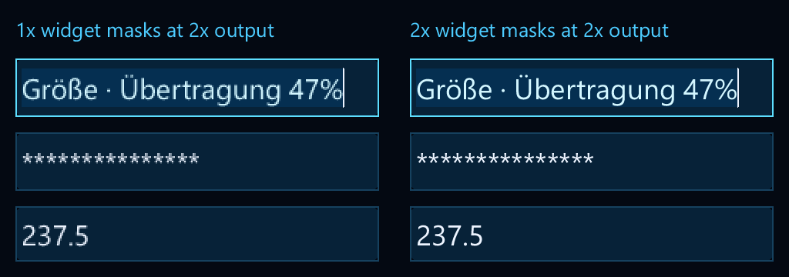

# Context raster density through widgets and editors

Implementation: `af5c2978c4229295cda81551c54175fc8f954be9` (2026-10-18).
Final source with the Metal clip correction:
`749c7fad44672ea870e538b2a6a9131637dc439f`.
This closes the reported P0 propagation gap. Existing scaled draw/stamp APIs
remain intact; application cache/pin adoption is a separate NexaCloud change.

## Contract and caller inventory

`nx_context_set_text_raster_scale(ui, scale)` selects the default raster density
for ordinary text drawing. `nx_context_get_text_raster_scale` reads it. New
contexts start at 1×, preserving existing output. Values must be finite within
[.125,8]; the setter rejects an active frame with STATE, does not allocate and
does not expire a completed command stream. The physical ppem range remains
[.125,16384]. Drawing can fail on its existing cache/memory/resource limits.

| Path | How density reaches rasterization | Executed targeted coverage |
| --- | --- | --- |
| `nx_draw_text_layout`, layout labels, layout-backed control labels | Ordinary layout draw uses the context default | Independent full-buffer glyph-position oracle, mask byte/size checks, label/button paths |
| Rich draw and rich labels | Styled internal draw uses the default; decoration geometry remains logical | Styled glyph masks, backgrounds/underline/strike, eleven allocation failures and same-frame retries |
| Text/password/numeric fields | Shared `nx_field_paint` passes the default to normal/selected/preedit text | Density transitions, logical caret/selection/outer clip, selection tint, protected semantics, pointer hit/edit; numeric masks; nine editor allocation failures/retries |
| Search field, result/empty labels | Field painter plus ordinary draw for supplied or generated layouts | Font-backed query/result popup and existing search regressions |
| Menus, tabs, tree/table labels, theme selector, property/dashboard text | Existing label helpers/ordinary draws converge on the same default | Source inventory; existing component/plot/property regressions, not a separate physical task for every widget |
| Plot tick labels | `nx_plot_tick_label` uses ordinary draw | Font-backed plot mask checks at common densities |
| Explicit `_scaled`, internal physical stamp composition | Exact explicit density, independent of the context default | Varied-default explicit draws, existing stamp bytewise references and retained-source tests |

These are the three internal layout-raster entry points in `src/nexaui.c` that
previously forced 1×: ordinary drawing, rich drawing and selected editor drawing.
The explicit scaled and internal stamp-pixel entry points retain their explicit
scale. There is no additional core font raster call site bypassing that inventory.
User-provided bitmap/stamp caches still need their own density keys/rebuilds.
Icons, shape widths, layout measurement, hit tests, semantic text and IME placement
are not scaled by this text setting. No OS density is guessed automatically.
The reference NexaCloud loop applies its requested window density before begin-frame.

Direct masks remain owned by the context until its next begin-frame/destruction.
Fonts/layout/source bytes need only survive recording. A failed widget draw
retains its existing rollback contract; accepted input may already have changed
the draft, so use the existing same-frame retry without reapplying events.
There is no automatic old-mask cache or silent fallback to lower density.
End the frame before choosing a smaller default for a later retry, or retain
application output independently through renderer consumption.

## Executed evidence and counterexamples

The new portable test checks 1×/2×/1.25×/1.5×/1× transitions in the same context,
plus .125×/8× direct/rich/control cases. An independent cache raster at required
physical ppem must match every emitted mask's size and bytes. Logical line
measurements, carets, selection fills, field clips, hit targets, protected values
and source semantics remain unchanged. Raster-padding clips can legitimately
change with ink bounds; they are distinguished from logical selection geometry.
The test font explicitly maps the password asterisk to visible synthetic ink.

The older full-RGBA oracle now also exercises default drawing at six densities;
explicit calls run while the context has varying defaults, detecting double
scaling. Invalid/null/NaN/Inf/range/state cases and a 2500-ppem layout at 8×
verify rejection without losing the sentinel command. Rich/editor allocator
sweeps check cleanup, exact successful command counts and retry. Editor input
remains `015`, rather than applying the `5` event again after a paint failure.

Three isolated source mutations independently restore a 1× literal in the
ordinary, rich or selected-editor raster path. Each breaks exactly its matching
physical-mask probe while the other paths pass. All twelve final probe processes
release their objects under ASan/UBSan/LSan. This is source-level cause isolation,
not a comparison against an entire old release. An initial probe collided with
a concurrently rewritten static archive and failed to link; it was excluded.
The final campaign ran after the build completed and preserves that earlier log.

Windows IME checks use an actual hidden HWND/native IMM context with injected
preedit `01`. At 1×/2×/1.25×/1.5×, physical glyph bytes match independent masks,
logical composition underline/caret geometry and native candidate coordinates
stay unchanged, and the committed draft remains `01`. Existing synthetic
WM_DPICHANGED coverage is not a physical monitor test or human IME acceptance.

The shared native text fixture now combines explicit/default draws and a
focused selected editor. It releases fonts/layout/field before rendering while
keeping frame-owned masks and the stamp alive. D3D12 hardware/WARP and Vulkan
locally compare full RGBA buffers at 1/1.25/1.5/2×, with unchanged byte-exact
tolerance. Metal execution belongs to exact-source CI, not a local macOS claim.

The first exact-source macOS static/shared jobs at `af5c297` expose a real native
failure: the new selected-editor fixture differs at byte 181471 (126 versus171).
A separate portable planner probe finds exactly one differing scissor: at 1.5×,
the ink clip produces `(12,158,1,5)` instead of `(12,158,2,5)`. Its logical origin
and extent sum before multiplication, whereas the software command contract
scales each float component before summing physical edges. The values straddle
pixel center13.5. `749c7fa` fixes that order for Metal clip/flat-rect preparation;
the shader, fixture, byte comparison and tolerance are unchanged. A minimal
portable RGBA regression fails before the fix at `(13,15)` and passes afterward.
Both initial red native job logs are retained; a portable pass alone does not
accept native Metal execution.

Commands, hashes, allocation counts, final outcomes and exclusions are recorded
in [the local receipt](context-text-density-local.json). Local Windows's full
`af5c297` run has 107 passes and one clipboard-transfer failure; its isolated
retry skips with 77. The cause is not diagnosed and a skip does not repair it.
All density/IME/D3D12/reference/UIA cases in that run pass. Windows shared
targeted checks pass 5/5 plus the final rebuilt unit 1/1, MSVC ASan 3/3 and Linux
ASan/UBSan/LSan 3/3. The new planner regression passes separately on Windows and
Linux after its demonstrated failure.

All seven required jobs of [final exact-source run 39086674419](https://github.com/Lulus792/NexaUI/actions/runs/39086674419)
pass: Windows static/shared each 108/108, macOS each 93/93, Ubuntu static/shared
and sanitizers each 107 executed passes plus seven unavailable-Wayland skips
(114 registered). Both Windows CI clipboard cases pass, separately from the
unresolved local failure. The new density unit, native D3D12/WARP, Metal and
Vulkan scenes execute. Both installed/add-subdirectory consumers build and link
the new exports; the workflow executes the installed consumer. It does not
execute the add-subdirectory consumer.
The [CI receipt](context-text-density-ci.json) records exact counts, selected
cases, package steps and log hashes. Optional Windows ASan/fuzz CI jobs are
skipped; the local instrumented MSVC evidence remains separate.

## Real-font visual comparison

The [portable widget example](../../examples/17_widget_text_density/README.md)
renders selected text, a password mask and a numeric field at 18.5 logical ppem.
Both columns are displayed at 2×; left uses a 1× context default, right uses 2×.
The headings explicitly request 2× in both contexts. Windows and Alpine produce
byte-identical 1024×360 output for the same installed Segoe UI and Arial files.
No font data is redistributed. Both images were opened and visually inspected.

The [Arial comparison](context-density-images/arial.png) shows the same contract.
Mask-piece command counts can differ because padding/clips change; logical
editor bounds and text size remain equal. The image supplies output-quality
evidence, not an interactive native-window or physical-display acceptance.

## Integration and remaining work

Call the setter with the application's current window density before begin-frame.
Continue to use logical ppem; do not enlarge it as a density workaround. Update
caller-owned stamp/breadcrumb caches separately and keep resource lifetimes
through actual renderer consumption. Regular/Semibold/Bold role selection and
final NexaCloud composition remain application responsibilities; this change
does not alter NexaCloud's dependency pin or application sources.

Physical monitor/4K/Retina checks, human IME and screenreader tasks, fractional
raster phase, hinting, advanced scripts, CFF/color/variable outlines and GPU
atlas/performance acceptance remain open. This closes P0's API propagation and
automated checks, not the complete framework/release goal.
