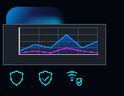
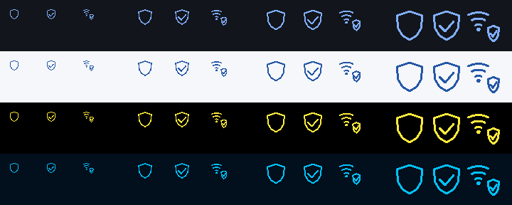

# NexaCloud Design A framework slice — 2026-10-17

Source: `c25ec7e0db46669b12d4ca3002a5ab7f0310bf09`.
The four requested building blocks now have public C17 implementations. Their
remaining acceptance is recorded below; the full Design-A application is not
declared finished. NexaCloud's dependency pin was not changed.

| Request | Public implementation | Acceptance still open |
| --- | --- | --- |
| A01 gradients | `nx_surface_image_create`, `nx_draw_paint_image`: solid/linear/radial, rounded alpha edges | D3D12 pixel parity (local 1.5×/CI 2×) and physical-display matrix |
| A02 shadows/glow | `nx_shadow_image_create`: cached padded rounded mask, three separable box passes | Same D3D12 issue; physical performance/contrast acceptance |
| A03 protection icons | `NX_ICON_SHIELD`, `NX_ICON_SHIELD_CHECK`, `NX_ICON_WIFI_SHIELD` | Physical DPI/accessibility task acceptance; parent provides meaning |
| A04 multiple area series | `nx_plot_multi`: named ordered layers, gradients, explicit segments/gaps, existing extrema decimation | Same D3D12 boundary; full application labels/legend and assistive acceptance |

Contracts: [paint resources](../concepts/paints.md),
[plotting](../concepts/plotting.md). Existing commands, `nx_plot_desc`, single-series
`nx_plot` and existing icon numbers remain compatible. Resources and sample data
contain no NexaCloud networking types, telemetry generator or external GUI library.

## Executed local evidence

- Windows static: 103/103 full CTests passed in the pre-publication run; later
  final targeted paint/multiplot/D3D12 checks also passed. Windows shared and
  Linux ASan/UBSan/LSan paint/multiplot/component checks passed. Full CI receipt
  is recorded separately after exact-source jobs complete.
- Paint tests independently inspect linear/radial endpoints, premultiplied
  transparent interpolation, zero vectors, clamped radius and four densities
  (1/1.25/1.5/2). Shadow checks find more than eight alpha levels, an outward
  halo and zero outer padding. All two surface and four shadow allocation
  failures leave output pointers unchanged and release allocations; retry works.
- The multiplot regression uses three named series, positive/negative/constant
  values, a transparent missing interval, shared units, pointer/keyboard cursor,
  two allocation failures with full state/mask/node rollback, retry and limits.
- The authored 180×140 renderer scene combines overlapping linear/radial cards,
  soft shadow, two area series, nested fractional clips and three shield icons.
  D3D12 passes byte-exact full-buffer checks at 1×/2×. The Linux X11/Vulkan test
  passes byte-exact comparisons at 1×/1.5×/2× under ASan/UBSan/LSan on the shared
  Alpine-Dev WSL environment. Metal's corresponding native test is part of CI.
- Headless icon matrix: Dark/Light/High-contrast/Midnight rows; 16/24/32/48 logical
  size columns, each containing Shield/Check/Wi-Fi+Shield. Visually inspected,
  along with paint and plot fixtures. They are test images, not a final dashboard.
- A 640×360 logical soft card at 2× was constructed in 361–785 ms in local
  MSVC Debug `clock()` measurements. MSVC reports elapsed process time here,
  as documented by [Microsoft](https://learn.microsoft.com/en-us/cpp/c-runtime-library/reference/clock?view=msvc-170).
  This is resource creation, not per-frame GPU cost
  or a release performance claim. Drawing reuses immutable pixels. No blur mask
  is recalculated by `nx_draw_paint_image`.

The [image receipt](design-a-framework-images.json) records dimensions and hashes.
The follow-up change after the implementation commit corrects only the test's
`clock()` output label; it does not change paint/plot/renderer behavior.

## Open D3D12 fractional sampling diagnostic

The exact-source [CI run](https://github.com/Lulus792/NexaUI/actions/runs/39069623365)
has **five successful required jobs and two failed Windows jobs**. Both Windows
variants pass 102/103 tests; the new paint comparison fails at 2× with maximum
channel difference 3 across 306 bytes. Local 1×/2× tests passed, so local success
does not accept this runner/driver. Ubuntu static/shared and sanitizers each
execute 104 successes plus seven unavailable-Wayland skips (111 registered).
macOS static/shared each pass 90/90, including the native Metal paint scene.
Optional Windows ASan/fuzz jobs are skipped. [Raw receipt](design-a-framework-ci.json).

Enable `NEXAUI_TEST_PAINT_FRACTIONAL=1` when running
`nexaui_d3d12_widget_tests`. Correct 1.5× geometry plus a 1.5× resource currently
has a maximum channel difference of 12 and 928 differing bytes in the local
180×140 case. The default gate attempts byte-exact 1×/2× cases and currently
fails in Windows CI at 2×; the 1.5× diagnostic remains outside that default gate.
Neither a local pass nor success on another platform closes this requirement.
The additional `NEXAUI_TEST_PAINT_DOWNSAMPLE=1` diagnostic keeps display scale 1
while changing resource density, separating bitmap resampling from native DPI.

The first probe incorrectly called this downsampling case a DPI test. Its first
divergence was at (18,11); multiplying source extent before division corrects
the software reference's exact 1:1 boundary. The corrected DPI case remains open.
Three experimental D3D12 numerical repairs (split-pair sampling, strict IEEE
compilation, candidate-boundary correction) did not eliminate the mismatch.
They were removed; no speculative renderer shader change remains. This follows
the central graphics skill's three-unsuccessful-repairs limit. Next investigation:
instrument actual selected source texels and shader constants in an isolated
coordinate-coded bitmap, then distinguish sample choice from composition. No
further renderer repair or broadened tolerance is claimed in this slice.

An initial Vulkan fixture insertion warmed the same renderer before existing
allocation-fault checks, invalidating their cold-allocation expectation. That
test exited early and consequently leaked its test-owned objects. Paint probes
now use their own renderer; the same full native draw case passes with leak
detection enabled. The initial empty-name-filter CTest run found no tests and
was not counted as evidence; the corrected run uses `--no-tests=error`.

## Reproduction and remaining product work

Build `nexaui_paint_tests`, `nexaui_plot_multi_tests`, and the platform renderer
tests. Optional arguments to the first test export paint/icon PPMs; the second
exports the plot fixture. Stop/destroy renderer use before releasing images.
Resize/density/style changes build a replacement resource outside frame building;
on failure retain the previous resource. Physical monitor changes, 4K/Retina,
reduced-effects/contrast task walkthroughs and real screenreaders remain open.
The application must integrate these APIs, supply real local data and complete
its final 1:1 visual review. The general project goal remains in progress.
