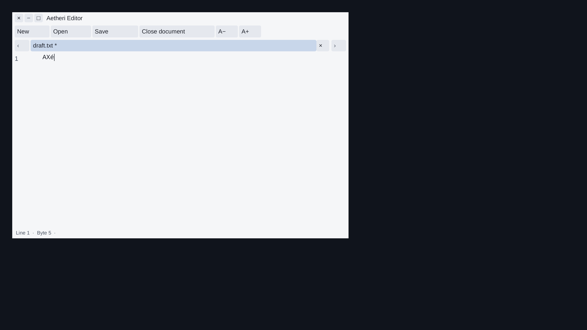

# Original Editor: rendered document geometry

Consumer source `364b1229d29c1d8bbf46bc33720c56e482149b5c`, 9 November 2026.
Compiled owner/reader source `042bf5856a6c7da559613562a6512e4b6cb6f065`.
Installed SDK0.1.30 source `aa899fbd7b95a975391a29dfd01b05b39e6b4c05`.
Original Editor `7bbe7042ecd48582b11ef7053a4dbeade6b02351`.
Catalogue SHA256 `9c932872caeba8007bf05b86f7c167b493260709b23c54d709222a5f19539e65`;
all103 requirements, thirteen surface groups and remaining packets6–8 persist.

## Owner implementation

The [optional original consumer](../../examples/36_aetheri_editor_consumer/README.md)
can enable `EDITOR_BUILD_NATIVE_PRESENTATION=ON`. Its default remains OFF.
It uses the existing public `nx_text_document_set_presentation` contract and
the original document, controller, history, row layouts, renderer and window.
There is no installed API/ABI or SDK version change in this consumer step.
It needs SDK0.1.30 containing the shared-cluster correction `aa899fb`;
the version number alone does not establish that correction.

After original row painting, the adapter derives logical selection cells from
the actual glyph clusters/advances and line positions. It applies the original
horizontal offset and row/canvas clipping, merges shared/combining clusters,
preserves the first original caret and represents CRLF/LF delimiter bytes at
the real line-end caret. The current native-IME caret overrides that position
only if the original renderer actually painted it in this frame. The setter
receives the exact resulting original document identity and SDK revision.
These are logical selection cells, not assertions about glyph ink bounds.

Two reusable arrays are bounded to65,536 boxes each and freed at owner close.
Sorting/grouping avoids per-scalar selection queries. Invalid layout/order,
overflow, allocation or budget failure omits the entire optional projection;
it does not publish a successful prefix or disable original editing. No layout,
font or original-model pointer is retained in the SDK's copied projection.
Invisible rows/parts are omitted; generic scrolling/realization is still open.

## Executed owner and native checks

The [raw ledger](editor-presentation-local.json) and
[source binding](editor-presentation-source-binding.json) distinguish compiled
input48 from executed input49. Both contain105 files, including53 frozen
original inputs. Only the uncompiled `run_native.py` clipboard admission changes
between042bf58 and364b122. This is checked reuse, not a claimed recompilation.
All133 owner/reader objects bind to their exact inputs; all28 generated C files
are regenerated independently and compared byte-for-byte across four builds.

- Release static, shared and whole-library ASan/UBSan/LeakSanitizer each pass
  19 owner CTests:57 total. Each builds33 owner/test objects plus one independent
  libatspi reader object. Presentation-OFF shared passes15 tests/31 objects.
  All133 objects explicitly use C17 and warnings as errors.
- Real Liberation Sans and borrowed Candara layouts check proportional text,
  Hebrew bidi, combining marks, CRLF,1×/2× scale and fractional/scroll clipping.
  Every visible grapheme is checked against the public selection oracle.
  Candara actually forms four shared groups; the original paint test explicitly
  requires the `office` ffi cluster. Allocation/budget failures and offscreen
  omission are also checked. This is selected-font coverage, not all-font proof.
- Three complete original-compositor native tasks pass with geometry enabled;
  one shared task passes with the option OFF. Each retains84 full three-output
  captures:336 total, decoded and checked for dimensions, length and raw hashes.
  An independent OS libatspi peer checks12 geometry observations across the
  three enabled profiles, including actual native edits to combining/CRLF text,
  character/range/point/caret queries and150%/200% style transitions.
- All existing original keyboard, clipboard, controlled IME, Undo/Redo,
  full8-MiB document/cache, Save/conflict, retained-reference, tab and close
  assertions remain. Each enabled task retains seven partial-byte/held-EOF
  stream cases:21 cases and78 forced pre-EOF frames. Idle close guards retain
  zero new frames and at most two CPU ticks; no power/performance claim follows.

The installed SDK is independently rebuilt in three profiles:57 selected SDK
CTests and three external C17 package consumers pass, with258 SDK/test objects
and three consumer objects. The [SDK prerequisite receipt](editor-presentation-sdk-local.json)
and source binding cover all1082 exact SDK Git inputs. These counts are separate
from the72 owner CTests, and are not the earlier69-test native SDK campaign.

## Image review and counterexample

Shared ON/OFF comparisons find82 completely byte-identical PPM pairs. Two other
pairs differ only in the original Save dialog's displayed temporary directory:
the full images remain different and are not counted as matches. All pixels
outside the recorded208×12 difference rectangle in each image are identical.
The initial collector's failed84-pair assertion and the exact bounded differences
are preserved. There was no image normalization or replacement capture.

The actual150% light original Editor screenshot was reviewed; it retains the
original toolbar, tabs, document, caret and footer. This is a virtual display
observation, not final design, physical display or human assistive acceptance.

A compiled control replaces only `document_presentation.c.o` in a private copy
of the current static SDK with the actual old1ee9d99 module. All other56 object
payloads remain byte-identical. The unmodified new original-owner/Candara paint
test then fails at the required geometry availability assertion; the current
module passes. The private mixed library still embeds the current revision
string, so this is explicitly an old-module replay, not an old installed SDK.
An earlier attempt with the genuine old musl SDK cannot build the unchanged
original model's glibc-specific spawn helper; that attempt is not counted as
detecting the geometry defect.

## Failures, CI and remaining acceptance

Initial attempts are retained: SDK-ASan and native capture ENOSPC under existing
user quotas; an original file-test short write during quota exhaustion; missing
explicit libm in the first shared consumer build, fixed by042bf58; and the
legacy clipboard SDK admission guard, fixed by364b122. One capture retry began
before archive retirement had completed and failed again. Final runs wait for
terminal completion and use the unchanged capture settings, guards and deadlines.
Only fully verified redundant archive copies and already archived inactive test
outputs were retired; no quota, mount, sanitizer, driver or global/tmp setting
was changed. The [archive ledger](editor-presentation-archive.json) records both
failure archives, preflight builds and exact retirement receipts.

All seven required jobs pass on364b122 in
[run42604007477](https://github.com/Lulus792/NexaUI/actions/runs/42604007477):
Windows145/144, macOS121/120, Linux267/265, a separate Linux one-test repetition
and sanitizer267 in each driver-discovery order. No CTest skips occur. Installed,
close-request and add_subdirectory consumers pass on six platform builds.
Two optional Windows-ASan/fuzz jobs skip. Complete logs and REST head-SHA/job
metadata are bound in the [CI receipt](editor-presentation-ci.json). Root CI does
not build the exported original owner; its72 tests/four native tasks are the
separate local evidence above. [Exact commands and results](editor-presentation-checks.json).

This delivers scoped original rendered geometry/carets through Linux AT-SPI.
Font/style metadata is the next owner step. Broader text/scroll interfaces,
AX/UIA document tasks, actual installed IMEs/screenreaders, full font/fallback,
physical/human/design/performance and normal application adoption remain open.
All53 consumed original files are unchanged at independently read Aetheri HEAD
`2188c3a0906b4160071b6131c5698a9dbfee1dcb`. Its active source, dependency pin,
builds and defaults were not modified.
All103 IDs remain in scope. No1.0 release is claimed.
