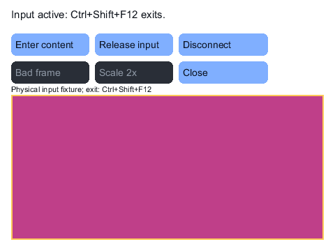
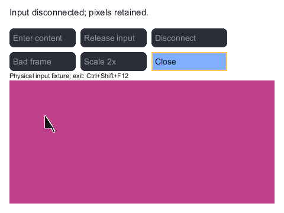

# Content input intent, host escape and release

Consumer source **`dc6a5493c5048cdb17dcaaa5476fb05b21e085b3`** extends
example38 with an app-owned input gate and its optional native fixture.
Installed SDK **0.1.33**, source `368cd38292498bd538964ba514ff02e0e9924358`,
is unchanged. The previously checked surface/staging code, surface tests and
worker implementation are byte-identical to `2ef9a56`. No new installed API,
engine, core dependency, application pin or 1.0 release is introduced.
[Build, integration and lifecycle contract](../../examples/38_external_content/README.md#explicit-content-input-and-host-release)

## Scope and existing APIs

This advances packet7 and I08/D08 using ordinary public `nx_event`,
`nx_window_next_event`, `nx_context_queue_event`, `nx_window_route_events`,
`nx_focus_id`/`nx_focus_set` and the existing window/software/snapshot APIs.
All mutation stays on the UI owner thread. The standalone gate owns one fixed
allocation; event/reset storage is bounded by `NX_KEY_COUNT` and five buttons.
The frame worker still carries only copied requests and immutable pixels.

The host explicitly activates content after native window/content focus and
release of all observed keys/buttons. The fixture displays its configured
**Ctrl+Shift+F12** exit chord before activation. Native text/IME events are
consumed during this normalized-key channel, preventing a key and its text
from being forwarded twice. No IME is enabled by this fixture. Unknown keys
or touch revoke with an explicit unsupported result. This is not an engine
keymap/scancode or general text-input implementation.

Absolute pointer events map half-open logical bounds to integer source pixels;
wheel units remain abstract. Leaving the content bounds revokes input. There
is no OS grab, relative pointer or claim of general guest capture support.
Host events draining from the released session cannot activate host controls;
their held modifiers are removed from other host-event copies until release.

Escape, host/native focus loss, pointer cancellation, geometry change,
unavailability, explicit release and close send accepted key/button ups and
FocusOut once, as an atomic old-generation batch. The sink must admit all or
none. **Success is local admission, not remote application/reset evidence.**
Failure fences the gate, keeps the accepted-hold ledger/error and prevents
automatic retry, replay or rearm. Close returns uncertainty even though it
frees local storage. A strictly newer explicit rebind asserts that the owner
independently retired/reset the old backend; it never proves that retirement.
Physical/draining observations survive rebind until released.

The native host first drains normalized native events through the gate, then
routes pending assistive actions in the ordinary native-before-AX order.
After the host frame/action it synchronizes actual content focus/geometry
before polling more native events. A failed host enqueue is an explicit
fixture failure, not a silent loss or replay of an already consumed event.

## Executed final checks

Clang22.1.3, C17/extensions OFF, Alpine-Dev/WSL2, uid65534:

| Profile | Consumer CTests | Native workflows |
| --- | ---: | ---: |
| Static Release | 9 | 4 |
| Shared Release | 9 | 4 |
| Debug `-O1`, ASan/UBSan/LSan | 9 | 4 |
| Default fixture-OFF, X11 discovery disabled | 9 | 0 |

All **36 CTests and twelve native workflows pass**, with no skips, suppressed
sanitizer errors or expanded deadlines. Own sources use conversion/shadow
warnings and Werror. The default build discovers no X11 and contains neither
native fixture executable. The opt-in peer alone links libatspi/X11 and no
NexaUI; the ordinary Wayland/software host links no X11 presentation library.
All installed SDK library hashes match their existing source-bound receipt.
This standalone example is outside root SDK CMake; historical SDK CI is not
claimed as coverage of these new consumer files.

The four original surface cases remain regressions. Five new input cases use
a separate atomic receiver model to check outputs and actual admitted holds,
including full-key/five-button reset capacity, activation while Enter is held,
repeat/duplicate/consumed-key filtering, coordinate edges, wheel, escape/drain,
all revocation causes, generation replacement, malformed/unsupported inputs,
callback reentrancy and admission/reset/close failures. Rejected resets retain
the receiver's actual holds and the gate's uncertain ledger; a green cleanup
state is not fabricated.

Each opt-in profile runs full/pending-close/rejected-close plus the new input
case. The latter first completes the original frame workflow, then:

1. Activates with host focus and real Return; routes A, Tab and a held mouse
   button while content focus stays on the viewport. Logical offset60/60 maps
   to source pixel120/120 at 2x backing.
2. Holds Ctrl/Shift and presses F12. Escape itself never enters the receiver;
   four keys and the mouse button release once, followed by FocusOut. Later
   real ups do not create host actions or duplicate receiver ups.
3. Explicitly rearms, holds B and a button, then moves actual X focus to the
   private carrier root. Native Wayland FocusOut releases both. Restoring outer
   carrier focus alone does not reactivate content. A real host-button click
   reactivates the Wayland surface and explicitly requests entry.
4. Holds C and a button, then invokes the independent native Disconnect action.
   Both release once. Enter is disabled, its assistive action is refused, and
   Close remains operable by real Return. Historical pixels remain visibly
   labelled as retained after disconnect.

Every input case exits with exactly **6 key downs/6 ups, 3 button downs/3 ups,
3 FocusIn/3 FocusOut, zero text events and zero accepted holds** in its local
fixture receiver. This does not prove delivery to a real VM or content engine.
All three original worker publication/disposal outcomes remain unchanged.
The client/Weston/frame limits remain 35seconds/60seconds/150frames.

The independent peer verifies all93,184 pixels in **45 body captures**, and
retains **63 final PPM files** including client/carrier and input-state views.
The existing late-generation/unsupported-format/recovery/2x images remain
checked. The two PNGs below are lossless conversions of actual Release client
captures; their CRCs and decoded RGB bytes match the retained PPMs. Visual
inspection confirms readable states, the displayed exit chord and available
host Close control. Product design and human assistive acceptance remain open.

## Negative evidence and retained earlier attempts

Four separately compiled input mutations fail the unchanged receiver tests:
disabled escape recognition, omitted key-release batch entries, x coordinates
forced to zero, and a falsely cleared held ledger after rejected reset. The
first three also fail the unchanged independent native peer after reaching the
scaled-content state. These are actual assertions, not accepted outer timeouts.
Mutants retain all original strict compiler flags; no peer expectations,
input count, image check, sanitizer or deadline was weakened.

Earlier native attempts279/281 failed during post-focus reentry. Diagnostic283
identified the failed assistive Enter-focus request and the absent native
FocusIn after restoring only the X11 carrier. The corrected285 pilot uses a
real host-button click, exercising Weston activation policy and release-before-
arm. Final287 repeats that flow in all three profiles. Earlier source/logs and
their failures remain archived; they are not counted as successful native runs.

[Source/object/command/image/negative receipt](external-content-input-local.json)
and [independent archive/PNG readback](external-content-input-final.json).
Archive `nexaui-content-input289.tar.gz`: **508 regular members, 14,736,579 bytes**,
SHA-256 `c126237b7df0ae293463c327ed0a5cc0618c9dc5c8b33ff21b0821f31cf0beed`.
Every member was hashed on archive creation/readback and again independently.
The borrowed font and OS/private tools are fingerprinted separately. Readback
found no live fixture executables from these runs.

## Remaining adoption gates

I08 and D08 remain partial. Selected maintained engines, actual guest input and
reset acknowledgements, keymaps/scancodes and unsupported keys, text/IME and
candidate geometry, accessible content subtrees, relative pointer/OS grabs,
sharing/reset authorities, reviewed GPU interop and actual Aetheri app adoption
remain open. Windows/macOS native consumer coverage, physical/human acceptance
and declared performance budgets are not inferred from this virtual Linux seat.
All103 requirements and the remaining ordered delivery packets remain active.
Aetheri can continue independently; this is an adoptable reference seam for the
stated input subset, not approval of an entire browser or VM console.
