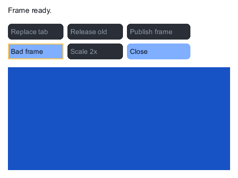

# Native external CPU content composition

Consumer `2ef9a56791c3dec63e542e66429ff2b7a43abba2` adds an optional ordinary
Wayland/software-window fixture to example38. It retains installed NexaUI
0.1.33/source `368cd38292498bd538964ba514ff02e0e9924358` and the exact previously
checked `surface.c`, `surface.h` and four-case test source from `5fa854d`.
There is no new installed API, engine, SDK dependency or application-pin update.
[Build/run and lifecycle instructions](../../examples/38_external_content/README.md)

## Native host and producer ownership

The app owns its worker, bounded frame allocation, condition gate, wake pipe,
snapshot exchange, content generation and window/context. The worker carries
only copied request metadata and publishes immutable pixels through existing
`nx_snapshot_exchange`. It makes no window/context/surface calls. Public
`nx_window_poll_with_fd_events` services native input/AT-SPI and the worker's
completion fd on the UI thread.

The first worker allocation is fully prepared and deliberately held. The client
replaces the content surface while retaining the host chrome/context, then
releases that old job. Generation 2 rejects its generation 1 frame. Fresh pixels
can subsequently render; an unsupported format removes the viewport and paints
the placeholder, while host controls remain available. A later fresh frame
recovers. Content backing then changes from 448x208 to 896x416 at the same 448x208
logical slot. This is 2x content backing on a 1x virtual output, not physical or
mixed-output DPI acceptance.

The host completes each viewport lease after `nx_software_view_render` returns.
That presenter borrows commands only until return; BUSY/SUSPENDED frames are
discarded and rebuilt later. A successful submit alone is not a display witness.
Closing a tab does not stop/replay its producer. Closing the fixture stops and
joins its own worker before destroying the exchange; a held unpublished
allocation is discarded once. Native semantics detach before context destruction.

## Executed evidence

Clang22.1.3/Alpine-Dev/WSL2, uid65534, passes **16 installed consumer CTests**:
four each in static Release, shared Release, Debug `-O1` ASan/UBSan/LSan and the
default fixture-OFF configuration. Own sources keep C17/extensions OFF and
conversion/shadow/Werror. Sanitized positives retain leak detection and no
suppressions. All installed SDK library hashes match the prior source-bound
receipt. The default profile builds with X11 package discovery disabled and
contains neither native fixture executable. Its unused-variable CMake warning
reflects that this default path never calls `find_package(X11)`.

**Nine native tasks** pass, three per opt-in profile:

| Workflow | Publications | Held allocations discarded | Published allocations disposed |
| --- | ---: | ---: | ---: |
| Full replacement/rejection/fresh/format-error/recovery/backing-resize | 5 | 0 | 5 |
| Close with a prepared unpublished worker frame | 0 | 1 | 0 |
| Close after rejecting the late old-generation frame | 1 | 0 | 1 |

The separate peer links libatspi/X11 and no NexaUI. The host links the selected
SDK and no X11 presentation library. X11 is only the private Xvfb carrier's
independent image observer; the app and SDK presentation remain Wayland-only.
The peer traverses host controls with real Tab/Shift+Tab/Return, enters the
viewport via native focus, and returns to a host control with Tab. A removed
viewport's old Component cannot take focus and stays Defunct after its numeric
ID is reused by the recovered viewport. This is generic viewport/host semantics,
not an engine's accessible content subtree or guest input forwarding.

For **27 captures**, the peer reads and verifies **all 93,184 pixels** in the
448x208 content rectangle from the actual private Weston/Xvfb output. Pending,
rejected and invalid states must show the gray placeholder; fresh, recovered
and resized content use distinct exact colors. Full-window/carrier captures
are retained too. Logs require generation 2/request 2, 896x416 physical pixels,
sequence 1 and exactly three staged copies after recovery/resize. The client,
Weston and frame bounds remain 35 seconds, 60 seconds and 150 frames, respectively.
No CTest/native case is skipped, and positive logs contain no sanitizer error.

The PNG is a lossless conversion of the peer's actual 480x360 client capture.
Its decoded RGB payload is checked against the retained PPM. Visual inspection
confirmed readable controls and a distinct bounded content area; final product
design and human assistive acceptance remain open.

Two effective compiled counterexamples fail the unchanged independent peer:

- Removing content-generation validation admits the old frame into the new
  surface and fails the expected old-frame-rejected state.
- Omitting submission for every unsupported-format frame leaves the prior blue
  image visible while the accessible status changes. The peer rejects the bad
  state's actual pixels, rather than accepting the status message as proof.

An earlier phase-conditioned submission omission passed and did not establish
a display fault: it did not cover all earlier rejected-format frames. Its
source, passing run and the helper's failed expected-exit assertion are retained.
The final control keys off the actual format-rejection result; no peer check,
deadline or expected image was relaxed. The negative results are native
assertions, not accepted outer timeouts.
[Source/object/command/native/image/negative receipt](external-content-native-local.json)
and [independent archive/PNG readback](external-content-native-final.json).

`nexaui-content-native274.tar.gz` retains 256 regular members, 11,130,619 bytes,
SHA-256 `c1bec5d73eaa30d1fc300479e7222ebebb4a5ab1f2479a50ae3c9855f59a6d19`.
It includes frozen source, objects/binaries, all 33 final PPM captures, logs,
pilot source/logs, both negative attempts and helpers. Every member was read back
and hashed twice. Borrowed font and OS/private tools are fingerprinted separately.
The unchanged SDK's seven required
[platform/package CI jobs](https://github.com/Lulus792/NexaUI/actions/runs/43760877115)
remain separately bound to `368cd382`; they do not build this standalone fixture.

## Remaining packet7 acceptance

This advances ordinary native CPU content presentation, host focus, worker
wakeup, stale-frame/native-object retirement and bounded close. It does not
establish a maintained browser/PDF/guest engine, content keyboard/pointer/text
forwarding, guest capture/host escape/stuck-input release, IME/candidate geometry,
engine accessibility, GPU import, actual Aetheri-compositor adoption or physical/
human/performance acceptance. Windows/macOS fixture/consumer validation remains
separate. Physim and NexaCloud retain their real-app adoption gates. All 103 IDs
and remaining delivery packets stay active; no Aetheri implementation, active
SDK pin or 1.0 release changes.
