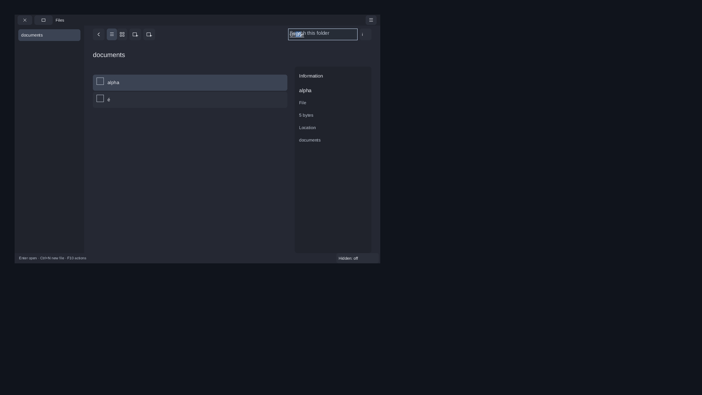
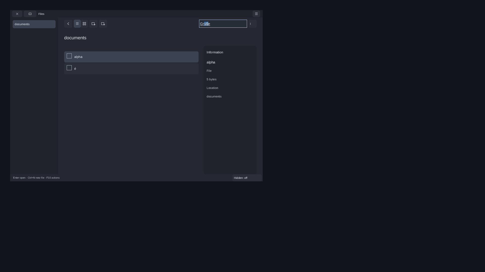
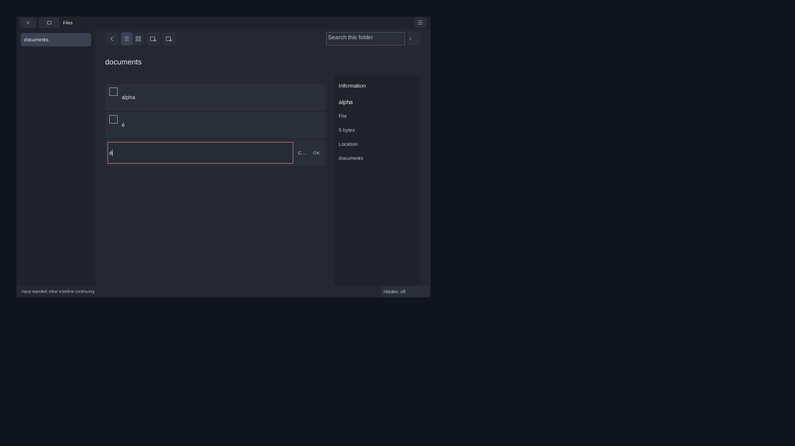

# Files native IME integration variant — 2026-11-08

Implementation: `3fd58c7a507ed94eaf4bb9c623c1b7acbbce394a`.
This is a separate, default-OFF consumer variant generated from the checked
Aetheri Files export. It connects existing public text-field/window APIs to the
original controller. The unchanged-original host remains a separate target.
No public SDK API, ABI or version changes, application migration or 1.0 release
are part of this checkpoint.

Affected evidence: B01/B03/B04, I01/I02, T01/T03/T04, A02/A04, P04/P05,
Q02/Q03/Q06. These are scoped additions, not closure of those catalogue IDs.

## Source and ownership

The original 87 files are Aetheri
`7483286bcaafbeaced5831f72cb4d0e0cad9a158`; their export, bytes and modes are
checked before configuration. A read-only survey of committed Aetheri
`3baa847f7a0c2b2f8972e61e180eaf5cce15c052` finds no Git differences in those
87 selected inputs. This is not a build or runtime test of the current checkout.
Aetheri's own reviewed SDK pin remains
`97a42647480bb05167cee5e4ae08cedd9147d80d`. The independent installed test SDK is
`c4f467d85b0147944d2456f5e7602a39ac18e579`, version 0.1.23, with Wayland-only
software windows and AT-SPI. Its exact artifacts remain in the paired Root11
SDK archive referenced below.

`FILES_BUILD_IME_HOST=ON` enables `aetheri_files_ime_candidate` and its separate
view library. `prepare_ime_host.py` writes only an owned build directory, records
exact before/after substitutions and original/generated hashes for three files,
and refuses an output overlapping the original export. Applying the recorded
changes in reverse reproduces all three originals on each final profile.
CMake watches the generator, checker, manifest and every original input.

The app-private binding is set once before the first frame; the window outlives
the view. The original model, filesystem worker, document children and unknown
operation policy keep their owners. The active `F:/Aetheri` source, build,
backend and pin are not changed or built.

## Input behavior

The existing `nx_text_field_desc.ime_window` supplies native activation,
preedit, surrounding state and candidate geometry. Preedit notifications reach
the existing UI context. During composition, raw text and app commands are
suppressed; Enter cannot open a retained file, Tab withdraws input and Escape
cancels composition without committing its text. Ctrl+Q still closes normally.

Native TEXT commits are checked against the existing target/revision query and
current editing focus. All scalars between START and END remain in the original
bounded app buffer until a complete batch can enter one widget frame. Original
filter/oversize rejection retains the old draft and marks it invalid; the original
confirmation rule then refuses the retained prefix. An explicit clear permits a
new valid name. The query placeholder is omitted while native preedit is visible,
including when the committed draft is empty.

Native DELETE_RANGE/SURROUNDING transactions still follow the original rejection
path. Complete replacement grouping, interrupted/late/empty/all-filtered batches
and exhaustive allocation-failure atomicity remain follow-up work. This step
does not claim full IME transaction or T04 acceptance.

## Executed final checks

Final application builds use input export10; final native runner/independent peer
use export11. The only difference is the test peer's static-text lookup corrected
from AT-SPI Text to Label. All other ten files, including all application and
generator inputs, are identical. The final peer was compiled and exercised in
each native run. All eleven export11 inputs match the implementation Git revision
(CRLF-to-LF normalization only). [Binding](files-ime-source-binding.json).

| Profile | Original and integration-view CTests | Translation units | Final IME/AT-SPI task |
| --- | ---: | ---: | --- |
| Shared Release | 23/23 | 47, C17/Werror | passed, 21 captures |
| Static Release | 23/23 | 47, C17/Werror | passed, 21 captures |
| Static ASan/UBSan/LSan | 23/23 | 47, C17/Werror | passed, 21 captures |

The original view tests run against both original and generated unbound views at
1×/2×: 1,536 layout checks across the three profiles. Each profile has 26 hashed
executables. The IME host has no fault-wrapper symbols or SDL/X11/Vulkan/EGL
dependencies. Runtime mapping checks distinguish static/shared SDK linkage.

Three controlled native v3 tasks use real Wayland buffers, a private registry
and an independently linked libatspi peer. They check native activation and a
nonempty candidate rectangle, uncommitted `Grüße`, Enter suppression, Escape,
committed `é`, 200% text, combining preedit, Tab withdrawal, Ctrl+N suppression,
name editing, filtered-commit rejection and disabled confirmation. After an
explicit clear, the real original controller creates exactly the empty file
`né`; both seed files remain byte-identical. Ctrl+Q exits cleanly. The peer
checks committed Unicode text, scalar caret/selection and original invalid-state
action refusal, independently of the model.

A fourth final run repeats the complete unchanged-original Files/AT-SPI/document
task with the final build, including actual Terminal/editor child identities,
pidfds, parent/executable observations and document save. Its 66 captures plus
the three IME tasks give **129 final positive virtual captures**. All decompressed
PPM hashes are checked. These are private virtual-input results, not physical or
human acceptance. ASan/UBSan/leak and GLib-critical log checks remain enabled.
Exact commands/results are in [the local receipt](files-ime-local.json).
The [checkpoint verification](files-ime-checks.json) also checks source bindings,
all final capture hashes, full PNG pixels, catalogue preservation and artifacts.

## Negative results and visual review

The first implementation passed headless tests but delivered native scalars one
frame at a time. Original scope rebinding split the commit, and the native
filtered-commit guard failed. Its failed run is retained. A compiled version of
that defect is rejected again by the input9 runner at the same retained-prefix
guard (18 captures, no file effects). This counterexample predates the final
placeholder assertion and is not described as a run of the input11 runner.

Visual review then found the empty-query placeholder painted over `Grüße` in
the build3 variant. The final generator suppresses it while preedit is visible.
The final input11 native peer rejects that older compiled build with
`Native preedit placeholder remained visible`; final build4 passes. The six
final reviewed PNGs and the actual before image are lossless conversions with
every decoded RGB byte checked against native PPM. [Image receipt](files-ime-images.json).

The other reviewed frames cover Escape, committed Unicode, 200% preedit and
combining input. The original narrow Cancel label remains visibly truncated;
its complete native action name is available. This is recorded as remaining
layout work, not a full visual acceptance. The earlier original-host emoji
fallback defect and English status/localization gap also remain open.

Eight build/admission controls cover changed original input, generator-triggered
reconfiguration, subsequent no-work build and overlapping output refusal. Six
commands succeed and two fail as expected; the 87 originals remain unchanged.
These use build3's unchanged final CMake freshness guards; the later application
change is confined to placeholder handling in the generator.

One pre-application native attempt hit EDQUOT (122); a bounded allocation probe
failed after 37,310,464 bytes. After full host-archive verification and exact
current-entry matching, 362,837,965 bytes of duplicate old Recovery-view shared
and Release builds were retired. Earlier failures, all current Files/IME builds,
raw captures and host archives remain preserved. No quota, clock, timeout,
sanitizer or assertion was relaxed to obtain a pass.

## Reproduction and remaining work

Use the [consumer instructions](../../examples/35_aetheri_files_consumer/README.md#native-ime-integration-variant)
and `run_ime.py --help` with the checked export, installed SDK, real original child
builds, private producer/AT-SPI fixture and borrowed local fonts. The producer is
the previously checked `test_compositor_server`, SHA-256
`631ec1740d9de6daac790d2c29351df7ccb2cabce936ac6ab35ba59b8cb71c75`;
it is historical test infrastructure, not a newly built current Aetheri compositor.
Fonts are not redistributed.

Full local archive: `D:/NexaUI/out/nexaui-files-ime-20261108.tar.gz`.
Size: 79,553,744 bytes; SHA-256
`120b11b9d0306ca0dfc04196719485e055584734b0cbe13a0b4fbd42d3a5d045`.
[Archive receipt](files-ime-archive.json) binds all archived files, modes, links,
directories, explicit special-file exclusions and the full host verification.
The paired SDK archive is `nexaui-recovery-root-v11-20261108.tar.gz`, SHA-256
`3abbf006b52920dce903f8ea11c1c895cc22b81fa549f90c27f74aa1e2e4da28`.
Full logs, prior application/runner stages, native counterexamples, original
87-file export, private fixture and reviewed images are retained in the archive.

The previous main `ec3ec7b589cae0ed7bdb6bd098e1e214ffd62db4` has seven required
CI successes and two optional skips in [run42451948897](files-native-ci.json).
That job metadata is not CI coverage of the new IME variant.

Next: complete native replacement/delete transaction and interruption/lifetime
cases, then foreign clipboard and remaining Files/font/localization work in
packet6. Installed production IMEs/v1, human assistive review, physical displays,
normal Aetheri adoption, complete device/trusted-system compositions, packets7–8
and declared performance acceptance remain open across all 103 catalogue IDs.
