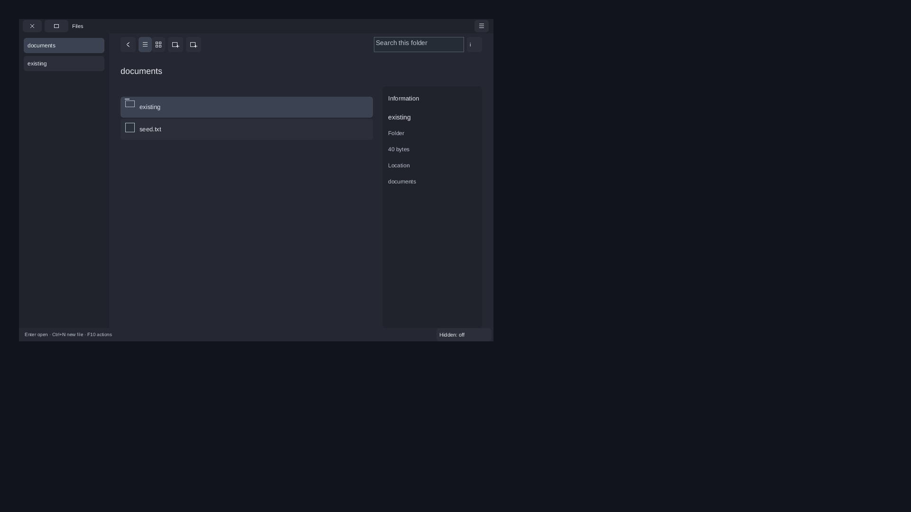
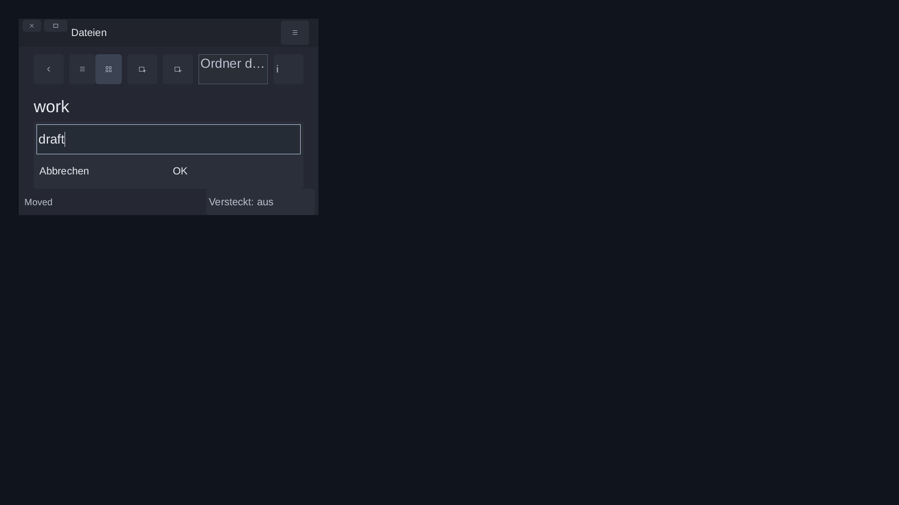
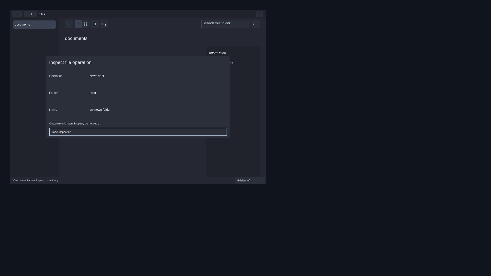

# Original Files: native document, assistive and uncertain-operation workflows

Consumer source: `d5018d36261da45289a46db51e8fa6dbe0e99a5e`. Original Aetheri snapshot:
`7483286bcaafbeaced5831f72cb4d0e0cad9a158`. Installed candidate SDK:
`c4f467d85b0147944d2456f5e7602a39ac18e579`, NexaUI 0.1.23.
Catalogue SHA-256: `9c932872caeba8007bf05b86f7c167b493260709b23c54d709222a5f19539e65`.
Date: 2026-11-08; the private guest clock is unchanged.

## What changed

[Example35](../../examples/35_aetheri_files_consumer/README.md) now optionally
builds the unchanged original SDL Terminal and modal editor as real document
children, plus affected original Files/editor/terminal regressions. The ordinary
Files host still uses the public Wayland/software SDK without SDL/X11/EGL/Vulkan
linkage. Original child ownership, filesystem operation admission and unknown
outcomes remain app-owned. No application implementation is added to the SDK repository or patched,
no SDK API/ABI/version changes and no active Aetheri checkout is built or written.

`run_native.py` accepts an explicit candidate SDK declaration, exact library
hash/path and peer D-Bus headers. The original normal native driver is executed
with exactly two substitutions: the reviewed SDK provenance selection block and
peer header prefix. Every behavior, assertion and deadline remains byte-for-byte
unchanged after reversing those substitutions. The fault driver is entirely
unchanged. All original inputs, including both drivers and the independent C
AT-SPI peer, match their immutable Git/archive bytes. This does not silently
repin Aetheri's own reviewed `97a42647480bb05167cee5e4ae08cedd9147d80d` SDK.
The explicit declaration alone is not a full build attestation; source, binaries
and paired SDK artifacts are bound separately.

## Executed checks

| Profile | Original CTests | Native workflow |
| --- | --- | --- |
| Shared Release | 21/21 | Normal document workflow, independent AT-SPI workflow, lost-result create/rename/move |
| Static Release | 21/21 | Lost-result create/rename/move |
| ASan/UBSan/LeakSanitizer | 21/21 | Lost-result create/rename/move |

The 63 CTests include Files session/view at 1×/2×, model/layout/launch/create/
rename/move, graphemes, editor document/modal/history/search/selection/file/view
and terminal model/selection/paste/composition. There are 768 original view layout
checks. All 44 translation-unit entries per profile have exact original paths,
C17 and warnings as errors. Ordinary/fault host symbol separation passes on all
profiles. Three actual pre-launch checks reject a wrong SDK revision, modified
library declaration and altered original Terminal source, with specific errors
and no output/app launch. Sanitizers, original view/operation deadlines and
assertions are not relaxed or suppressed.

The five final native runs retain 144 verified captures over three virtual outputs:
60 ordinary, 66 assistive and 6 for each fault profile. The ordinary and assistive
runs create real folders/files, navigate held directories, edit middle/long names,
rename and move without replacing targets. They open the actual original Terminal
and editor, verify both process executable hashes and direct parents with pidfds,
accept actual input, save exact `hello` bytes and wait for document end. They also
exercise all eight resize edges, caption move/zoom/cancellation, pointer loss,
German 200% text at 640×420, modal cancellation, idle redraw/CPU guards and clean
close. Those short idle guards are not an efficiency benchmark or energy result.

The separate native libatspi client exercises actual selection, inline name
editing, scalar/grapheme caret and selection guards, retained oversized rejection,
query filtering, localized information close and application close. A second
normal host with `NO_AT_BRIDGE=1` is specifically rejected as unregistered. These
are real independent OS API tasks on a private registry, not human screenreader
acceptance. The private AT-SPI runtime fixture is an exact copied 1075-file/
35-link snapshot; its original prefix is preserved. Header/runtime identities
and actual compiled peer hashes are retained.

The nine lost-result cases perform real mkdir/rename/move and hold the original
worker after the effect. Each verifies one syscall attempt and a retained effect;
rename/move also check the original inode and bytes. Create/rename verify unknown
inspection without a new confirmation/editable name and blocked replay.
Move close waits for the original worker and preserves the effect. These cases
use a separately linked test-only host; the ordinary host has no fault hooks.
No durable restart recovery, file grant, hostile-writer exclusion or removal
authority follows from this ordinary-user experiment.

## Visual scope and a real remaining gap

Six [lossless images](files-native-images.json) were visually inspected after
full RGB comparison with their original captured PPM bytes. The initial list,
move review, minimum German naming and unknown create/rename inspections have
visible content, focus and controls within their app bounds. The minimum German
query hint is ellipsized; a previous operation's English `Moved` status remains
visible in that localized view. This is no complete localization acceptance.

The [AT-SPI text frame](images/files-native-atspi-text.png) shows a replacement
box for the U+1F642 emoji in the original `a + combining acute + emoji + x` test.
An actual call to the installed SDK font API confirms this borrowed single font
maps U+0061/U+0301 and returns glyph 0 for U+1F642. Text/caret/selection correctness
does not prove visible glyph coverage. Font selection/fallback for this original
host remains an explicit integration gap; this frame is not declared a complete
visual pass. The borrowed fonts are not redistributed.

## Preserved setup failures and resource recovery

The first normal attempt used an overlong Unix socket path and stopped before
app launch. A direct AF_UNIX bind control confirms that original path is too long.
The setup helper uses a short owned runtime root and relocates it only after the
original driver has reaped its children. The first assistive preflight found no
`inputs.json` in the older runtime prefix; an exact private fixture copy supplies
the original driver's expected hash manifest, without changing that prefix.

The expanded regression export initially omitted `grapheme_vectors.h`, stopping
compilation before CTest. The complete 87-input export includes that unchanged
original dependency; no product code is fixed or assertion removed. Initial
native five-run evidence and incomplete build2 remain separate from final build3.

The first final native restart stopped before app launch while an owned 64MiB
write probe hit EDQUOT 122 after 53,587,968 bytes. The earlier full Recovery-view
host archive was reverified, then every current file/link in its owned ASan build
copy matched its archive hash/size/mode/target before 252,857,628 bytes were retired.
The authoritative host archive, current Files inputs, all SDK prefixes and live
Aetheri remain untouched. Unchanged final binaries/flags/drivers then pass all
five native cases. No quota, clock, sanitizer or timeout adjustment is made.

The initial metadata collector expected 147 captures; inspecting the original
driver confirms two additional assistive captures, giving 60+66+3×6=144. Only
that collection count is corrected; all actual test outputs/images are preserved.
All failed setup/build/collection logs remain in the final artifact.

## Exact source and archive

The [seven-file consumer binding](files-native-source-binding.json) ties final
tested input3 to exact Git bytes, with CRLF-to-LF normalization only and no
post-test code difference. All 87 original inputs match Git blobs, raw archive
bytes and extracted modes, and are rechecked after all tests. Extracted file
mtimes are normalized to 0; the raw source tar retains original metadata.
The original snapshot archive SHA-256 is
`3a44a500f99e45fd27e6ce19e2570f121a3df2ffefe529902ec56de157b43186`.
At publication, Aetheri has independently advanced to
`c4199abacdd1048574d2d3f92c053eefa5b87a09`; read-only Git comparison finds
no differences in these 87 inputs. The executed binding remains the exported
`7483286` snapshot, not a build of the active checkout.

[Local receipt](files-native-local.json) retains commands/exits, all CTest logs,
compile commands, 24 executable identities per profile, driver adaptations,
native results/actors, controls, runtime/font/source identities and storage proof.
The normal native runs verify the actual mapped shared SDK library; static and
sanitized fault hosts use their separately checked installed SDK builds.
The historical private compositor carrier is bound to SHA-256
`631ec1740d9de6daac790d2c29351df7ccb2cabce936ac6ab35ba59b8cb71c75`;
this is not a build or acceptance of the current Aetheri compositor.

Host archive: `D:/NexaUI/out/nexaui-files-native-20261108.tar.gz`, 30,374,759 bytes,
SHA-256 `eb3f9da26d16ca4c1dca23404b141f98340c2ce731afb33b151c8771e80e59ec`. [Receipt](files-native-archive.json):
2794 files, 50 links, 2497 directories.
Every file hash/size/mode, link target and directory entry is verified. The
artifact includes raw source exports, all three input/build stages, success and
failure logs, native captures/results, runtime fixture, source bindings, six PNGs
and helpers. The [paired Root11 SDK artifact](recovery-root-v11-archive.json)
supplies the unchanged SDK prefixes. Previous main 222c930 has
[seven CI successes/two optional skips](files-consumer-ci.json); that metadata
does not execute this new optional external native consumer.

## Open continuation

Host-owned IME target/revision integration, foreign clipboard and full font
fallback/localization remain open in this original Files consumer. Its current
view rejects tagged IME edits. The document child in this run is the original
SDL Terminal/modal editor; the separately evolving NexaUI Terminal presenter,
graphical text editor/panes and default desktop are not requalified here.
Normal app/SDK adoption, authorization, persistent sessions, durable recovery,
physical/human/performance gates and remaining packet 6/packets 7–8 work stay open.
The catalogue's 103 IDs and documented order are preserved; no overall completion
is claimed. Aetheri continues independently with its own reviewed pin.
