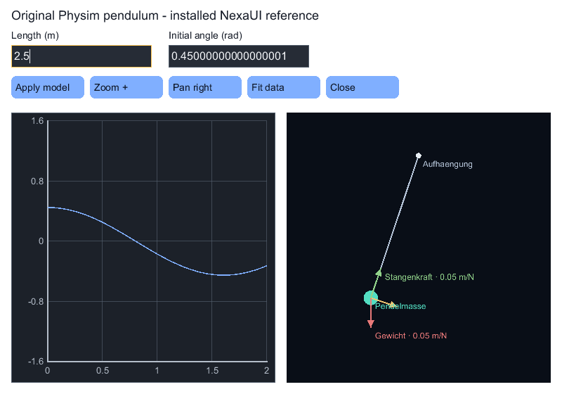

# Original Physim model, numeric controls, plot and CPU viewport

Consumer **`7329212198127adc5350330be12b8e9843c66424`** exercises original
Physim **`01ccc27a94ca611c9e9cdd8ccde0da426aee2378`** through installed
NexaUI **0.1.33/source `368cd38292498bd538964ba514ff02e0e9924358`**.
This is the initial Physim consumer seam in packet7, principally R11.
It changes no installed SDK source/API/dependency, Physim/NexaCloud application
file, application pin or1.0 release. It does not substitute a second physics
model or claim adoption of Physim's complete approved application design.
[Build/export and ownership contract](../../examples/39_physim_consumer/README.md)

## Original application inputs and existing public APIs

The committed source manifest selects27 original files: the documented
pendulum experiment, unchanged core/numerics/units/math/scene support, original
app-owned plot view and original plot test, headers and MIT license. The public
`prepare.py` reads pinned Git objects into a separate new export and verifies
each SHA-256; CMake verifies every file again. No original implementation is
patched or replaced. The final source audit compares every export with the
original Git bytes and observes no working diff in the selected inputs.
Physim's unrelated ongoing native UI changes are preserved.

The test runs as uid65534 on the shared WSL mount. Its prepare subprocess uses
`safe.directory=/mnt/d/Physim` only through its child Git environment; no global
Git configuration, source checkout or index is changed. Existing output and an
output nested inside the original checkout are refused before writing.
An altered exported original plot source is rejected at configure time.

The bounded host calls the actual `ps_get_experiment` ABI, supplies original
parameter overrides, creates/finalizes the original model and invokes240 RK4
steps at1/120s. As required by that ABI, the host advances time after each
successful model step. It snapshots all nine original SI-valued channels at241
times, original length/angle bounds and display units, and the original scene's
positions/colors/labels/parent identities. The model's user state is destroyed
on success and on failed create. Rejected input preserves the entire previous
output. There is no synthetic trajectory or simulation operation on a widget.

The owner supplies that immutable snapshot to `nx_numeric_field`,
`nx_series_view`/`nx_plot` and `nx_viewport`. Apply validates both drafts against
original model limits, computes a replacement separately and publishes one new
generation only on success. Invalid drafts do not mutate physics. Zoom/Pan/Fit
call the original `ps_plot_view` functions. View recreation retains the published
model and original app plot state; widget drafts remain view-local.

An app-owned orthographic CPU renderer projects the original scene into a
bounded16MiB RGBA buffer, with explicit unsupported-shape errors. Geometry,
arrows, spheres, labels and group metadata remain original. Source label/line
sizes follow viewport backing. The initial view is a bounded reference layout,
not the original production3D camera/picking/renderer or accessible object tree.
The caller retains model/plot/fonts, completes rendering before releasing the
viewport lease, and must discard an unsuccessful host frame/context before
retrying. A live lease blocks Apply, another frame and destruction. A failed
private scene canvas is retired before retry. The reference workload is
synchronous; the production runner's worker/sampling/storage ownership remains
an integration gate, not a new GUI-thread execution recommendation.

## Executed final evidence

Alpine-Dev/WSL2, Clang22.1.3, C17/extensions OFF:

| Profile | Executed CTests | Context frame-allocation failures rejected |
| --- | ---: | ---: |
| Static Release | 4 | 12 |
| Shared Release | 4 | 12 |
| Debug `-O1`, ASan/UBSan/LSan | 4 | 12 |

All **twelve CTests pass**, with no skips, sanitizer suppressions or relaxed
timeouts. The exact original plot test passes in each profile. Original sources
use Wall/Wextra/Wpedantic/Werror; the new adapter/tests additionally use
conversion/shadow warnings as errors. Function/data sections and linker garbage
collection omit unused original persistence APIs; no file/run storage function
is called. Original source remains external to the SDK and includes its license.

The consumer discovers/links no X11, SDL, Nuklear or other UI stack. The unused
`CMAKE_DISABLE_FIND_PACKAGE_X11` configure warning confirms that this path never
discovers X11. Shared execution resolves the recorded installed NexaUI library;
all three library hashes match the prior source-bound SDK receipt. Root SDK
CMake does not build example39, so historical SDK CI is not claimed as coverage
of these new files. This checkpoint has **zero native application test tasks**.

The model case independently creates/runs the original experiment and compares
every sample time and all nine channel values, original geometry/parent IDs,
units and bounds. It checks invalid length/angle/nonfinite/generation rejection
and a changed parameter trajectory without overwriting the previous result on
error. The view case drives normalized keyboard Zoom and invalid/valid numeric
entry, requires explicit Apply, checks original zoom/pan-state equivalence,
original scene-colored disk coverage, full-frame equality after view recreation,
model preservation and2x backing. Failure tests exercise actual in-flight lease
refusals, invalid geometry/scale and twelve allocation failures through the
caller context, then render successfully with a fresh context.

Each profile writes an800x560 PPM after applying length2.5m and rebuilding2x
scene backing. All three complete RGB payloads are byte-identical. The PNG is a
lossless conversion of the actual headless Release render, with CRC and full
decoded-RGB comparison against its PPM. Visual inspection confirms controls,
plot and original scene; it is not a native screenshot or product-design pass.
The Numeric field retains its current full-precision default angle draft, and
scene labels/arrows can overlap in this simple projection. Production numeric
presentation, label placement and the approved Physim design remain open.

Four compiled adapter counterexamples fail the unchanged consumer tests:

- Rotating the stored channel index fails the independent original-run comparison.
- Omitting model Apply fails the expected generation/value transition.
- Omitting original Zoom fails the original plot-state comparison.
- Omitting the sphere draw fails actual disk-color coverage.

All mutants configure/build with the same strict flags and fail actual
assertions. Altered original source also fails CMake's source hash check; export
reuse/nesting are refused. None is an accepted timeout or skipped check.

The first293 pilot passed original plot/model/allocation tests but failed an
incorrect center-pixel oracle: original force arrows are painted after the
sphere and cover its center. The corrected test checks substantial sphere-color
coverage within the original disk. The sphere-omission counterexample proves
that this revised image check still rejects missing content. Original drawing
order/geometry was retained. Pilot294/295 and exact-source296 pass; all pilot
source/logs and the original failure are retained.

[Source/object/command/image/negative receipt](physim-model-local.json),
[independent archive/PNG readback](physim-model-final.json).
Archive `nexaui-physim-model298.tar.gz`: **272 regular members,9,073,901bytes**,
SHA-256 `8a96200de2c0843f75c4f085f1519b84f12793c6ebe4ddf0d758e30f1264cf3f`.
Every member was read back and hashed twice. Font and toolchain are fingerprinted
separately; no borrowed font is redistributed. No own test executable remained
live at independent readback.

## Remaining scope

R11 remains partial: ordinary native window/input/IME/AX integration, real
simulation runner/workers, asynchronous production snapshots, camera/picking,
full scene/object semantics, additional datasets/plot varieties, complete
approved Physim application UI and actual adoption still need evidence.
Windows/macOS, GPU/physical output, screenreader/human review and agreed
performance budgets are not proven by these headless Linux checks.
NexaCloud's original application locally has no root Git revision and retains
ongoing uncommitted development; no pin/source/application change is made there.
Existing NexaCloud reference-scene evidence remains attributed to its original
revisions. All103 requirements and remaining ordered packets persist.
