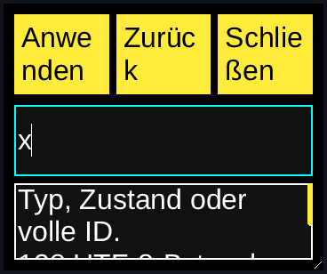

# Native Recovery resize and compact restoration — 2026-11-07

Consumer/OS peer/driver source: `38210e00ea34fe9611ac01145f05a4828d852bf7`.
Installed SDK: `c4f467d85b0147944d2456f5e7602a39ac18e579`, 0.1.23.
Original Aetheri: `46e2a21ef979d9a76db2a8487d1de167a6a79ef7`.
Scoped requirements: W03/D11/L04/I01/T11/A02/A06/P05/Q02/Q04.

[Example 33](../../examples/33_aetheri_recovery/README.md) preserves content
key focus when its pointer-only native resize grip is pressed. The grip remains
outside Tab traversal. No SDK implementation, ABI, version, original backend,
live Aetheri source or consumer pin changes. The original catalogue stays on its
worker; resize and filtering send no original-owner request.

## Reproduced defect and repair

The first native workflow used the exact previously validated Release host.
Dragging from 360×300 into 64×64 correctly focused compact Close. Pressing the
grip again cleared focus to zero; resizing to 240×96 remained compact, so no
compact-mode transition restored it. The test failed at its second compact-focus
boundary. The old binary, source, logs, partial captures and result remain saved.

The view now remembers focus before frame input is processed and restores it
after an admitted grip interaction, using its existing restore path and public
focus API. A pending size-transition restore still takes precedence. This fixes
the consumer composition without changing the core policy for other nonfocusable
pointer regions. The independent OS peer verifies actual focus after each gesture.

## Executed checks

Fedora 44, Linux 6.19.10, GCC 16.2.1, CMake 4.3.0, Python 3.14.3,
SQLite 3.51.2. The existing frozen original Aetheri compositor, Liberation Sans
font and private OS AT-SPI dependencies are reused. Consumer targets retain
strict C17 warnings including `-Wconversion -Wshadow -Werror`. The independent
libatspi peer uses real OS headers and runtime libraries, strict C17 and
`-Wall -Wextra -Wpedantic -Werror -O2`; it includes no NexaUI headers or linkage.
Optional system pkg-config discovery is separate from this direct-build evidence.

| Installed SDK profile | Rebuilt consumer CTests | Native resize workflows |
| --- | ---: | ---: |
| Static Release | 3/3 | Root + User |
| Shared Release | 3/3 | Root + User |
| Static Debug ASan/UBSan/LSan | 3/3 | Root + User |

All six native workflows pass thirty checkpoints each. Root uses German,
32-pixel text, 360×300, high contrast and controlled native IME; User uses English,
16-pixel text, 800×600 and light theme without the controlled IME extension.
The preceding keyboard/filter checks remain included. Three real pointer-grip
gestures call the public resize API and reach 64×64, 240×96 and the initial size.
The driver observes compositor admission/release and requires a submitted frame
after the release configure. Its (40,40) window origin and activated/resizing
state-array observations belong to this single-window pinned fixture.

The independent OS peer checks compact Close focus and window-relative bounds,
absence of the filter field, and restored draft `x` and field focus after
enlargement. The retained old field refuses edits both while absent and after a
new field with the same ID appears. Escape retires the restored field, returns
to Filter focus and preserves the selected full record identity. The peer then
explicitly focuses Close before ACK29 and native Enter; the post-ACK29 sample
therefore correctly records Close. Exactly three original reads complete.
Original database bytes/rows remain identical and host/peer exit normally.

Four current-host/driver regressions pass: ordinary German32/narrow/contrast/IME,
shared User navigation, native held-query close and ASan/User held-query wake.
Two private view mutations compile and fail the intended native boundaries:
removing focus preservation loses second-compact Close focus; suppressing the
grip intent prevents the native resize request. All failures remain retained.
No new SDK test run is claimed; installed SDK libraries are hash-checked against
the preceding verified receipts.

## Native images

Two representative workflows capture four scenes on each of three virtual
outputs: 24 complete PPMs with hashes. Eight output-0 window crops were converted
to PNG and actually inspected. Full filter/restored PPMs are byte-identical for
each output in both cases. Compact mode intentionally displays Close and the
grip; its enlargement explanation is accessible rather than painted. German
narrow button labels wrap, and the full help occupies an explicit scroll area.
Final consumer design/human acceptance remains open.

## Source, artifacts and CI boundary

[Local receipt](recovery-resize-local.json), [archive receipt](recovery-resize-archive.json).
All 24 final source inputs match the exact commit after only CRLF-to-LF
normalization. Only README changed after execution; tested runtime sources match.
The peer binary's initial-source input is also identical to the final source.
The initial collector incorrectly expected Filter in the post-ACK29 sample;
its correction follows the peer's explicit subsequent Close focus. That failed
collector and all unchanged successful native runs remain in the artifact.

`D:/NexaUI/out/nexaui-recovery-resize-20261107.tar.gz` contains 23,004,742 bytes;
SHA-256 `00b04779fc3fa5178f5f7c0c14bc58d9cce27b8d64fef8429be920b139a0257d`.
Independent local verification checks all 1,316 file hashes/sizes/modes, two link
targets and 471 directory modes. Sources, complete consumer builds, original
fixtures, installed SDK prefixes, native logs/captures, failed attempts and
command journal are included. The collector's own log/terminal journal record
are outside the frozen boundary. Previous artifacts remain unchanged.

Prior published `7e49bc8` has all seven required CI jobs successful, with two
optional skips; [exact-run API receipt](recovery-navigation-ci.json). The optional
Recovery consumer workflows above are local evidence, separate from root CI.
No later source's CI result is inferred from that prior run.

## Remaining scope

This proves selected ordinary-window resize/compact restoration at scale 1 in
the private virtual compositor. It does not prove output migration, fractional
or mixed scaling, physical driver/input/display or human screenreader behavior.
Clipboard, active-composition resizing and broader content/platform acceptance
remain open. Production original-owner/service transport, reconnect/unknown
outcomes, actual recovery authorization/readiness and remaining device/software/
component/installer/trusted packet 6 compositions remain open, followed by
packets 7–8 and the rest of the 103-requirement catalogue.
