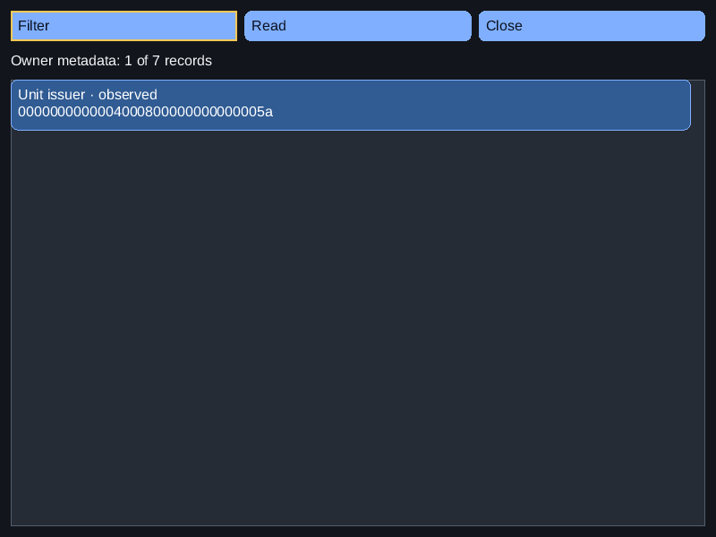
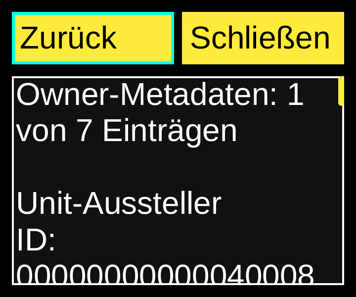

# Reviewed Root11 recovery source profile — 2026-11-08

Consumer source: `e3031e0f382c67e41929d7c08e710ea7be7e4a7f`.
Explicit current Aetheri snapshot: `fa5347264054b05e8af57e6d0a210008a6c849d1`.
Default legacy Aetheri snapshot: `46e2a21ef979d9a76db2a8487d1de167a6a79ef7`.
Installed SDK: `c4f467d85b0147944d2456f5e7602a39ac18e579`, NexaUI0.1.23.
Catalogue SHA-256: `9c932872caeba8007bf05b86f7c167b493260709b23c54d709222a5f19539e65`.
Scoped B01/B04/D07/L05/L11/P04/P05/P07/Q02/Q04/Q08, within packet6.

The independently evolving original backend now supports Root schema11 and
Unit issuer recovery kind17. The previous consumer correctly refused an
unreviewed schema, but could not display this original metadata. The existing
[Recovery example](../../examples/33_aetheri_recovery/README.md#reviewed-original-source-profiles)
now has an explicit, separately hash-pinned `root-v11` source profile. Its
model, view and serialized owner worker remain shared with `legacy-v10`.
The installed SDK API/ABI/version and Aetheri consumer pin are unchanged.

## Source and model contract

`AETHERI_SOURCE_PROFILE` defaults to `legacy-v10` with the unchanged67-input
legacy pin. `-DAETHERI_SOURCE_PROFILE=root-v11` selects76 reviewed original
inputs from the exact `fa534726` Git snapshot. A different snapshot/profile,
changed source bytes or unknown profile is rejected before original-source
configuration. The [31-file source binding](recovery-root-v11-source-binding.json)
matches the tested NexaUI inputs to exact committed Git blobs; only CRLF→LF
normalization is permitted, and there are no post-test code differences.

The private model asserts the reviewed schema/kind counts at compile time.
The current profile admits Root11 and labels Unit issuer distinctly in English
and German. A row key remains full kind plus opaque ID, so allocation/custody/
issuer rows with the same ID do not alias. Future Root12, User11, wrong counts
and issuer-in-Root10 inputs are rejected; caller ownership and the last good
observation survive rejected completions. Some negative cases also encounter
existing same-snapshot revision guards; no isolated mutation coverage of every
individual validation branch is claimed.

The issuer row is stored recovery metadata. Its reason and related operation
are displayed without interpreting them as current actor/image/ProcessFD
admission, permission, independent issuer retirement or holder drain. Selective
recovery inventory is not a complete operations log; an absent row proves no
completion. No current service or privileged operation is invoked.

## Executed component and compatibility checks

| Original source profile | Static Release | Shared Release | ASan/UBSan/LSan |
| --- | ---: | ---: | ---: |
| Explicit Root11 | 4/4 | 4/4 | 4/4 |
| Default legacy | 3/3 | 3/3 | 3/3 |

These are21 CTests across six fresh build variants. Each retains16 model cases:
14 read-only schema fixtures and two explicitly changing original runtime
fixtures. The two worker and two view scenarios per variant also pass. Shared
linkage to the installed shared SDK is checked with `ldd`; all example C targets
compile as strict C17 with conversion/shadow warnings treated as errors.

The new `recovery_root_v11` group adds three original metadata-only modes:
`exec-issuer-fresh`, `exec-issuer-lost` and `exec-issuer-replacement`, giving nine
Root11 scenarios across the three current builds. The unchanged original
`tests/test_launch.c` fixture is compiled without native service/root-unit
effect macros. Complete catalogue byte hashes and all database rows are compared
before and after the read/model/view/worker phases and remain unchanged.

Each scenario exercises three existing styles: dark800×600/16px/1×,
German high-contrast360×300/32px/2×, and light480×400/16px/1.25×. Thus27 view
exercises check filtering by the issuer label, full kind/ID, related operation,
schema/runtime/reason, read-only details, end-of-text paging, compact restoration
and Escape focus return. The existing worker checks no scan at handshake,
serialized query, detached ownership, retained snapshot after owner close,
separate EIO and balanced descriptors. These checks are component/input-model
evidence, not native keyboard or assistive-client acceptance for Root11.

Two actually compiled defects fail the intended assertions: restoring the
schema cap to10 and mislabelling Unit issuer as Unit custody. Four source
controls reject current-as-legacy, legacy-as-current, unknown profile and one
changed original header. Full commands, outputs, hashes and results are in the
[local receipt](recovery-root-v11-local.json) and raw archive.

## Retained failures and environment handling

The first configure succeeded, but Ninja refused a repeatedly dirty build file:
the frozen Git archive carried November8 mtimes while the carrier clock was
November7 UTC. This failed build and its commands/logs remain archived.
Only the private frozen source copy had its mtimes normalized to epoch0.
All653 entries were checked for unchanged contents, sizes, modes and links;
the original Git archive retains its original timestamps. No VM clock, mount,
quota or system limit was changed. The31 normalized NexaUI input files are
identical between the initial and final exports; their gzip container hashes
differ. The final six builds passed without relaxing assertions or timeouts.

Before making room, three older receipt-view build directories were compared
entry by entry against the already host-verified immutable archive, including
file bytes, modes and links. Only those exact archived duplicates were retired.
The retained authoritative host archive and the storage proof are unchanged.

## Images, artifacts and CI scope

Six [image records](recovery-root-v11-images.json) bind inspected lossless PNGs
to full RGB component captures. They cover the normal list and detail, German
large-text top/bottom and light fractional-density replacement details. The
issuer name, reason, IDs and final fields are readable using ordinary scrolling;
these are headless component renders, not physical/native acceptance.

Authoritative local artifact: `D:/NexaUI/out/nexaui-recovery-root-v11-20261108.tar.gz`,
40,176,766 bytes, SHA-256 `3abbf006b52920dce903f8ea11c1c895cc22b81fa549f90c27f74aa1e2e4da28`.
The [archive receipt](recovery-root-v11-archive.json) lists 2217 files,
2 symlinks and 674 directories. Every regular
file's bytes/size/mode and every link/directory is verified against its manifest
after download. It includes original frozen source, six build/test outputs,
compiled controls, failed first build, source/timestamp/storage bindings and
reproduction helpers. Borrowed font bytes are not redistributed.

The preceding main `785fbd237f29ca3306dce779c361e1e8c019e81e` has seven required
successful CI jobs and two optional skipped jobs in
[run42434189040](https://github.com/Lulus792/NexaUI/actions/runs/42434189040).
The [compact job-metadata receipt](software-receipt-view-ci.json) covers that
previous revision only; no raw CI log or new Root11-source CI result is inferred.

## Open acceptance and next work

Root11 native Wayland/IME/independent AT-SPI checks remain to be executed on this
profile. Earlier [legacy native evidence](recovery-native-report.md) remains
attributed to its original revision. Actual current issuer/ProcessFD/service
admission and trusted effects need their original host authority; metadata
fixtures do not substitute for them. Device/software/trusted compositions in
packet6, packets7–8, full application adoption and measured performance remain
open across the103-ID catalogue. Paused physical/human and Mac checks were not
resumed. This is no1.0 release or complete catalogue acceptance.

The independent live Aetheri repository was read-only observed at `fa5347264054b05e8af57e6d0a210008a6c849d1`
during evidence publication. It may continue advancing; this consumer chooses
an explicit frozen profile rather than a floating live checkout. No Aetheri
source, build, running application or pin was edited, reset or published.
