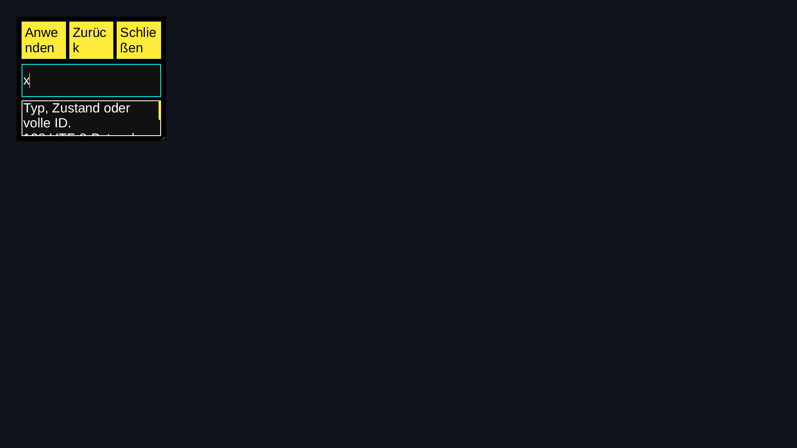

# Root11 native clipboard and resize — 2026-11-08

Driver source: `cc8b5e73621b9636e76bb2ed69399702dba94b7c`.
Unchanged provider/model/view/worker: `e3031e0f382c67e41929d7c08e710ea7be7e4a7f`.
Unchanged independent OS peer: `5a5a1b4eff1ddcb581ca2d178c1469bff3005f17`.
Explicit original Root11: `fa5347264054b05e8af57e6d0a210008a6c849d1`.
Legacy original: `46e2a21ef979d9a76db2a8487d1de167a6a79ef7`.
Installed SDK: `c4f467d85b0147944d2456f5e7602a39ac18e579`, NexaUI0.1.23.
Catalogue SHA-256: `9c932872caeba8007bf05b86f7c167b493260709b23c54d709222a5f19539e65`.
Scoped W03/D07/D11/L04/L05/L11/I01/I05/T11/A02/A06/P05/P07/Q02/Q04/Q08.

The existing [Recovery consumer](../../examples/33_aetheri_recovery/README.md#native-root11-issuer-inspection)
now admits its explicit original Root11 fixture to the already implemented
clipboard workflow. Native pointer resize already composed with this profile.
This step changes one driver guard and verifies those existing paths. Toolkit
API/ABI/version, provider code, worker ownership and Aetheri consumer pin are
unchanged. [Ordinary native](recovery-root-v11-native-report.md) and
[held-query](recovery-root-v11-held-report.md) results retain their original sources.

## Executed native matrix

| Workflow | Root11 static/shared/sanitizer | Legacy User static/sanitizer |
| --- | ---: | ---: |
| Unicode clipboard, ownership and late-focus reply | 9/9 | 2/2 |
| Close while foreign clipboard source is stopped | 9/9 | 2/2 |
| Native pointer resize, compact and restore | 9/9 | 2/2 |

All33 cases pass on the selected unprivileged Fedora/Linux x86-64 carrier.
Root11 covers fresh/lost/replacement original metadata fixtures on each of
static Release, shared Release and ASan/UBSan/LSan. Six legacy User regressions
cover Release and sanitizers. Every case retains the original native IME
preedit/commit sequence. There are671 checkpoints:16 per normal clipboard,
15 per pending-close and30 per resize. These are fixture checks, not completed
catalogue IDs, daily-use adoption or performance measurements.

Each current case also retains the independent full-ID/schema/runtime/related
operation/reason/read-only issuer Text checks. Root and paired fixture User
database bytes/rows remain unchanged. Local filtering, resize and clipboard
dispatch no extra original-owner work: normal/close read twice and resize three
times. Every ordinary host and OS peer exits0; no cleanup child needs forced kill.
Process maps exclude SDL/X11/EGL/Vulkan from software Wayland presentation.

## Clipboard ownership, late replies and close

Private unchanged wl-clipboard2.2.1 tools run only against the test compositor.
All five executable/runtime files are checked against the previous exact tool
receipt; no installation or account clipboard is used. An independent source
publishes `Grüße 🌍 é`; native paste must deliver the exact Unicode text. Copy
must actually cancel the previous foreign owner before a separate wl-paste
client reads the bytes; matching text alone does not prove ownership.

The driver stops its own foreign source during pending transfer. In normal
cases Tab leaves the field before the source resumes. The parent's bounded
syscall/socket witness confirms the sender callback returned, then a native
frame precedes the OS peer's check that the old draft was not modified. In close
cases the host must unmap and exit before that source resumes; retained field
and action references refuse late mutation. Finally cleanup resumes its own
stopped child. These are native private-owner workflows, not arbitrary-session
clipboard or every compositor's acceptance.

## Native resize, captures and focus

Pointer presses on the existing grip must request native resize. The original
test compositor admits/releases gestures to64×64,240×96 and the starting size.
The peer checks compact Close focus/bounds, absence of the field, retained draft,
field focus after restoration and refusal of retained old field edits. The grip
does not add a Tab stop. Enter/Escape/Back and the ordinary full-ID selection
checks remain. Geometry and configure observations belong to this pinned test
compositor, not a general physical/window-manager guarantee.

The Release fresh case saves12 full PPM captures: filter/tiny/compact/restored
on each of three virtual outputs. Four output0 captures were converted losslessly
and visually inspected; [image records](recovery-root-v11-window-images.json)
bind their exact source paths/hashes and full RGB pixels. The other eight raw
captures remain archived without claiming a separate visual review. The draft
and cyan focus return after restore. At German32px/360×300, button labels wrap
within their buttons and help text scrolls. This is no final visual design,
physical mixed-DPI/output migration or human screenreader signoff.

## Source, negative controls and artifact

All32 [exported inputs](recovery-root-v11-window-source-binding.json) match exact
Git blobs after CRLF→LF only; no post-test code differences exist. The unchanged
OS-peer source is checked against its prior input export. Eight used native/
fixture binaries match the previous component archive by exact bytes/size.
All33 positive cases passed in their first matrix attempt. No full CTest rebuild
is claimed for the one-line driver admission change; earlier21 component CTests
retain their original attribution. The selected SDK/host/original catalogue is
sanitized with leak detection; system libraries/OS peer are not all instrumented.

Two actual compiled provider defects fail the unchanged native checks: omitting
the field's clipboard adapter fails the independent pasted-Text assertion at
checkpoint11; disabling the resize grip fails the native resize request boundary.
Commands, variant sources, outputs and binary hashes remain in the
[local receipt](recovery-root-v11-window-local.json) and raw artifact. Assertions,
deadlines and detection were not weakened.

Local artifact: `D:/NexaUI/out/nexaui-recovery-root-v11-window-20261108.tar.gz`,
4,958,605 bytes, SHA-256 `305d4c6a89ca910c73fb402bea6a2d3900c6300573e69d7bf1d0e4c667b7edf4`.
The [archive receipt](recovery-root-v11-window-archive.json) covers 950
files, 0 links and 363 directories, fully
verified after download. It retains all33 workflows, all12 original captures,
four lossless PNGs, exact foreign tools, compiled controls and reproduction
helpers. Reproduction also uses the prior component/SDK archive SHA-256
`3abbf006b52920dce903f8ea11c1c895cc22b81fa549f90c27f74aa1e2e4da28` and ordinary
native artifact SHA-256
`b2818c3e2291608b2cf1b53e5bf7deb404bfdeba0c7268cf3e3a4f3a67eeec84`.
They supply the frozen source, SDK prefixes, ordinary binaries and compositor.
Borrowed font bytes are not redistributed. No global clock/mount/quota or driver
settings changed; paused physical/human/Mac checks were not resumed.

## Next scope

The selected Root11 ordinary/held/clipboard/resize recovery inspection now has
its scoped native evidence. Actual current issuer/image/ProcessFD/service
admission, independent retirement and holder drain require original host
authority; stored metadata remains no such authority. Broader packet6 Files,
device/software/component/trusted compositions, packets7–8 and final per-consumer
performance/adoption/physical/human gates remain across103 IDs. No1.0 is released.
The next implementation work must continue those broader compositions; this
profile's test matrix does not replace the remaining application coverage.

Live Aetheri was read-only observed at `64afdcdf2b64b88ffe5f86de11bc19ca049c4996` during publication and may
advance independently. Its source, build, running app and pin were not changed.
