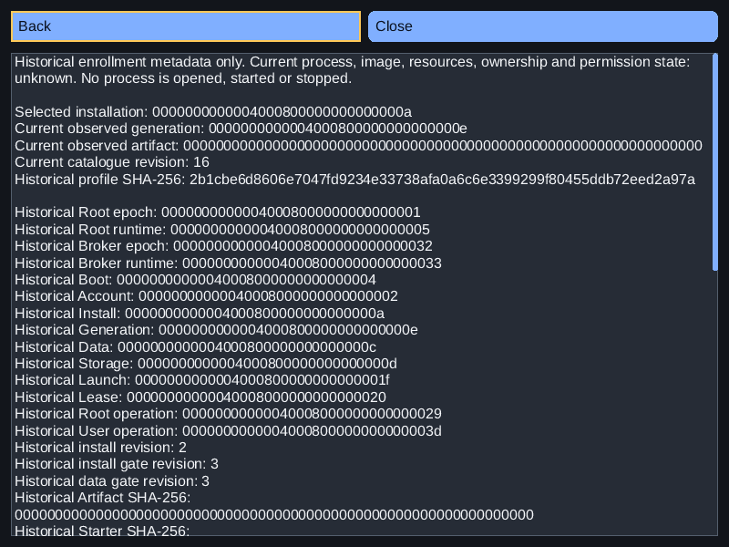
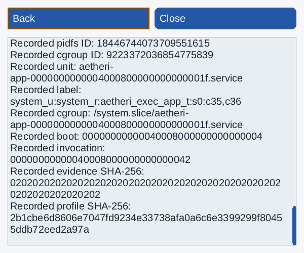
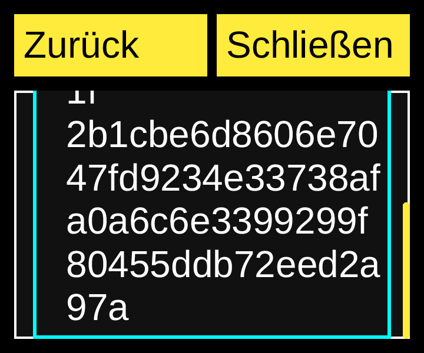

# Native historical process inspection — 2026-11-07

Consumer source: `755a7880d69e206b9eb775d94f761da5ab8b0080`.
Original Aetheri: `46e2a21ef979d9a76db2a8487d1de167a6a79ef7`.
Installed SDK: `c4f467d85b0147944d2456f5e7602a39ac18e579`, NexaUI 0.1.23.
Catalogue SHA-256: `9c932872caeba8007bf05b86f7c167b493260709b23c54d709222a5f19539e65`.
Scoped D07/L04/L05/L06/L11/I01/I05/T11/A02/A06/P04/P05/P07/Q02/Q04/Q08.

The [existing selected-app example](../../examples/34_aetheri_software/README.md)
now composes its original historical reader through the bounded owner worker and
a native read-only History tree/detail page. Existing model, channel, tree, text,
focus, software-window and OS semantics APIs are reused. SDK core/public API/ABI/
version and Aetheri's independent source/pin are unchanged.

## Ownership and observation

The trusted startup owner supplies up to 64 complete canonical profiles using
`--history PROFILE_HEX`, alongside existing manifest configuration. The original
decoder validates the exact 384 bytes before any window opens. This metadata is
not GUI-selected authority. The worker validates and copies profiles before thread
start; only its original serialized Root handle reads historical records after a
successful selected-app observation. No historical getter runs in its handshake.

Each response owns app, manifest and history payloads independently. An unexpected
history error retains the separately valid app observation with unavailable
history; it cannot publish a successful prefix or an empty process inventory.
The GUI checks the existing ticket plus view/request key, retires one publication
before binding both metadata batches, detaches history once, and frees replaced
batches. Unadopted replies dispose every remaining owned payload. The two reserved
channel slots and wake-hint draining remain unchanged. Stop cancels queued work;
dequeued work can finish after GUI/model retirement without accessing either.
Original I/O and join have no new time guarantee. No ThreadSanitizer/general
race-freedom acceptance is claimed.

The tree exposes complete launch IDs/profile digests. Each profile detail retains
all fourteen historical identities, three revisions, four digests and both
original starter/app observations, including timestamps, full unsigned 64-bit
pidfs/cgroup identifiers, unit/label/cgroup and witness identities. Current
selected-app generation/artifact/revision remain separate. Both pages explicitly
say that current process/image/resource/ownership/permission state is unknown.
Missing configuration and absent/unsupported roles remain distinct unavailable
states. No numeric PID is opened and no process, unit or catalogue effect runs.

Enter opens a profile. Escape/Back restores the exact tree item and then History
button. Home/End navigate the bounded tree; Page Up/Down reaches long entries and
detail text. Read-only semantic text has no editable value, caret or selection.
Metadata or observation replacement retires old actions/references and resets
nested inspection. Below-minimum fallback retains logical focus for restoration.

## Executed checks

Static Release, shared Release and GCC ASan/UBSan each pass **7/7 CTests** against
input3. This includes the unchanged eleven original reader cases per profile
(33 total) and four new original worker/view scenarios per profile (12 total):
completed/released history, actual same-boot Root replacement, unsupported Root2
and a deliberately corrupt original witness. Root/User bytes and table rows
remain unchanged after fixture preparation. Existing model/worker/view/declared
manifest regressions pass. Actual shared linkage resolves the selected SDK.

Worker/view checks cover overwritten caller configuration, once-only owned
transfer, separate ENOMEM/EIO propagation, two-slot capacity, queued cancellation
and late in-flight completion after owner retirement, plus full identifiers,
read-only text, exact focus return, compact restoration and queued-action
retirement. A positive scenario additionally exercises 64 canonical profiles and
explicitly synthetic maximum 511-byte labels/1023-byte cgroup strings. These
stress strings are not kernel observations.

Input4 changes only the test, independent peer and README. Every production input
is byte-identical to input3. The final test is separately compiled/linked against
each tested production build and reruns all four scenarios, explicitly reaching
the end of the long tree item. All three profiles pass, with 12 additional
read-only scenarios and 108 final PPMs. The first extra driver incorrectly linked
the old test object; its apparent results are excluded from this added proof.
The corrected driver verifies the new executable marker. Its first ASan compile
then failed with ENOSPC; a verbose compiler/assembler probe and the failed
commands are preserved. After an older archived duplicate was verified and
retired, the same final source compiles, links and passes with ASan/UBSan/LSan.
No timeout, assertion or system limit was relaxed.

The final independent OS peer passes **seven native virtual Wayland cases**:
three build profiles in German/32px/high-contrast/360×300, plus Release owner
replacement, unsupported, corrupt and no-profile cases. It verifies actual
tree/text/button roles, complete identities/digests and recorded values,
rejected edits/retired objects, native Enter/Escape and full tree/detail paging,
focus return, exactly one explicit refresh and keyboard close. Every host/peer
exits zero, no forced kill or sanitizer diagnostic occurs, and both original
databases remain unchanged. The earlier seven native cases are also retained.
Process maps exclude SDL/X11/EGL/Vulkan presentation libraries.

Two additional Release/ASan native regressions retain the existing manifest,
filter and controlled IME workflow: ten checkpoints and 84 content commands each.
They do not establish installed user-IME or human-reader acceptance. Three
privately compiled worker defects (borrowed caller profiles, conflated history
and app errors, repeated history ownership transfer) are rejected by intended
assertions. Their build exits are zero and test exits one; these Release
counterexamples are not passing sanitizer runs.

The [local receipt](software-history-worker-local.json) retains commands,
distributions of test cases, actual binaries/linkage and failure classification.
Twelve PNGs bind losslessly to final Release history PPMs: ordinary dark 800×600
at1×, light 480×400 at1.25× and German high contrast 360×300 at2× with32px text.
Ten distinct images were inspected; two wide tree-end images are byte-identical
to their inspected tree-start counterparts. Narrow tree/detail clipping is the
scroll viewport, with complete end reachability checked. The narrow maximum
detail captures contain explicitly synthetic stress strings. These are headless
reference images, not physical display screenshots or final product-design signoff.

## Source, artifact and CI

All **62 final source inputs** match the exact consumer commit after CRLF→LF
normalization. [Source binding](software-history-worker-source-binding.json)
records the three test/document differences from the full-suite input and final
executed harnesses. Existing immutable original-source pins remain in force.

`D:/NexaUI/out/nexaui-software-history-worker-20261107.tar.gz` is 50,277,204 bytes.
SHA-256: `45d84dd90cff85a1be3ef6629260f1b8ce2306e40e12be9a7dbb1d45892c0c0e`.
The full verifier checks 2,651 regular files, 8
symlink targets and 920 directory modes. Explicit FIFO
fixtures and the borrowed font are excluded. Source exports, all build/test
attempts, original metadata databases, native logs, counterexamples, compiler
probe and helpers are retained. The [archive receipt](software-history-worker-archive.json)
records exclusions. Original SDK/source/compositor/OS-library provenance remains
in the preceding [manifest artifact](software-components-report.md).

Only exact copies of already verified historical-reader builds were retired to
stay within existing private storage limits. The preceding archive remains
unchanged at SHA-256 `2ce0131145645bf22f4fd9a93c9501e5f03ffb126cf4ba4efff300983b628ecb`.
Per-file comparisons and both retirement receipts are retained. No system quota,
mount, driver or service setting changed.

Previous published main `4395c9ed00c4b775aa8bc702fb08ce9eefd52e7c` has all seven
required jobs successful and two optional skips in [run42420190468](https://github.com/Lulus792/NexaUI/actions/runs/42420190468).
This is [GitHub API metadata](software-history-ci.json), not raw-log verification
or CI acceptance for the new source. The optional original-Aetheri campaigns are
local evidence separate from root CI.

## Remaining work

Historical inspection does not supply current authenticated ProcessFD/system-bus/
supervisor/image observations, CPU/RAM metrics, installed dependency/ownership
graphs, full inventory or admission. Compose additional actual historical
lease/custody/reason relationships and owner-supplied current data without
substituting declarations, names, PIDs or SQL rows for those contracts. Native
software-specific held-query/clipboard/resize checks, device/permission/trusted
service composition, the remaining packet6, packets7–8 and physical/human/
performance acceptance remain open across all 103 catalogue IDs. No 1.0 release
or final catalogue completion is declared. Aetheri independently advanced to
`6261ab68b4e243430ead60afecaa0e8b1b96e8bb`; it was not compiled, edited, reset,
published or repinned here.
