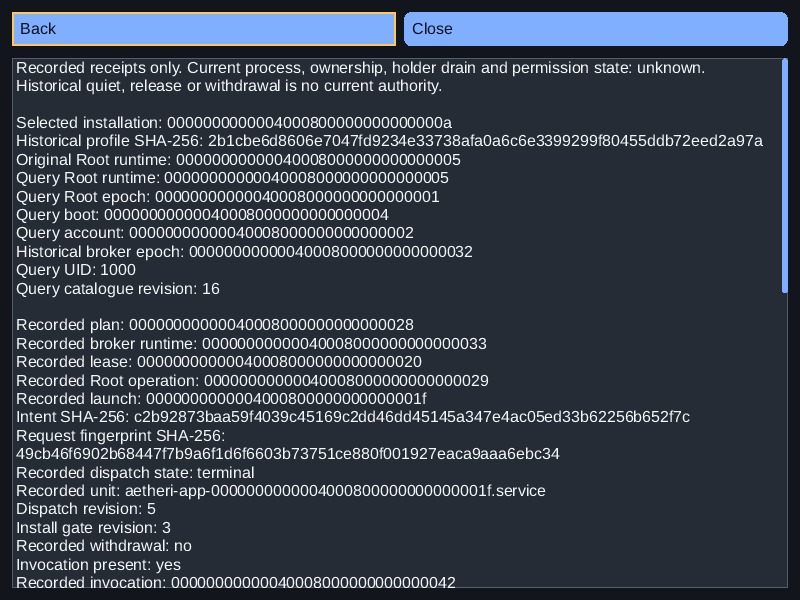
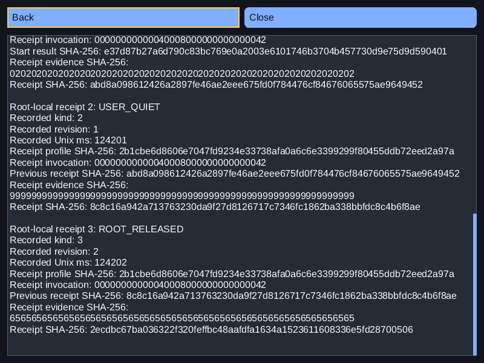
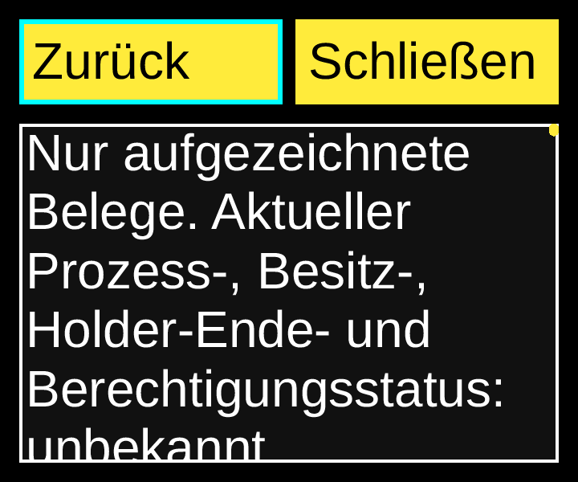
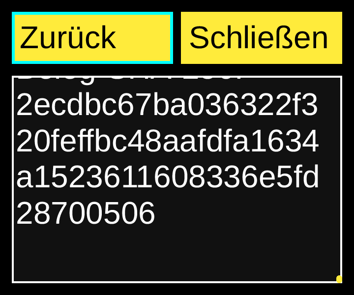
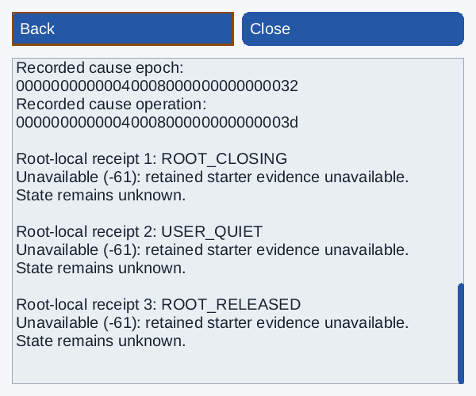
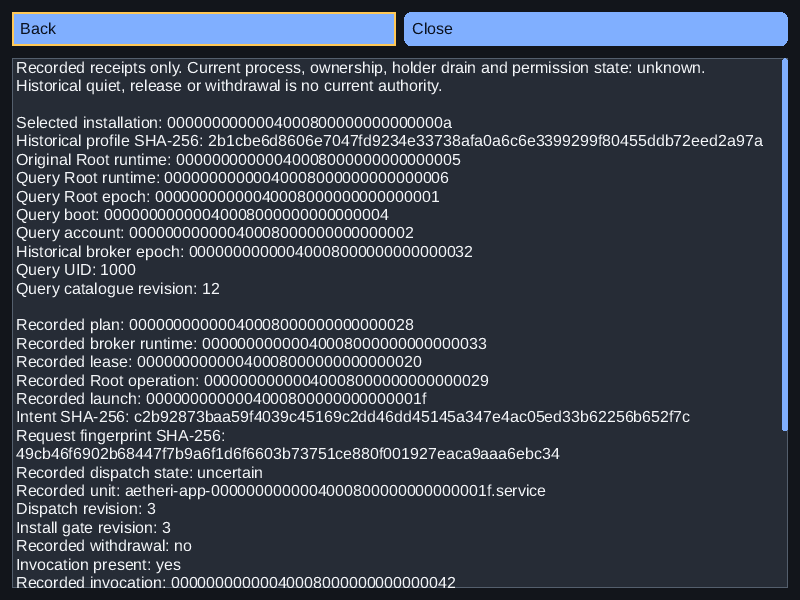

# Native reservation/lifetime receipt inspection — 2026-11-08

Consumer source: `0769fab8b26b6351613d870b638710baebbd6ed5`.
Original Aetheri: `46e2a21ef979d9a76db2a8487d1de167a6a79ef7`.
Installed SDK: `c4f467d85b0147944d2456f5e7602a39ac18e579`, NexaUI 0.1.23.
Catalogue SHA-256: `9c932872caeba8007bf05b86f7c167b493260709b23c54d709222a5f19539e65`.
Scoped D07/L04/L05/L06/L11/I01/I05/T11/A02/A06/P04/P05/P07/Q02/Q04/Q08.

The existing [software example](../../examples/34_aetheri_software/README.md#reservation-and-original-lifetime-receipts)
now opens **Receipts** from its historical profile detail page. It presents the
already checked [original receipt worker data](software-receipts-report.md) using
existing public SDK buttons, focus/actions, read-only Text, wrapping, scrolling,
themes and native Wayland/AT-SPI. No GUI query, new SDK API/ABI/version, mutation,
dependency, current process authority or Aetheri migration is added.

## Display and navigation contract

The complete selected installation/profile digest, original Root runtime and
checked query Root runtime/epoch/boot/account/UID/catalogue revision are shown.
Original broker epoch and stored broker runtime remain distinct. Reservation
metadata includes plan/lease/Root operation/launch, intent and request fingerprint,
dispatch state/unit/revisions, withdrawal flag, optional invocation and optional
cause epoch/operation. Missing optional IDs are omitted with explicit presence
flags; zero-filled unavailable snapshots are never rendered as real data.

All three Root-local receipt slots show their original kind and availability.
Available entries include revision/time, profile/invocation, start-result or
previous-receipt digest, evidence digest and canonical receipt digest. The first
previous digest is correctly labelled **Start result SHA-256**. USER_QUIET is a
stored counterpart record, not a current User drain observation. Unrecorded,
unsupported, missing starter evidence, replaced Root and different-request data
retain explicit reasons. No current process, ownership, holder drain, permission,
cleanup or replay authority is inferred from historical release/quiet/withdrawal.

The toolbar reuses four existing button slots on profile details and two on the
receipt page. Enter opens the focused button. Escape/Back returns focus to
Receipts; a second Back returns to the profile tree. Page keys read the complete
wrapped body without moving toolbar focus. Below-minimum windows expose Close
and restore normal focus on recovery. Both metadata and owner-snapshot
replacement retire publication/actions and return nested inspection to app
details, even when row values are identical. All temporary page text/layout
storage uses the existing bounded body/paragraph budgets and disposal paths.

## Checked behavior

Static Release, shared Release and ASan/UBSan/LSan each pass **9/9 CTests**.
Expanded `software_history_links` covers nine original modes on each profile,
giving **27 association/receipt scenarios** at three styles each: dark800×600/
16px/1×, German high-contrast360×300/32px/2× and light480×400/16px/1.25×.
Complete reservation and receipt fields, unknown/error states, end-of-text
scrolling, compact recovery, focus return, queued old actions and metadata/
snapshot replacement are asserted. The unchanged original source/database
byte/row comparisons, descriptor balance and worker checks remain.
Existing suites retain 33 historical-reader, 12 worker/view and 27 receipt-reader
scenarios across the three profiles. These counts are scoped fixture scenarios,
not completed catalogue IDs or current-process/service observations.

Three actually compiled presentation defects are detected: returning focus to
the wrong button, displaying query runtime in place of original runtime, and
retaining the receipt page across owner-snapshot replacement. Their variant
sources, compile/link commands, binaries and exact failed assertions are retained;
none is counted as a passing normal implementation.

The rebuilt independent OS peer runs **12 ordinary native cases**: completed
history on all three profiles; withdrawal on all three; and Release replacement,
unsupported, unit, custody replacement, corrupt and no-profile controls. Corrupt
and no-profile cases keep History disabled rather than fabricating a receipt
page. The peer verifies full UTF-8 read-only Text, fixture metadata, focus,
native Enter/Page keys/Escape, complete end reading, retired handles, explicit
refresh only, unchanged database bytes/rows and normal host exit. Expected
values are independently read from the private fixture database; no SQL is added
to the GUI or worker. Canonical original receipt bytes are checked and hashed
in the driver; full labelled fields are separately checked by component tests.

Two additional Release/ASan cases use a retained peer variant that changes only
entry from direct OS focus to **two native Tab keys** from Back through Unit
links to Receipts, followed by Enter. They verify the actual toolbar traversal
without changing production code. This yields **14 native cases** overall.
The first ASan Tab case timed out at the original10-second keyboard-frame boundary on the final Escape; its complete client/host logs and interrupted host run remain explicit. An unchanged scoped retry uses the same binary, source, flags and10-second boundary. No latency improvement or cause is inferred from a later success; performance acceptance remains open. Two further Release/ASan legacy IME/manifest cases each pass ten checkpoints and
84 content commands. These are native virtual-compositor/OS transport checks,
not installed production IME, human spoken-reader, physical GPU/display/input
or performance acceptance.

## Visual inspection and exact inputs

Eight final Release PNGs were inspected: completed top/bottom at normal and
200% German text, withdrawn light top/bottom, and replaced Root top/bottom.
They retain exact 64-digit hashes, visible focus and reachable final text, with
original/query runtimes visibly different after replacement. High contrast uses
the existing solid theme; there is no new animation/transparency dependency.
Images are lossless copies of the archived actual full headless RGB renderings;
all channels are compared back to those PPMs. They are component renderings,
separate from the actual native OS-peer evidence and physical acceptance.

The [source binding](software-receipt-view-source-binding.json) verifies all
**66** final inputs against exact Git blobs and normalized final input4, SHA-256
`1f109ce7a856497574e54c40822576a25c19c84792e1f4bcc8e5d30b52ffbd34`, with no post-test differences. The
[local receipt](software-receipt-view-local.json) retains all commands/exits,
binary hashes, shared SDK resolution, complete scenario/native results,
compiled counterexamples, image source paths/hashes and storage receipts.

The initial source1 pilot also passed Release9/9. Final input2 adds explicit
owner-snapshot retirement checking, query identity assertions, correct start
result labelling and documentation. Input2 supplies this report's component
matrix and images. The first native input2 driver failed before starting the
host: its expected-metadata SQL tuple overwrote the Runtime directory Path with
runtime-ID bytes. Input3 corrected this and passed the first five native cases. Its missing-reservation control then rejected an unconditional expected Lease ID. Final input4 requires Lease text only when the original reservation exists; unavailable snapshots stay unrendered. The failed peer assertion and its parent timeout remain retained. These corrections affect only that native Python driver, retaining
all compiled application/core/component-test inputs byte-for-byte. The nine
CTests do not execute that driver. Final native tests use input4; source binding
retains input2 and input4 hashes plus the single-file difference. The original
failure, its sources and driver/peer logs remain explicit in the local receipt
and archive. Existing product assertions, CTest time limits and sanitizers were retained.
The fully verified pilot archive is
`D:/NexaUI/out/nexaui-software-receipt-view-pilot-20261108.tar.gz`, SHA-256
`383a363a7c20ca5ab20c55c1b6d244a87a0c93d7d205e54dcb3f64b0f5c812b2`
(787 files, one link,252 directories and one excluded FIFO).

The [final archive](software-receipt-view-archive.json) is
`D:/NexaUI/out/nexaui-software-receipt-view-20261108.tar.gz` (59,742,066 bytes), SHA-256
`7dc669ebf2ceee8ec7de5028b9c6bd022d866aca2832598a004ce27868faf109`. The complete member verifier checks 3100
files, 7 links and 1012 directories, with
special/FIFO exclusions listed. It retains final source/builds and raw outputs,
the pilot, source binding, full images, helpers, SDK prefixes and storage proofs.
Source/compositor/OS dependency provenance remains in the
[manifest baseline](software-components-report.md). Previous receipt evidence
retains archive SHA-256 `dc54145db455addaf2217d2f81f446cf0917ba27dea8b401da8ae2c02c40ee93`.
Only exact archived duplicate task builds were retired after host archive hash
verification and per-file/mode/link comparison, including six older software-view
builds from the verified v2 artifact. Authoritative host archives remain intact;
no quota, mount, system limit, global cache or paused physical test was changed.

Previous main `38563d8a74b7112f80872689dcbe8651a94219bd` CI is recorded separately
in [its API metadata](software-receipts-ci.json); this is neither new-source CI
nor raw-log review or coverage for this optional installed consumer.

## Remaining scope

Broader operation/diagnostic/reason relationships, actual current process/image/
resource/ownership providers, complete discovery/inventory, device/permission/
trusted-service compositions and software-specific held-query/clipboard/resize
acceptance remain. Independent Aetheri source remains
`1441b636eb14dbbed36e4e2825b2f44b16599a01`; no consumer source/pin was edited,
built, reset or pushed. All 103 catalogue IDs, remaining packet6, packets7–8
and physical/human/performance gates remain active. No 1.0 or full-goal
completion is declared.
