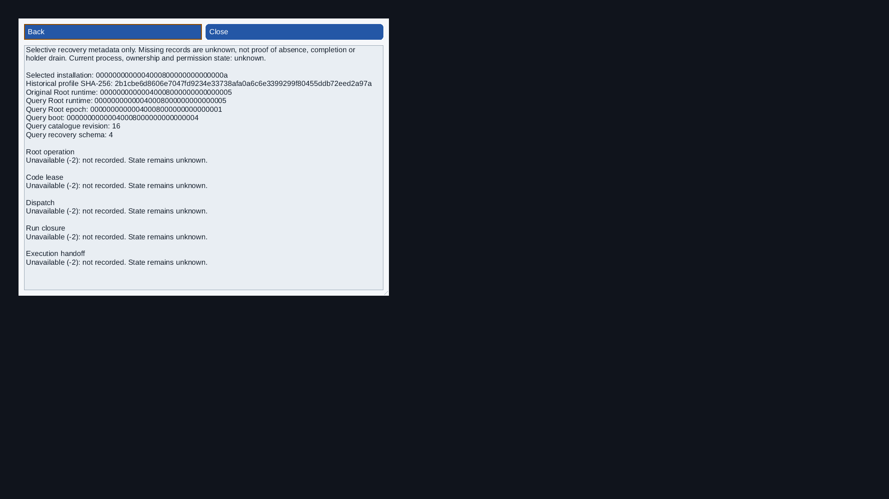
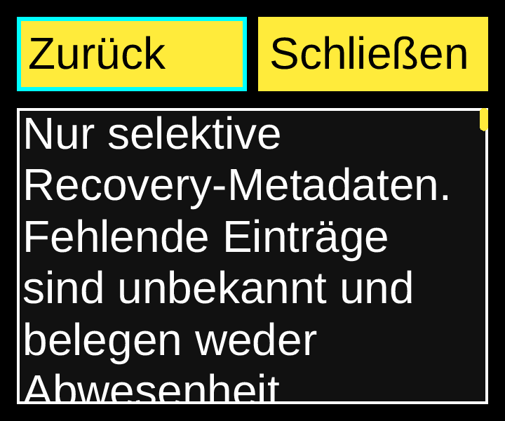

# Software Recovery relationship inspection — 2026-11-08

Consumer source: `8b29872a2bccec620f453cc2a97e7ef796ecee64`; presentation implementation
`4ef2b9962467528d31ba9126447488c3cec616a2`.
Original Aetheri: `46e2a21ef979d9a76db2a8487d1de167a6a79ef7`.
Installed SDK: `c4f467d85b0147944d2456f5e7602a39ac18e579`, NexaUI 0.1.23.
Catalogue SHA-256: `9c932872caeba8007bf05b86f7c167b493260709b23c54d709222a5f19539e65`.
Scoped D07/L04/L05/L06/L11/I01/I05/T11/A02/A06/P04/P05/P07/Q02/Q04/Q08 evidence.

The [selected-app consumer](../../examples/34_aetheri_software/README.md#recovery-relationship-inspection)
now presents the five original recovery relationships supplied by the
[existing worker foundation](software-recovery-report.md). From a selected target,
open History, a profile, Receipts and Recovery links. This adds a read-only page
using existing public buttons, Text, keyboard focus, theme and scroll controls.
Model/worker/adapter source, public SDK API/ABI/version and independent Aetheri
source/pin are unchanged by this presentation step. It supplies no current
process, resource, ownership, holder-drain, effect or permission authority.

## Complete fields and transitions

The page distinguishes original profile Root runtime from the query Root epoch,
runtime, boot and catalogue revision, and shows the selected installation and
full profile SHA-256. Query schema/error and each of the five role errors remain
separate. Available operation, code-lease, dispatch, closure and handoff records
show kind, full ID, optional full related ID, revision, unfinished-step count,
state, detail, phase and reason. No related ID is explicitly labelled none;
unavailable records show their error and unknown state without zero IDs posing
as real observations. Missing selective records establish neither absence nor
completion or holder drain. Original metadata is literal text, not a command.

A separate page retains the Receipts body's existing8192-byte budget. Legal
embedded newlines in all five records can exceed the previous256 paragraph slots;
the private view now admits2048 bounded paragraphs without truncating fields.
The synthetic maximum case supplies all five valid kind/ID/relation records,
maximum text lengths with embedded newlines and `INT64_MAX` counts/revisions.
These are test display inputs after an actual original read, not real service
facts. The source data reader remains unchanged.

Tab/Enter opens the new page from Receipts. PageUp/PageDown reaches the complete
body without changing Back focus. Escape returns to the Recovery-links trigger;
Shift-Tab returns to Back. Below-minimum resize exposes Close, and restoration
retains the page and focus. Metadata or owner-snapshot replacement retires its
context, discards queued old actions and resets nested inspection to installation
details. The new mode is included in both replacement paths and paging routing.

## Actual checks and boundaries

Static Release, shared Release and ASan/UBSan/LeakSanitizer each pass the four
affected existing CTests: `software_history_links`, `software_history_worker`,
`software_view_original` and `software_components_original`. There are no retries
or weakened deadlines in this final matrix. The expanded links group exercises
nine original fixture modes on each profile (27 scenarios), at three
locale/theme/font/density/size styles each (81 Recovery-page exercises):
English dark16px/800×600/1×, German contrast32px/360×300/2×, and English
light16px/480×400/1.25×. The existing read, receipt, unit, content/filter and worker
checks remain; complete database bytes and all rows are unchanged.

The sanitized links group takes570.35seconds within the unchanged600second
deadline. Original database reads, context lifetimes, full record text and
synthetic newline stress pass with leak detection enabled. This duration is not
a UI latency or performance acceptance result. The six unchanged metadata-only
CTests are not rerun here; their preceding data-foundation coverage is scoped
in its own report, rather than called a new full10/10 run.

Three actually compiled presentation defects are rejected by the unchanged test:
omitted reason text, wrong Escape return focus and the old256-paragraph limit.
The exact variant sources, binaries, commands and intended diagnostics remain
in the artifact. No production code is changed by these private counterexamples.

Ten native virtual-Wayland flows pass with an independent libatspi OS peer:
history on all three profiles, Release/ASan replacement, and Release withdrawn,
unsupported, unit, custody and custody replacement. The original Python recovery
reference independently walks all source rows for the five selected kind/full-ID
keys. The peer reads complete OS Text, checks original/query identities and all
available fields, refused editing, actual Tab/Enter/PageUp/PageDown/Escape,
return focus and retained old nodes after page retirement. Explicit refresh and
normal window shutdown complete; local inspection posts no original backend
work. Original Root/User database bytes/rows remain unchanged, with no forced
host/peer cleanup. These are controlled original metadata and OS transport
checks, not current-runtime, actual installed IME, spoken reader or physical
display acceptance. The initial Release history flow passes. The first Shared
German flow reaches the new page but its second native capture is incomplete;
the compositor exits, followed by the host's explicit lost-Wayland error. A
separate owned write probe actually returns `EDQUOT` after56,008,704bytes.
After verified capture-copy retirement, the failed Shared case and the eight
not-yet-run flows are executed with unchanged source/flags, five relevant binary
hashes per profile and unchanged independent peer. The initial Release pass is
reused. This is ten successful flows plus one retained failed attempt, not an
uninterrupted first-pass native matrix. The unsupported-process fixture then
exposes an incorrect new native-reference expectation: it has no reservation
(`-ENOENT`), rather than an unsupported recovery read (`-EPROTONOSUPPORT`). A
separate diagnostic peer records the actual published read-only Text and the
missing expected line. Source `8b29872a2bccec620f453cc2a97e7ef796ecee64` corrects only those two reference
lines; all70 other inputs, provider and peer binaries and build flags remain
unchanged. The six already-successful branches are retained; the affected older
fixture and three not-yet-run flows execute with the corrected driver. The
reference failure and intentional diagnostic run are retained separately from
the ten final successful flows. No timeout is relaxed and no failed
capture is substituted for a successful final image. One additional Release
custody flow repeats the complete OS-peer task with capture enabled, retaining
available operation/lease/dispatch fields as visual evidence as well as the
missing-record examples (eleven successful native executions in total).

## Images, provenance and storage

The [image manifest](software-recovery-view-images.json) binds eight native output0
captures (top/bottom for Release history, shared German history and Release
withdrawn and custody) and two headless references. All ten lossless PNGs are visually
inspected and independently decoded/compared against every original PPM RGB byte.
The native results retain all24 captures across three virtual outputs. The
800×600 history/withdrawn bodies fit without scrolling, so their paired captures
are identical; German and available-custody views exercise actual paging. Text
wraps and scrolls inside the available viewport; native contrast and reference
2× large-font captures retain visible focus. These are functional example views,
not approval of a final application design or physical display match.

The [source binding](software-recovery-view-source-binding.json) matches all71
tested inputs to exact Git and archive bytes, with CRLF-to-LF normalization only
and no post-test code differences. Compiled source input1 and corrected native
driver input2 remain separately bound; only the Python native-reference file
differs. The final README adds only the usage section.
The [local receipt](software-recovery-view-local.json) retains actual commands,
exits, profile results, binaries/shared linkage, native protocol/captures, compiled
defects and storage proofs. The prior main `7ffca821b67f6c3503801ec80939170f9c394ff7`
has [seven required CI successes/two optional skips](software-recovery-ci.json);
that metadata applies to its own source and does not test this new page.

Before building,29 exact archived old VM build/test subtrees were retired after
full byte/size/mode/link/directory checks. Three remaining old build roots were
then checked against the same archive minus only the27 already-proved test
subtrees and retired. The authoritative host data-foundation archive remains
intact. No new source/build/failure data, original source, SDK prefixes, VM limits,
clock or independent Aetheri checkout was removed or changed. To recover quota
for native captures, 26 current headless capture subtrees were separately archived,
fully verified on the host and compared byte/size/mode/link/directory-wise before
retiring only their VM duplicates (567,223,020 bytes). All fixture databases,
result metadata, sources and binaries remain. The [capture archive receipt](software-recovery-view-captures-archive.json)
binds `nexaui-software-recovery-view-captures-20261108.tar.gz` (11,967,621 bytes,
SHA-256 `d0603bb59fee7276d4102ba5153cb12cc5fb96e392fd0aeaf856476b51e8bf15`). Its 547 files include all 468 retired PPMs
plus source/binding/build evidence. That complete component archive is also nested
inside the final artifact; the authoritative separate host copy remains intact.

Host artifact: `D:/NexaUI/out/nexaui-software-recovery-view-20261108.tar.gz`,
50,878,786 bytes, SHA-256 `b3e32d76d439e446cd4d784bf82792d133d660bf87174a6deed89d0214f99059`.
[Archive receipt](software-recovery-view-archive.json): 2408 files,
3 links, 699 directories. Host verification
checks every regular file's hash/size/mode, symlink target and directory entry.
Sources, builds, original46, tests/captures, independent peer, compiled controls,
native carrier/registry and helper scripts are retained. Borrowed fonts are not
redistributed. The paired [Root11 component artifact](recovery-root-v11-archive.json)
supplies unchanged installed SDK prefixes.

Broader Files/device/software/component/trusted-system compositions remain in
packet 6; packets 7–8, complete inventory and current owner observations, actual
adoption and final performance/physical/human gates remain open across the
unchanged 103-ID catalogue. Historical reason/relationship inspection does not
close those requirements.
