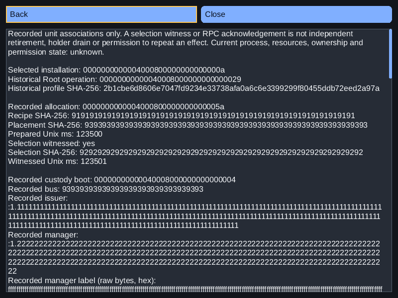
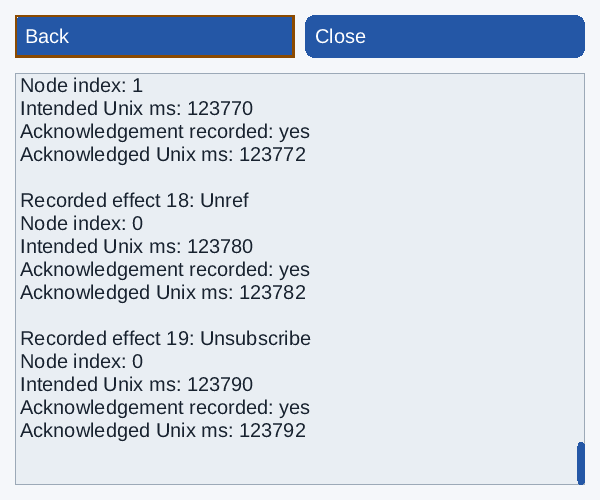

# Original unit/custody associations — 2026-11-08

Consumer source: `c5662675022effbcd3159e163377c865973a6715`.
Original Aetheri: `46e2a21ef979d9a76db2a8487d1de167a6a79ef7`.
Installed SDK: `c4f467d85b0147944d2456f5e7602a39ac18e579`, NexaUI 0.1.23.
Catalogue SHA-256: `9c932872caeba8007bf05b86f7c167b493260709b23c54d709222a5f19539e65`.
Scoped D07/L04/L05/L06/L11/I01/I05/T11/A02/A06/P04/P05/P07/Q02/Q04/Q08.

The existing [selected-app history composition](../../examples/34_aetheri_software/README.md#recorded-unit-associations)
now reads exact original unit-allocation/custody metadata and opens it as a native
read-only **Unit links** page. Existing worker, model, tree, action, text, scroll,
focus and Wayland/AT-SPI contracts are reused. There is no SDK core/public API/ABI/
version change or new toolkit dependency. The original Aetheri catalogue and its
OpenSSL/SQLite requirements remain optional consumer dependencies.

## Reader and ownership contract

`swh_record` retains independent `unit_error`/`custody_error` plus owned snapshots.
`swh_read` calls `ae_catalogue_get_unit` and `ae_catalogue_get_unit_custody` on the
same serialized original Root worker as its process reads. Their current-owner
tuple comes from the already checked Root scope; the original getters bind the
complete historical profile and digest. The existing epoch/account/boot/profile
admission and before/after context/row checks remain. Unselected/ineligible rows
cause no new query. No GUI callback, SQL inventory, RPC or process effect is added.

Root versions before 9/10 and absent records remain explicit per-field unavailable
errors with zero snapshots. Unexpected I/O/allocation/context/conflict/corruption
errors reject the entire history batch. A valid unit prefix cannot become partial
success when custody fails. The existing worker separately preserves a valid app
observation. Bounds, booleans, origin codec/boot, effect/node indices and timestamps
are checked before UI indexing. These checks do not authenticate a source/actor,
create a cross-query transaction or confer effect/replay permission.

The current Root may inspect older same-epoch owner metadata. Original runtime,
profile and allocation remain explicit; no original handles are adopted. This
composition retains the existing same-boot profile admission. Broader historical
boot selection is not added. Current process/resources/ownership, actual unit end,
holder drain, lease release and future-effect exclusion remain unknown.

## Native presentation

From a historical profile, Unit links shows full allocation and Root-operation
IDs, profile/recipe/placement/selection digests and timestamps. Custody retains the
complete boot/bus/issuer/manager/label, node/effect counts and each recorded effect,
node index, intended time, acknowledgement flag and acknowledged time. No numeric
PID or bus name is used to recover an actor. A recorded selection witness or any
number of RPC acknowledgements is explicitly not independent retirement, current
ownership, holder drain or permission to repeat an effect.

The original origin codec permits non-UTF-8 manager-label bytes. The immutable
record preserves them; the page displays valid UTF-8 directly and otherwise the
complete bytes as labelled hex. It neither silently substitutes characters nor
fails the whole text layout. The existing 8192-byte body/256-paragraph limits are
unchanged and tested with 19 effects, two 255-byte unique bus names and 511 raw
non-UTF-8 label bytes. These long origin strings are synthetic stress inputs.

Enter opens a profile; Unit links opens the new page. Back/Escape restores Unit
links focus in that profile before returning to its tree item. Page Up/Down reaches
the complete text; below-minimum restoration retains logical focus. Source/metadata
replacement retires queued old actions and returns to installation details.
The complete semantic Text value remains read-only without a caret or selection.

## Executed evidence

Static Release, shared Release and GCC ASan/UBSan/LSan each pass **8/8 CTests**.
Each includes 11 original reader scenarios, four worker/view scenarios and seven
new relationship scenarios: older unsupported Root 2/4, witnessed Root 9 allocation,
Root 10 custody, all 19 effects and actual same-boot metadata owner replacements.
Thus 33 reader, 12 worker/view and 21 unit/custody read-only scenarios retain exact
Root/User database bytes and all table rows after fixture preparation. Earlier
unchanged model/view/manifest tests also pass. Actual shared linkage resolves the
selected installed SDK. No new SDK-wide local suite is claimed.

The unchanged original metadata-only `test_launch.c` is compiled without native
unit/service options. Its original unit fixture already rejects a changed complete
profile and altered recipe/placement/selection, retains immutable retries and
performs real metadata owner replacement. These are not actual bus/unit/process
effects. No production service or authenticated ProcessFD is supplied by them.

New checks inspect every copied field, both unavailable flags, full hashes and
timestamps, all recorded effects, raw-label hex, three styles/densities, complete
paging, focus/compact restoration, retired queued actions and worker-thread getters.
Malformed returned allocation/origin/effect/count/time values and post-prefix
EIO/ENOMEM/ESTALE reject the whole batch. Three privately compiled guard omissions
(unit shape, custody shape and whole-batch errors) fail intended assertions.
Variant builds exit 0 and tests exit 1; they are Release counterexamples, not passing
sanitizer tests. [Local receipt](software-unit-links-local.json).

The initial final-source ASan suite reached EDQUOT while writing captures/logs;
later tests could not prepare complete results. Its logs, partial inputs and
Testing metadata remain. After exact archived duplicates and verified VM archive
copies were retired, the **same source and binaries** pass a complete 8/8 rerun.
No assertion, instrumentation or timeout changed. The prior host archives remain
unchanged; no quota, mount, driver or service setting was changed.

**Eleven native virtual Wayland/OS-AT-SPI cases pass**: all three build profiles
inspect 19 effects in German / 32px/high-contrast/360×300; Release additionally covers
Root 9 allocation, both owner replacement kinds, unsupported Root 2/4 and corrupt/
unconfigured history; ASan also repeats available process history with unavailable
unit metadata. The peer checks real roles, full read-only values, original hashes,
every effect/time, rejected edits/retired objects, complete tree/detail paging,
Back/Escape focus, explicit refresh and normal keyboard close. No local inspection
posts extra backend work. Root/User bytes/rows stay unchanged, every host/peer
exits0, no forced kill or sanitizer diagnostic occurs. Maps exclude SDL/X11/EGL/
Vulkan presentation libraries. Two Release/ASan legacy native IME/manifest cases
also retain ten checkpoints and 84 content commands each. This is controlled virtual
input and OS transport, not installed user IME or human-reader acceptance.

Six inspected PNGs bind losslessly to final Release custody-max PPMs: dark 800×600
at 1×, light 480×400 at 1.25× and German high contrast 360×300 at 2× / 32px. All 126 final
relationship PPMs remain (seven cases × three styles × top/bottom × three builds).
They are headless references, not physical screenshots or final product signoff.

## Exact source, artifact and CI

All **64 source inputs** match the tested input3 and exact consumer Git blobs,
normalizing CRLF→LF only. There are no post-test code differences.
[Source binding](software-unit-links-source-binding.json). Existing 67 original
inputs plus manifest/history pins remain; original fixture code was not patched.

`D:/NexaUI/out/nexaui-software-unit-links-20261108.tar.gz` is 49,723,850 bytes.
SHA-256: `8665e187fe2f97bc6971fcdad6978cb66b98c9d7ec3de7a98d63f9ac551b1904`.
The full verifier checks 2,764 regular-file hashes/sizes/modes,
8 symlink targets and 975 directory modes.
Explicit FIFO fixtures and the borrowed font are excluded. All source exports,
initial/retry builds and logs, private databases, original fixture probes, native
results, counterexamples, images, SDK prefixes and storage receipts remain in the
[archive](software-unit-links-archive.json). Earlier SDK/source/compositor/OS-library
provenance remains in the [manifest artifact](software-components-report.md).

The preceding full [history-worker artifact](software-history-worker-report.md)
retains SHA-256 `45d84dd90cff85a1be3ef6629260f1b8ce2306e40e12be9a7dbb1d45892c0c0e`.
Only verified duplicate VM builds and cached archive copies were retired. Host
copies were hash-checked first; per-file build comparisons and all original
archive hashes are retained. This does not delete the authoritative host evidence.

Previous main `3e24bd654d597337fab759091f87398e7d909254` has seven required CI
successes and two optional skips in [run42423927526](https://github.com/Lulus792/NexaUI/actions/runs/42423927526).
This is [GitHub API metadata](software-history-worker-ci.json), not raw-log review,
new-source CI or acceptance for the optional local unit/custody consumer.

## Remaining scope and adoption

This read-only presentation can be reused by an independently admitted Aetheri
owner supplying the existing explicit profile/recipient/source contract. No
consumer pin or active Aetheri source is changed. Aetheri was independently at
`1441b636eb14dbbed36e4e2825b2f44b16599a01`; it was not compiled, reset, edited or
published here.

Further lease/operation/diagnostic/reason relationships, actual current process/
image/resource/ownership snapshots, full discovery/inventory, device/permission/
trusted-service composition and software-specific held-query/clipboard/resize
acceptance remain. Same-boot historical profile admission stays explicit. The
remaining packet 6, packets 7–8 and physical/human/performance gates still span all
103 original requirements. No overall completion or 1.0 release is declared.
