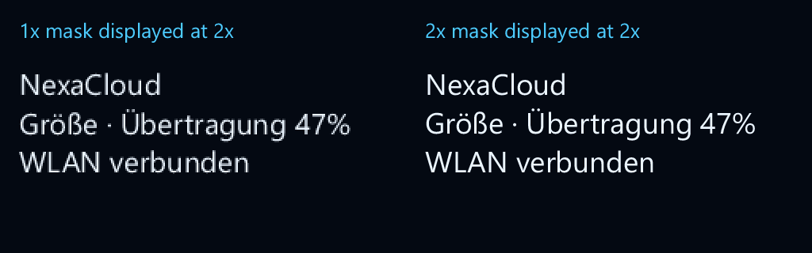

# Fractional text and raster density — 2026-10-18

NexaUI can now rasterize fractional font sizes and higher-density text without
changing the supplied logical layout. The NexaUI NexaCloud example adopts the
window density. This is a T15 text-quality step, independent of the already
adopted Design-A paint APIs; the separate NexaCloud application is unchanged.

## Public contract

| API | Behavior |
| --- | --- |
| `nx_glyph_cache_get_fractional` | Exact finite double ppem [.125,65535]; no size quantization. Shares entries with the existing integer getter. |
| `nx_draw_text_layout` | Now accepts fractional ppem [.125,16384]. Existing integer geometry/arithmetic is retained. |
| `nx_draw_text_layout_scaled` | Rasters at ppem × density; records logical geometry. Density [.125,8], physical ppem [.125,16384]. |
| `nx_text_stamp_create_scaled` | Composes those physical glyph masks into an owned A8 stamp; no reshaping/reflow. |
| `nx_text_stamp_bounds` | Logical destination rectangle, including raster padding; view dimensions remain physical pixels. |

Ordinary stamp drawing, semantic labels and action labels consume the logical
rectangle automatically. The legacy constructor is the density-1 path.
Font-backed editors, numeric fields, plots, inspectors and dashboard font
validation accept finite fractional sizes within their existing [1,16384] range.
No public structure/command layout, existing signature or enum value changes.

The layout's width, height, line breaks, carets and existing shaping/GPOS Device
adjustments stay as supplied. No physical-ppem reshaping is implied. Ink bounds
can change slightly in logical units because their padding and rounding use
physical pixels. Masks have a fixed per-glyph raster phase; nearest-neighbor
placement, unhinted outlines and combined-monochrome-before-tint semantics remain.
This does not add phase-aware AA, LCD rendering, font hinting or atlas packing.

## Ownership and failure behavior

Stamps own their text/pixels and retain the caller's allocator, whose user state
must survive destruction. Fonts, layouts and source bytes can be released after
successful creation. Draw commands borrow a stamp until renderer consumption;
direct text drawing copies masks into context-owned storage until next begin-frame
or destruction. A failed draw rolls back commands and owned masks.

Construction's own live allocations cap at 64 MiB, including its temporary
context/cache/masks and composition buffers. Font outline decoding uses the
borrowed font's separate allocator and existing parser limits. Final A8 storage
still caps at 4,194,304 pixels and 16384 per axis. Invalid scale/physical ppem gives
ARGUMENT, work/storage caps give LIMIT, underlying allocation failure gives MEMORY.
Creation clears the output on failure; use a separate candidate variable to keep
an existing stamp. A budget proxy is temporary and the completed stamp restores
the base allocator, so it retains no pointer to constructor stack state.

The example cache keys text, logical ppem, wrap width and density. Native Windows,
X11/Wayland and AppKit runners set the window density before frame building.
Changes apply after begin-frame; previously recorded views are not invalidated
by the setter. If replacement creation fails, a compatible old-density stamp
remains usable and is retried later. Stable frames allocate no new stamps.
Entries used by the current command stream cannot be evicted in that frame.

## Executed checks

- The old existing draw/stamp entry points reject a 19.25-ppem layout with
  ARGUMENT. An isolated build of the old core/cache/stamp sources from 5004083
  reproduces this beside unchanged font/layout helpers. The current entry points
  accept the same probe. This is an isolated cause comparison, not an entire
  old-release binary comparison.
- Six densities (.125/1/1.25/1.5/2/8): direct drawing and cached stamps match an
  independent physical-position glyph composition bytewise. Layout measurements,
  line count and caret fields remain identical. All sources are destroyed before
  cached rendering, and copied semantic text remains available.
- The exact cache key distinguishes adjacent double values even in the same
  hash bucket. Integer and fractional getters share the same integer-size entry.
  A 20.5-ppem mask matches a separately rasterized decoded outline.
- Constructor allocation failures and direct-draw allocation failures release
  tracked resources. Failed draws retain a prior sentinel command. Invalid
  density leaves the stream intact. An overlapping 8000-glyph case hits the
  construction budget with 67,100,212 peak tracked bytes, returns LIMIT and frees
  all tracked allocations; the ceiling is 67,108,864 bytes.
- Fractional text editor, numeric field and font-backed plot calls pass. The
  NexaCloud smoke workflow forces a failed density rebuild, verifies retained
  views, retry, unchanged semantic IDs/bounds and warm cache reuse at common
  densities. Existing text-reflow/native workflows pass locally.
- Native tests compare complete clipped, tinted A8 streams at 1/1.25/1.5/2×
  against software. Local D3D12 hardware/WARP and Linux X11/Vulkan pass with
  unchanged byte-exact tolerance. Metal execution is supplied by exact-source CI,
  not claimed as a local macOS run.

Local Windows static passes 105/105; shared targeted tests pass 8/8. Linux
ASan/UBSan/LSan and shared targeted checks pass. The
[local receipt](text-density-local.json) records commands, source/probe/image
hashes and actual outcomes. Exact-source CI is recorded after its jobs complete;
physical display/input/assistive acceptance remains separate.

## Real-font comparison

The [portable example](../../examples/16_text_density/README.md) renders the same
18.5-pixel logical layout into a 1024×320 software image. Both columns use current
APIs: left is a 1× mask sampled at 2×, right is a newly rasterized 2× mask. The left
is not an old implementation accepting fractional text. Segoe UI and Arial were
read locally; no font data is redistributed. The two images were visually
inspected for complete German text, layout, accents and sampling quality.

For Segoe UI, layout stays 208.820557×73.819336 logical pixels, three lines.
Stored masks are 211×66 at 1× and 418×129 at 2×. Raster padding explains the small
logical ink-bound difference. The corresponding
[Arial comparison](text-density-images/arial.png) keeps 213.879150×63.819580 logical
pixels and uses 215×59 / 428×116 masks. These are readability samples for two
installed fonts, not corpus-wide font-quality or physical Retina/monitor proof.

Use the [text contract](../concepts/text.md#raster-density-without-changing-layout)
for integration. Actual monitor transitions, fractional-origin raster phase,
advanced scripts, hinting, CFF/color/variable outlines, physical performance and
screenreader tasks remain open. The general framework/release goal is active.
