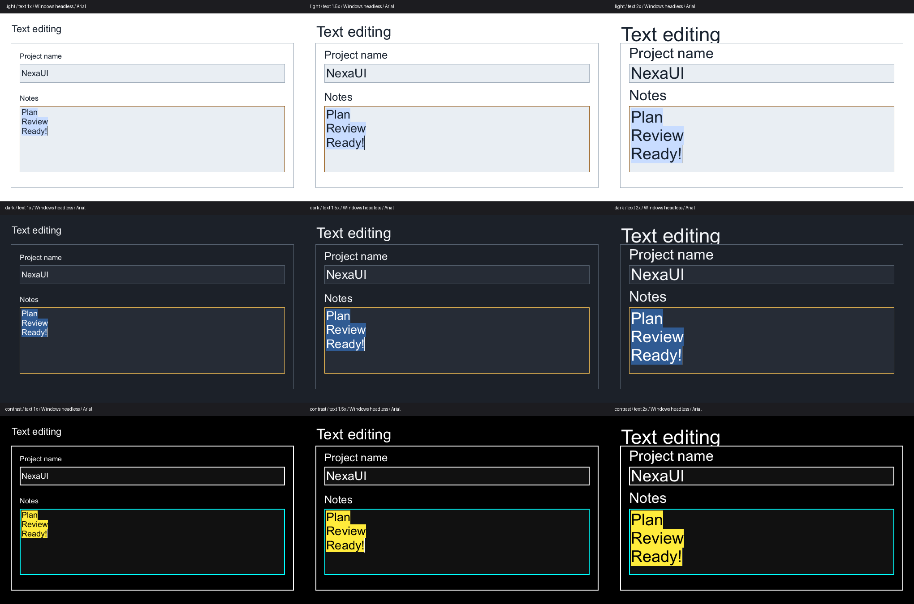

# Captured text selection — 2026-10-16

Source `8dce6f2f41057ea5982cf339f95f982ad76a0756` adds mouse selection and edge
scrolling to general and numeric fields. It also corrects selected-text contrast
and demonstrates the real pointer sequence in `examples/07_text_editing`.
This advances T16/U04/U05; it does not complete the text or platform gates.

## Behavior and ownership

A left press starts a source anchor. Movement and release extend from that
anchor through the same layout hit test used for caret placement. Shift-click
retains the existing selection anchor. Release may occur outside the field.
Capture cancellation, focus loss, disabling, omission, programmatic draft
replacement and subsequent editing/navigation actions stop the drag. A touch tap still sets
the caret; this change does not add touch selection handles.

The context records capture and focus provenance beside each dispatched event.
The public event array, size and fields are unchanged. This preserves the press
position when press/move/release arrive in one frame, and keeps typed edits with
their actual field when focus changes later in the same queued batch. Routing
uses the existing clipped hit test and overlay policy. A pointer selection also
breaks an accepted IME edit batch, preventing its old revision from continuing
through the changed selection.

The routing tail shares the existing reusable event allocation, with checked
capacity arithmetic. A growth failure leaves already queued events intact.
The sized-allocator test checks exact frees, retry and no event-buffer
allocations after both frame buffers are warm. Field state remains private;
applications still own their data and fonts.

General-field carets retain bidi/wrap affinity. Password hit positions map back
from one mask character per extended grapheme to the complete UTF-8 source;
selection never exposes the password in semantics. Numeric dragging changes the
draft selection without committing the numeric value.

While capture remains held, a pointer beyond the visible content edge scrolls
once per frame. Horizontal single-line and vertical multiline scroll limits use
the layout extent. Speed is proportional to edge distance, capped at forty
times the text size in logical pixels per second, with at most 0.1 seconds of catch-up. A stationary
outside pointer continues scrolling; zero elapsed time does not advance it.
Movement-event frequency does not multiply the scroll step. Release stops it.

## Selected text rendering

The initial review showed white text on High Contrast's yellow selection. The
field painter had used the ordinary foreground for all glyphs despite the
existing `NX_COLOR_SELECTION_TEXT` token. It now applies the selection foreground
inside the selected geometry and the ordinary foreground outside it.

Glyph masks are rasterized and owned once. Fully selected/unselected masks use a
single bitmap command. Boundary masks split into disjoint clips, including
vertical overhang, rather than drawing the entire antialiased glyph twice.
Sorted merged selection rectangles permit a binary search per glyph followed by
the actual intersecting intervals. Failure restores the command/clip depth and
owned bitmap boundary; the widget's normal paint retry contract remains in use.

## Executed regressions

The registered `nexaui_text_pointer` test exercises the public context and fields:

- Same-frame press/move/release, reversed selection, Shift-click and release
  outside the field; typing subsequently replaces exactly the selected bytes.
- Capture cancel, focus loss, disabled state, clipped-away presses and unchanged
  selection after a later uncaptured movement.
- Horizontal/vertical edge scrolling, a stationary held pointer, reverse
  scrolling, zero time, bounded paused-frame catch-up and 1 versus 100 moves.
- Two fields receiving different text in one frame while only the second ends
  focused; numeric draft selection without changing the committed number.
- RTL source offsets, supplementary/combining password graphemes, protected
  empty semantics, touch taps, allocation growth failure/retry and exact frees.
- Actual selection pixels, paint containment, black selected glyph pixels on
  yellow, and ordinary white glyph pixels outside that selection.

The isolated older/mutated cores were actually compiled and run with the current
test and real fixture resources:

| Counterexample | Observed failing assertion |
| --- | --- |
| Original `6e7a01e` core | Expected anchor 1 / cursor 3 after one-frame drag |
| Final-frame focus substituted for per-event focus | First field's expected `1511` draft |
| Catch-up cap removed | Equal cursor progress after paused versus 0.1-second frame |
| Selection foreground path disabled | Selected black ink and unselected white ink pixel check |

Raw local logs are `out/text-pointer-before-tests.log` and
`out/text-pointer-{focus,scroll,contrast}_before-tests.log`; temporary source
copies remain under ignored `out/text-pointer-before/`. These deliberate faults
prove the named test sensitivities, not complete negative coverage.

MSVC 19.38/CMake 4.3.2 Windows Debug static and shared each pass the six selected
tests: text pointer, text field, numeric field, input, text layout and text editing
example. Alpine 3.24/WSL2 Clang 22.1.3 ASan/UBSan/LeakSanitizer passes those six
with `ASAN_OPTIONS=detect_leaks=1 UBSAN_OPTIONS=halt_on_error=1`. No new fuzz
campaign is claimed; these are executed deterministic interaction/render tests.

## Visual review

The actual example now queues a press, move and release over all three notes
lines, asserts the selected source range and writes its rendered output. Its
optional theme and text-size arguments provide Light, Dark and High Contrast at
100%, 150% and 200% logical text size. The contact sheet of all nine Windows images and the 200% High Contrast detail
were opened and reviewed. Labels, selected notes and caret fit the 680 × 420 form, and High
Contrast selected text is black on yellow. This is a focused control example,
not a visual acceptance of the complete toolkit.

The same nine runs execute under Linux ASan/UBSan/LeakSanitizer with the same
local Arial bytes. All nine Windows/Linux image pairs are pixel-identical
(285,600 pixels per pair). The [visual receipt](text-pointer-visual.json) retains
the source/font/image hashes and comparison counts. Arial is not redistributed.
These logical text-size captures are not physical DPI or native input evidence.

[High Contrast at 200% text size](text-pointer-images/contrast-2.png).

## Native CI and remaining work

The [CI receipt](text-pointer-ci.json) identifies the exact source/run/jobs,
executed pointer/example tests and explicit skips. Both macOS variants run the
new common tests alongside the native AppKit window and separate AX client.
Windows and Ubuntu retain their native integration suites. The common pointer
test itself injects normalized events and renders headlessly; it does not drive
a physical pointing device.

[Run 38954437818](https://github.com/Lulus792/NexaUI/actions/runs/38954437818)
passes all seven required jobs at the source above:

| Configuration | Passed | Skipped |
| --- | ---: | ---: |
| Windows static / shared | 100 / 100 | 0 / 0 |
| macOS static / shared | 87 / 87 | 0 / 0 |
| Ubuntu static / shared | 101 / 101 | 7 / 7 |
| Linux ASan/UBSan | 101 | 7 |

Optional Windows ASan and CI fuzz jobs are skipped by workflow policy. The
recorded local leak-checked tests and real-font images are separate evidence.

Touch handles/long-press selection, double/triple-click word/paragraph units,
text drag/drop and complete native text accessibility remain open. Installed-IME
composition interactions, surrounding/reconversion, OS secure input, physical
display/device acceptance and real screenreader tasks require further work.

The interaction contract is consistent with Microsoft's
[mouse capture lifecycle](https://learn.microsoft.com/en-us/windows/win32/learnwin32/mouse-movement)
and Apple's [click-and-drag selection](https://support.apple.com/en-sg/guide/mac-help/mchlp1378/mac)
and [Shift-click guidance](https://support.apple.com/guide/pages/select-text-tan0a80d512e/mac),
read on 2026-10-16. The private routing representation and bounded scroll policy
are NexaUI implementation choices, not requirements imposed by those platforms.
