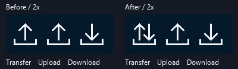
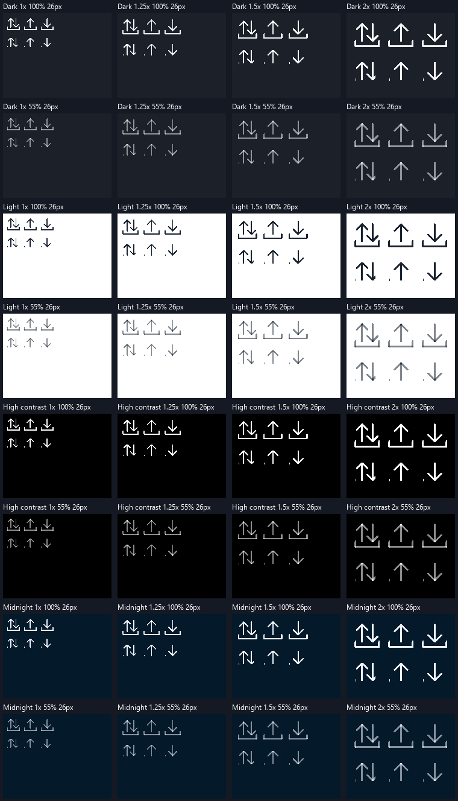

# Bidirectional transfer icon — R02

Source: `f7ec75b39ca171ee98922ca128f7c34b68565690`, 2026-10-18.
Baseline:2460116. [Local tests and pixel receipts](transfer-icon-local.json).

[CI run39098614917](https://github.com/Lulus792/NexaUI/actions/runs/39098614917)
tests this exact source commit: all seven required jobs pass. Windows static/
shared each111/111; macOS each94/94; Ubuntu static/shared and sanitizers each
108 passed plus7 Wayland skips. Both consumer forms build/link and the installed
consumer runs. The optional Windows-ASan/fuzz jobs skip; the local ASan result
below is separate. [Decoded-log hashes, cases and job receipts](transfer-icon-ci.json).

`NX_ICON_TRANSFER` previously followed the Upload switch branch and produced
exactly the same drawing. It now has a left upward arrow and a right downward
arrow above the existing tray. The public enum/API, caller bounds, stroke and
tint contract are unchanged. Upload and Download keep their existing paths.



This figure uses the original24-unit fixture: baseline software pixels on the
left and actual D3D12 hardware readback on the right. It crops the unclipped top
row at synthetic2x with no magnification. Labels are annotations outside the
captured pixels, not a NexaUI text-rendering acceptance test.

## Regression and actual output

The original-source test fails at the Transfer-versus-Upload pixel comparison.
The final checker also rejects two independently compiled counterexamples:
mapping Transfer back to Upload and omitting all clips. Their failures occur at
the intended distinct-output and cropped-pixel assertions, respectively.

The portable fixture exercises64 combinations:24/26 logical-unit icons,
Dark/Light/High-contrast/Midnight,1/1.25/1.5/2x, and100%/55% alpha, all with a
caller stroke of1.5. It checks both shafts, the upper-left/lower-right arrowheads
and absence of the opposite heads. It compares clipped pixels with an
independently cropped, unclipped render of the **same physical geometry**;
it does not duplicate the icon path or assume float translation invariance.

The entire90x70 logical scene fits the180x140 native target even at2x, so all
three icons and both rows remain inside the readback at every tested density.
Each local D3D12 configuration compares all RGBA channels byte-for-byte in64
frames on hardware and another64 on forced WARP. Tolerances remain zero.

| Local execution | Result |
| --- | --- |
| Windows static Debug full suite | 110 passed +1 Clipboard skip;111 registered |
| Windows shared Debug targeted | 5/5, including both64-frame D3D12 variants |
| MSVC ASan RelWithDebInfo targeted | 5/5 with actual `/fsanitize=address` |
| Alpine-Dev ASan/UBSan/LSan targeted | 4/4, including the real Vulkan X11 draw fixture under Xvfb/lavapipe |
| Old/new Upload and Download | 64 complete24-unit RGBA regions remain byte-identical |
| Native image comparison | All64 hardware/WARP RGB capture pairs match;32 separate24-unit CPU snapshots match too |

The pre-change and final snapshots cover32 combinations at24 units. Transfer
is initially equal to Upload in every case; every final Transfer region differs
from both single-direction icons. Upload/Download were compared using actual
RGBA bytes, not hashes alone. The renderer tests independently compare raw GPU
RGBA; exported PPM galleries preserve RGB on an opaque clear surface.

The general paint fixture also draws Transfer, extending the existing native
Metal/Vulkan paint checks without changing their tolerances. Local Linux uses
Alpine3.24.2/Clang22.1.3 with leak checking enabled and forced lavapipe; this
is not a physical Linux GPU/display acceptance.



The matrix shows actual26-unit hardware captures at native pixel size. Top rows
inside each cell are unclipped; lower rows are intentionally fractionally
clipped. The annotation font is external to the captured icon output.

## Ownership, reproduction and remaining work

Transfer appends nine ordinary line commands instead of six. It uses the
existing command buffer/allocator and atomic rollback; there is no new image
resource, symbol font, cache, platform branch, thread or GPU pipeline. Caller
stroke width/tint and normal command lifetimes still apply. Existing component
allocation-failure/retry checks pass; MSVC ASan is not a general leak-sanitizer
or driver-memory guarantee.

```powershell
cmake --build build --config Debug --parallel 4
ctest --test-dir build -C Debug --output-on-failure --timeout 30
ctest --test-dir build-shared -C Debug -R '^nexaui_(transfer_icon|d3d12_widgets|d3d12_widgets_warp|cloud_components|paint)$' --output-on-failure
```

The new portable test is `nexaui_transfer_icon`; the D3D12 cases reuse
`nexaui_d3d12_widgets` and `_warp`. `NEXAUI_TEST_TRANSFER_DUMP` optionally names
a prefix for test-owned PPM output. Logs, counterexamples, frozen baseline/final
capture executables and pixel comparisons are under `out/r02-transfer/`.

Cleanup removed64 obsolete PPMs only after matching their SHA-256 hashes
against retained final24-unit captures, plus five unused manual compiler objects:
5,039,896 bytes freed. All128 final native captures, baseline/final RGBA images,
negative proofs, programs, helper sources and open R01 traces remain. Exact paths,
sizes and hashes are in the local receipt.

This delivers the framework's directional icon correction. NexaCloud adopts
the candidate pin and reviews its actual composition separately. Physical
monitor/DPI/IME, human assistive use and overall Design-A acceptance remain
open. [R01](d3d12-private-cache-trace-report.md) remains open independently;
no startup-speed improvement is inferred from this icon change.
