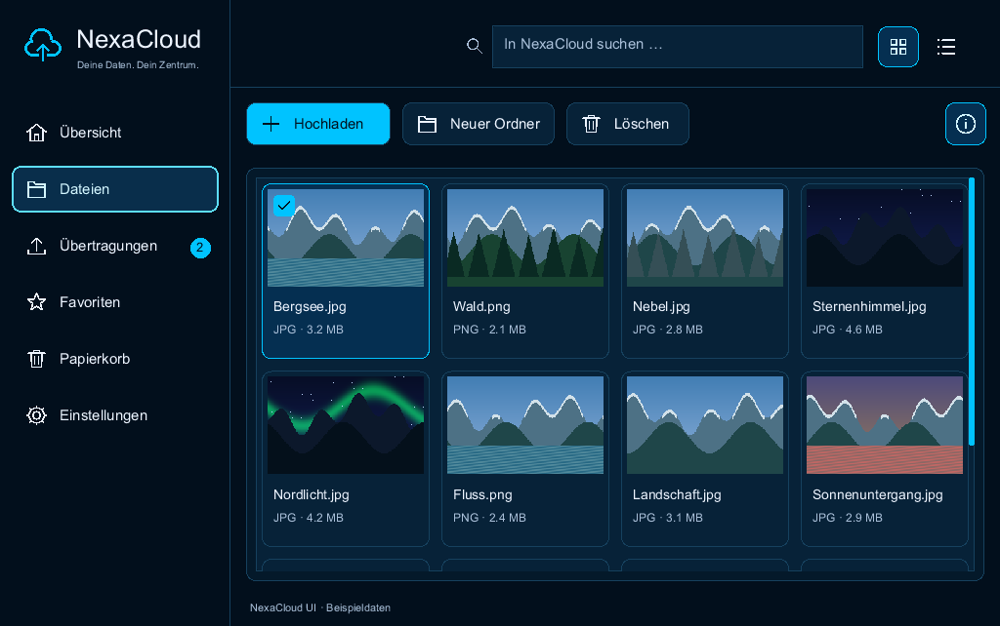
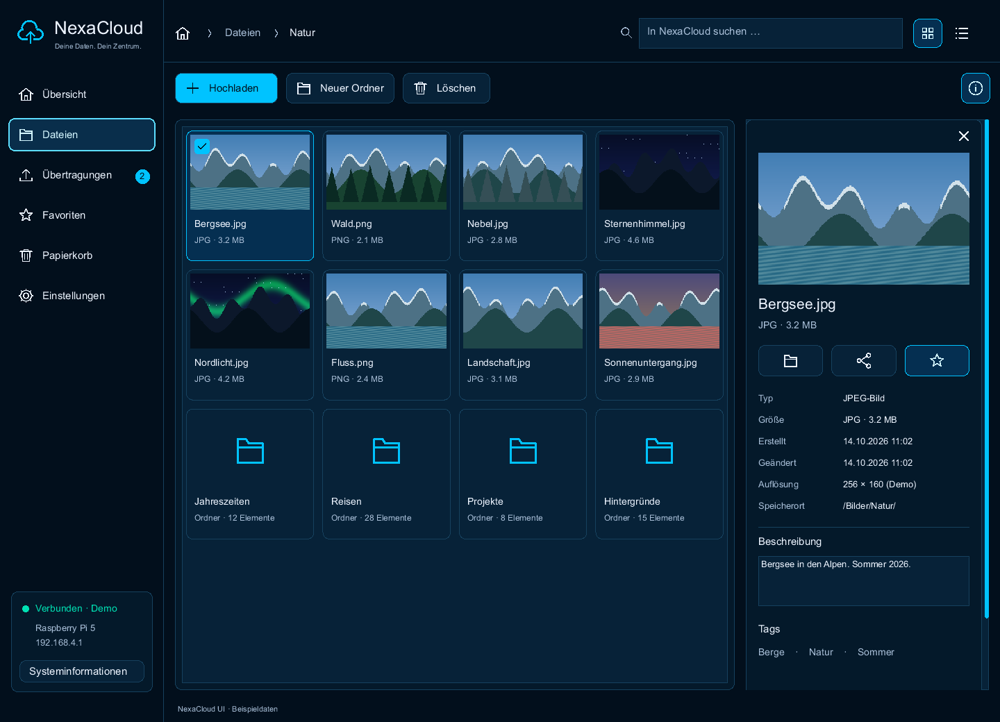

# NexaCloud reference UI

A native NexaUI example based on the supplied NexaCloud dashboard and file-browser
designs. The shared C17 scene contains the interface and local demonstration
state. It has no cloud server connection and never uploads, deletes or shares
real user files. The generated landscape thumbnails are original sample artwork.

The overview contains navigation, storage/CPU/network/system cards, a two-series
rate chart, transfers, activity and quick actions. The file browser contains
search, grid/list views, file selection, a scrollable inspector, description
editing, favorites, local folder creation and reversible example-file deletion.
Upload, share and preview actions open explicit demonstration dialogs.

The reusable [component APIs](../../docs/concepts/cloud-components.md) are part
of NexaUI itself: Midnight theme, rounded surfaces/cards, vector icons, action
variants, progress displays and immutable cached text stamps. App data stays in
`scene.c`; platform window/renderer code stays in the native runner.

## Run

Build with the default `NEXAUI_BUILD_EXAMPLES=ON`. Supply a local TrueType font;
font files are not redistributed. For example, on Windows:

```powershell
cmake -S . -B build
cmake --build build --config Debug --target nexaui_nexacloud_native
.\build\examples\nexacloud\Debug\nexaui_nexacloud_native.exe C:\Windows\Fonts\segoeui.ttf
```

The native Windows runner uses a real Win32 window and the existing D3D12 driver.
The OS supplies window decorations and backing scale. The shared scene does not
draw platform-specific window buttons.

On Linux, build the Vulkan target and select either native window backend:

```sh
cmake -S . -B build -DCMAKE_BUILD_TYPE=Debug
cmake --build build --target nexaui_nexacloud_native --parallel 4
NEXAUI_PLATFORM=wayland ./build/examples/nexacloud/nexaui_nexacloud_native /path/to/font.ttf
NEXAUI_PLATFORM=x11 ./build/examples/nexacloud/nexaui_nexacloud_native /path/to/font.ttf
```

This uses the private Vulkan renderer with strict presentation-fence retirement;
see its [driver requirements](../../docs/concepts/vulkan.md). It requires a usable
display and Vulkan driver. Configure `NEXAUI_BUILD_VULKAN=OFF` for core/headless
builds without that backend.

On macOS, the initial AppKit/Metal runner uses the same scene:

```sh
cmake -S . -B build -DCMAKE_BUILD_TYPE=Debug
cmake --build build --target nexaui_nexacloud_native --parallel 4
./build/examples/nexacloud/nexaui_nexacloud_native /System/Library/Fonts/Supplemental/Arial.ttf
```

This runner and its RGBA8/A8 atlas pass static/shared macOS CI at `fb80bd0`,
including full-scene GPU/reference comparisons and renderer lifecycle tests.
Test builds accept
`--smoke FONT.ttf OUTPUT_PREFIX` and compare GPU overview/file/compact captures
against the software reference before writing `macos-*` PPM files. CI saves
these artifacts with its native test logs. A missing Metal device skips the
smoke explicitly; `NEXAUI_REQUIRE_METAL=1` makes absence fail. Physical input,
display behavior and assistive acceptance remain separate requirements. The
virtual desktop used actual 1024×642 and 820×645 client sizes; see the
[native report](../../docs/nexacloud-validation.md#native-macos-scene--2026-10-15).





The portable workflow writes PPM previews and exercises the same normalized
pointer/key input as the native adapters:

```sh
./build/examples/nexacloud/nexaui_nexacloud --smoke /path/to/font.ttf /tmp/nexacloud
```

On a Windows multi-configuration build the executable is inside `Debug`.
`ctest -R nexaui_nexacloud --output-on-failure` runs available checks when an
example font is found. Set `NEXAUI_EXAMPLE_FONT` explicitly on systems where the
default font paths are unavailable. With tests enabled, the Windows native runner
also accepts `--smoke FONT.ttf OUTPUT_PREFIX`; its `native-*` captures are actual
D3D12 back-buffer readbacks, rather than software-rendered approximations.

The Linux native runner also accepts that smoke form when tests are enabled.
Its `linux-*` captures are Vulkan canvas readbacks compared byte-for-byte against
the shared scene's software reference. The finished canvas is copied to the
swapchain for presentation. The smoke navigates with normalized pointer/key
events and checks selection semantics; it does not inject compositor-native
input. It creates a second 820×700 native window for the compact case, rather
than asserting a Wayland compositor resize. Window/input/resize adapters have
separate native tests; physical input, IME and display acceptance remain open.


Linux test builds also provide a separate profiling target:

```sh
cmake --build build --target nexaui_nexacloud_vulkan_profile
# Or select a native display and output prefix explicitly:
NEXAUI_PLATFORM=wayland ./build/examples/nexacloud/nexaui_nexacloud_native \
  --profile /path/to/font.ttf /tmp/nexacloud-profile
```

Run profiling without injected validation layers; keep correctness `--smoke`
and synchronization validation separate. Three workloads run four warmup and
32 measured frames in each unbatched/batched/batched/unbatched block. The runner
holds normalized input constant, rejects counter/geometry drift, checks stable
GPU allocations and compares all mode images with each other and headless.
CSV output and GPU readback occur outside measured intervals. Timings are elapsed
CPU intervals. See the
[preserved comparison](../../benchmarks/baselines/vulkan-d4a2508/README.md) for
raw data, environment and mixed timing results.

To compare serial and three-slot upload pacing with batching held on, use
`--profile-ring FONT.ttf OUTPUT_PREFIX` or build the separate
`nexaui_nexacloud_vulkan_ring_profile` target. It runs serial/ring/ring/serial
blocks with the same input and full-image gates, adding frame-slot identity,
retirement/pending counts and upload capacity columns. Production uses three
slots; both comparison modes are diagnostic test-build options. A faster CPU
retirement interval may shift waiting into acquisition/presentation, so the
complete CPU distributions need to be assessed together.
The [ring report](../../benchmarks/baselines/vulkan-1cdf550/README.md) retains
768 measured CI frames and the native gated-lifetime results; it records no
software-driver frame-time improvement.

Vulkan profiling also records GPU state, raw device ticks, timestamp period and
counter width, elapsed GPU milliseconds and readback scope. After each block it
drains the tail outside CPU measurement and joins each GPU result by submission
ID and slot. Missing timestamps remain explicitly unavailable; they are not
averaged as zero. Set `NEXAUI_REQUIRE_VULKAN_TIMING=1` to require valid results.
The GPU interval covers the whole command buffer and its GPU-side waits, uploads,
rendering and final copies. It does not measure visible presentation latency or
GPU busy-only time. See the [timestamp contract](../../docs/concepts/vulkan.md#v08-submission-keyed-gpu-timestamps).
The [GPU baseline](../../benchmarks/baselines/vulkan-fa58bc1/README.md) preserves
768 valid per-submission timestamp pairs and the corresponding CPU distributions.

## Interaction and layout

- Tab/Shift+Tab move focus; Enter/Space activate named actions and file tiles.
- Arrow keys move among visible file tiles and scroll the destination into view.
- Ctrl+F focuses search on Windows/Linux; the shared macOS mapping uses Command+F.
- Delete moves the selected example file to the example trash while a file tile
  has focus. The trash toolbar restores a selected file.
- Escape closes a dialog and restores its trigger's focus. The detail button opens
  a scrollable dialog when an inline inspector does not fit.
- The sidebar becomes an icon rail on narrow windows; grid column count adapts,
  long names remain available in semantic labels/details, and wide content is
  capped to avoid stretching cards across large desktops. Target minimum size
  is 640×480 logical pixels. Very small windows show a resize hint.
- Settings switch between Midnight and Light during runtime. Reduced motion is
  an explicit application preference; these scenes currently use direct changes.
- Settings also cycle text size through 100%, 150% and 200%, independently of
  backbuffer density. Cards and file columns reflow, metadata stacks, and dialog
  bodies scroll while the close action stays fixed. Tab focus is revealed after
  a text-size or window-size change. Narrow list rows stack their preview and
  labels when needed. Cached text includes wrap width and safely evicts old
  entries across frames during repeated resizing.

The sample search performs ASCII case folding and byte matching for non-ASCII
text. It is not a complete locale-aware cloud search implementation.

## Verification and remaining platform work

The portable smoke workflow checks navigation, keyboard file selection, deletion,
folder creation, empty search, compact layout, dialog Escape/focus return and
theme changes. The Windows native workflow sends real Win32 mouse/key messages,
checks selection semantics after routing, resizes the actual window and reads
back D3D12 frames. Component tests cover keyboard/disabled state, semantic
progress, rounded geometry and allocation rollback. Text-stamp tests cover
pixel output, font-independent ownership and exact-size cleanup at every
injected creation failure.

| Platform | Current evidence | Remaining native work |
| --- | --- | --- |
| Windows | Local MSVC Debug native D3D12 smoke and visual back-buffer review; completed frames publish the initial UIA snapshot | Physical HiDPI monitor changes, native screenreader and release acceptance |
| Linux | Local X11/Wayland Vulkan overview/file/compact captures equal the software reference; component and renderer regressions | Hardware GPU/performance, physical input/IME, HiDPI, AT-SPI and release acceptance |
| macOS | Static/shared native tests pass at `e258f40` (80/80 each); seven GPU captures including files/details/settings at 200%, dialog focus flow and text matrix checked | Wide-display/Retina coverage, full physical keyboard/IME/AX walkthrough and release acceptance |

The `nexaui_nexacloud_text_reflow` test checks all six pages at 100/150/200% and
five logical window sizes, plus preference activation, Tab focus, modal return,
text bounds and repeated resize/cache ownership. Native test builds additionally
capture files, details and settings at 200%. Current evidence and its limits are
in the [large-text report](../../docs/nexacloud-validation.md#text-reflow--2026-10-15).
Physical 4K/HiDPI display behavior and native UIA/AX/AT-SPI screenreader tasks
remain open. See the [NexaCloud delivery plan](../../docs/nexacloud.md).

The Windows runner now exposes explicit single-selection containers for navigation and files. The independent `nexaui_nexacloud_uia` client changes pages, selects a file, verifies the real inspector preview name, clears selection and reopens the file view while checking an old handle remains unavailable. Selection updates use the application model before layout rather than synthetic clicks. This automated UIA workflow is not a complete screenreader acceptance test.

The Windows UIA workflow also runs as `nexaui_nexacloud_uia_compact` at 800 × 700. The independent client opens the responsive details dialog through the exposed command, verifies the file preview, closes the dialog and waits for the file controls to become enabled before continuing.
